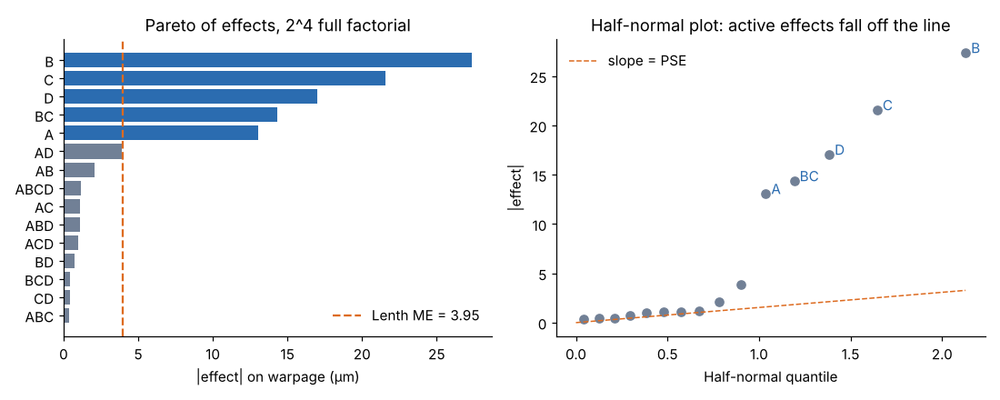
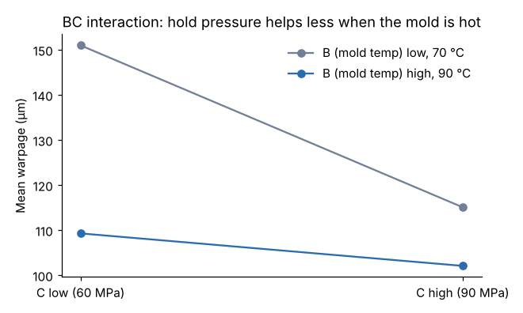

# Module 07: Full-Factorial 2^k Designs

## Objectives

- Build a 2^k design matrix in standard order with coded −1/+1 levels.
- Compute main effects and interactions with contrasts.
- Separate real effects from noise in an unreplicated design (Pareto chart, half-normal plot, Lenth's method).
- Use center points to test for curvature, and write the fitted model.

## Concept

With k factors at two levels each, a full factorial has 2^k runs. In coded units, low = −1 and high = +1.

- **Effect of a factor** = (mean of y at +1) − (mean of y at −1).
- **Interaction column** = product of the factor columns (for example, AB = A × B). Its effect is computed the same way.
- **Regression coefficient** = effect / 2, because the coded distance from −1 to +1 is 2.

A single replicate of a 2^4 design gives 15 effects and no error df. Two tools handle that:

1. **Effect sparsity:** usually only a few effects are real. The rest behave like noise and can estimate σ.
2. **Lenth's pseudo standard error (PSE):**
   - s₀ = 1.5 × median |effect|
   - PSE = 1.5 × median of the |effects| that are smaller than 2.5 s₀
   - margin of error (ME) = t(0.975, m/3) × PSE, where m = number of effects

**Center points** (all factors at 0) add pure-error df without disturbing the effect estimates. They also test for **curvature**: if the center-point mean differs from the mean of the factorial points, the response is not linear across the region.

## Worked example: warpage

| Factor | Low (−1) | High (+1) |
|---|---|---|
| A melt temp | 270 °C | 290 °C |
| B mold temp | 70 °C | 90 °C |
| C hold pressure | 60 MPa | 90 MPa |
| D cooling time | 12 s | 20 s |

The design has 16 runs in standard order plus 4 center points (`data/full_factorial_warpage.csv`). In the plant, all 20 runs were made in random order. The response is warpage, in µm.

**Computing one effect by hand.** The 8 runs with A = +1 average 125.88 µm; the 8 with A = −1 average 112.83 µm. Effect A = 125.88 − 112.83 = **+13.05 µm**.

**All 15 effects** (sorted by size):

| Effect | Estimate (µm) | | Effect | Estimate (µm) |
|---|---|---|---|---|
| B | −27.35 | | ABCD | −1.17 |
| C | −21.55 | | AC | 1.10 |
| D | −17.02 | | ABD | −1.07 |
| BC | +14.35 | | ACD | −0.97 |
| A | +13.05 | | BD | 0.73 |
| AD | 3.88 | | BCD | 0.43 |
| AB | 2.10 | | CD | 0.42 |
| | | | ABC | 0.40 |

**Lenth:** PSE = 1.54 and ME = t(0.975, 5) × 1.54 = 2.571 × 1.54 = **3.95 µm**. The active effects are **B, C, D, BC and A**. AD (3.88) sits just below the line: note it, and check it in a confirmation run.



**The BC interaction.** Hold pressure (C) helps a lot when the mold is cool and little when it is hot:

| | C low | C high | Effect of C |
|---|---|---|---|
| B low (70 °C) | 150.98 | 115.08 | −35.9 |
| B high (90 °C) | 109.28 | 102.08 | −7.2 |

Interaction BC = (−7.2 − (−35.9)) / 2 = **+14.35**, which matches the table.



**Fitted model (coded units):**

ŷ = 119.35 + 6.53·A − 13.68·B − 10.78·C − 8.51·D + 7.18·B·C

The model has R² = 0.987 and residual SD 3.17 µm (10 df).

**Curvature check.** The center-point mean is 122.5 µm, against a factorial mean of 119.35 µm, a difference of 3.15. Using the center-point SD (3.31, 3 df):

t = 3.15 / (3.31 × √(1/16 + 1/4)) ≈ 1.70, p = 0.19

No significant curvature, so the linear model is adequate *inside* this region. With only 3 df this test has little power. If the optimum appears to be near the center, add axial points (response surface methods).

## Practical reading

- **Mold temperature (B) is the biggest lever.** Running hot cuts warpage about 27 µm, at the cost of a longer cycle.
- **Higher hold pressure (C) and longer cooling (D) both help.** C matters much less once the mold is hot (the BC interaction).
- **Higher melt temperature (A) makes warpage worse.**

Module 09 turns this into an operating decision that includes cost.

## Run it

```bash
python tools/doekit.py full
python tools/make_figures.py
```

## Check yourself

1. Why is the coefficient for B equal to −13.68 when the effect is −27.35?
2. AB is 2.10. Should it go in the model?
3. If the center points had averaged 135 µm, what would you conclude and do?

<details><summary>Answers</summary>

1. The coefficient is the change per coded unit. Moving from −1 to +1 is 2 units, so coefficient = effect / 2.
2. No. It is well inside Lenth's ME of 3.95. Keep the model hierarchical and parsimonious.
3. Strong curvature (a difference of about 15.6 µm against noise of about 3). The linear model would mislead between the corners. Add axial runs to fit quadratic terms (a central composite design), or narrow the region.

</details>
