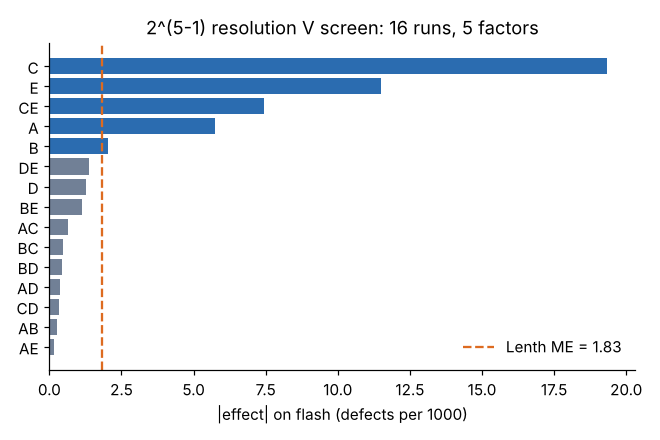

# Module 08: Fractional-Factorial Designs

## Objectives

- Build a 2^(k−p) fraction from generators.
- Derive the defining relation and the alias structure.
- Choose a resolution that fits the objective, and know how to break aliases afterwards (fold-over, added runs).

## Concept

A full factorial gets expensive fast: 2^5 = 32 runs, 2^7 = 128. Most high-order interactions are negligible (effect sparsity), so we can run a **fraction** and give up information we do not expect to need.

**Building a half fraction 2^(k−1):** write a full factorial in k − 1 factors, then set the last factor equal to an interaction of the others. For 5 factors in 16 runs, use **E = ABCD**.

**Defining relation:** multiply both sides by E. Since E × E = I (a column of +1s), we get **I = ABCDE**. Any effect's alias is found by multiplying it by the defining word and cancelling squared letters:

- A × ABCDE = BCDE → A is aliased with BCDE
- CE × ABCDE = ABD → CE is aliased with ABD

Aliased effects share one column. The estimate you compute is their *sum*.

**Resolution** = length of the shortest word in the defining relation.

| Resolution | What is aliased | Typical use |
|---|---|---|
| III | main effects with 2-factor interactions | early screening of many factors, with risk |
| IV | main effects clear of 2FIs; 2FIs aliased with each other | screening when interactions may exist |
| V | main effects and 2FIs clear of each other | characterization in fewer runs |

The 2^(5−1) with I = ABCDE is **resolution V**: every main effect and every 2FI can be estimated, assuming 3-factor and higher interactions are negligible.

**A resolution III example:** 2^(3−1) with C = AB, so I = ABC. Then A = BC, B = AC and C = AB. Each main-effect estimate is contaminated by a 2FI. If you see a "big C", it might really be AB.

## Worked example: screening for flash

Flash (thin fins of plastic on the parting line) has five suspected causes: melt temp (A), mold temp (B), hold pressure (C), cooling time (D) and injection speed (E). A full factorial needs 32 runs; the 2^(5−1) needs **16** (`data/fractional_flash.csv`).

Main effects and 2FIs, each aliased only with 3- or 4-factor interactions:

| Effect | Estimate | | Effect | Estimate |
|---|---|---|---|---|
| C hold pressure | +19.35 | | BE | −1.12 |
| E injection speed | +11.50 | | AC | 0.65 |
| CE | +7.45 | | BC | 0.48 |
| A melt temp | +5.75 | | BD | −0.45 |
| B mold temp | +2.03 | | AD | −0.37 |
| DE | −1.38 | | CD | −0.32 |
| D cooling time | +1.28 | | AB | −0.27 |
| | | | AE | −0.15 |

Lenth ME = **1.85**. Active effects: **C, E, CE, A and B** (B just clears the line).



Interpretation:

- High hold pressure and fast injection both push resin past the parting line, and **together they are worse than the sum** of their separate effects (CE = +7.45).
- Cooling time (D) does not matter for flash and can be set on other grounds, such as warpage and cycle time.
- Conflict: Module 07 wants *high* hold pressure for warpage, but high pressure drives flash. The trade-off is handled in Module 09 (and, in practice, with clamp-force and vent checks).

## When aliases bite: fold-over and augmentation

If a resolution III or IV screen leaves an ambiguous alias pair:

- **Full fold-over:** rerun the fraction with *all* signs reversed. Combined with the original, main effects are freed from 2FIs (III → IV).
- **Single-factor fold-over:** reverse only one factor's column. That factor and all its 2FIs become clear.
- **Semifold or a few targeted runs:** cheaper, enough to separate one specific pair.

Always run the follow-up as a separate block, because time has passed.

## Choosing a fraction

1. List factors and objective (screening vs characterization).
2. Pick the smallest design whose resolution keeps the effects you care about apart. Standard tables of minimum-aberration fractions (in the textbooks under `reference/further-reading.md`) give good generators.
3. Write down the alias structure **before** running, and decide which aliases you are willing to assume away.
4. Add center points if curvature is possible.

## Run it

```bash
python tools/doekit.py fractional
```

## Check yourself

1. In the 2^(5−1) with I = ABCDE, what is AB aliased with?
2. A 2^(7−4) design has 8 runs for 7 factors. What is its resolution, and what is the risk?
3. You ran a resolution IV screen and found AB + CD large. How do you tell which is real?

<details><summary>Answers</summary>

1. AB × ABCDE = CDE.
2. Resolution III. Each main effect is aliased with several 2FIs, so an "active" factor may be an interaction in disguise. Use it only when interactions are believed small, and plan a fold-over.
3. Use process knowledge (do A and B plausibly interact?), then add runs: a fold-over on A or C, or a few runs chosen to separate AB from CD. Analyze the new runs as a separate block.

</details>
