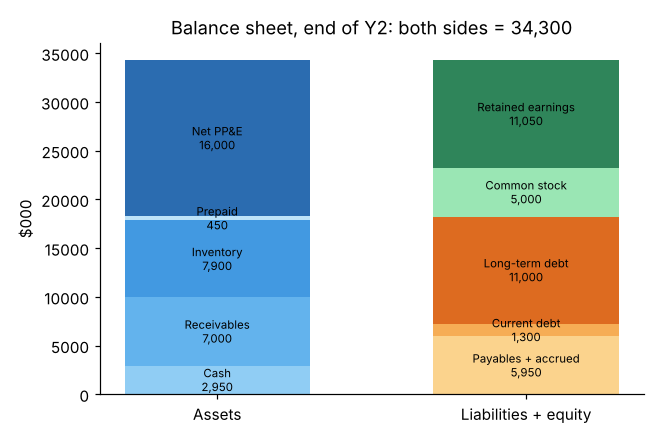

# Module 02 — The Balance Sheet

## Objectives

- Read a balance sheet: assets, liabilities, equity.
- Explain current vs long-term items and net PP&E.
- Trace how retained earnings link the balance sheet to the income statement.

## Concept

The balance sheet is a **snapshot** on one date: what the business owns (assets) and who has a claim on it (liabilities and equity).

- **Current assets** — expected to become cash within a year: cash, accounts receivable (customers owe us), inventory, prepaid expenses.
- **Long-term assets** — property, plant and equipment (PP&E) at cost, less accumulated depreciation = **net PP&E** (book value, not market value).
- **Current liabilities** — due within a year: accounts payable (we owe suppliers), accrued expenses (wages, utilities earned but unpaid), the current portion of long-term debt.
- **Long-term liabilities** — debt due after one year, leases, pensions.
- **Equity** — owners' paid-in capital (common stock) plus **retained earnings** (cumulative profit kept in the business).

## Worked example: Riverbend ($000)

| Assets | Y1 | Y2 | | Liabilities & equity | Y1 | Y2 |
|---|---|---|---|---|---|---|
| Cash | 2,400 | 2,950 | | Accounts payable | 3,900 | 4,300 |
| Receivables | 6,100 | 7,000 | | Accrued expenses | 1,500 | 1,650 |
| Inventory | 7,300 | 7,900 | | Current debt | 1,200 | 1,300 |
| Prepaid | 400 | 450 | | **Current liabilities** | **6,600** | **7,250** |
| **Current assets** | **16,200** | **18,300** | | Long-term debt | 10,800 | 11,000 |
| PP&E at cost | 26,000 | 29,100 | | **Total liabilities** | **17,400** | **18,250** |
| Accumulated depreciation | (11,000) | (13,100) | | Common stock | 5,000 | 5,000 |
| **Net PP&E** | **15,000** | **16,000** | | Retained earnings | 8,800 | 11,050 |
| | | | | **Total equity** | **13,800** | **16,050** |
| **Total assets** | **31,200** | **34,300** | | **Total L + E** | **31,200** | **34,300** |



Things an engineer should notice:

- **Inventory is the biggest current asset** (7,900). That is cash sitting on the floor — a lean target.
- **PP&E at cost rose 3,100** (capital spending) while accumulated depreciation rose 2,100 (the year's depreciation expense).
- **Retained earnings rose 2,250** = net income 3,150 − dividends 900. This is the bridge between the income statement and the balance sheet.
- **Working capital** = current assets − current liabilities = 18,300 − 7,250 = **11,050**.

## Book value vs market value

A 10-year-old CNC lathe may be fully depreciated (book value 0) yet still make good parts and be worth $60k on the used market. The balance sheet records historical cost less depreciation, not what things are worth. Valuation (Module 13) looks forward instead.

## Run it

```bash
python tools/finkit.py statements
```

`data/balance_sheet.csv` holds both years.

## Check yourself

1. Riverbend repays $1,200k of debt in cash. What happens to total assets and total liabilities?
2. Why does a large accumulated-depreciation balance relative to PP&E at cost matter to an engineering manager?
3. Calculate the Y1 working capital.

<details><summary>Answers</summary>

1. Both fall by $1,200k; equity is unchanged.
2. Accumulated depreciation of 13,100 on 29,100 at cost means equipment is, on average, about 45 % through its depreciable life — an early signal of a coming wave of replacement capital.
3. 16,200 − 6,600 = 9,600.

</details>
