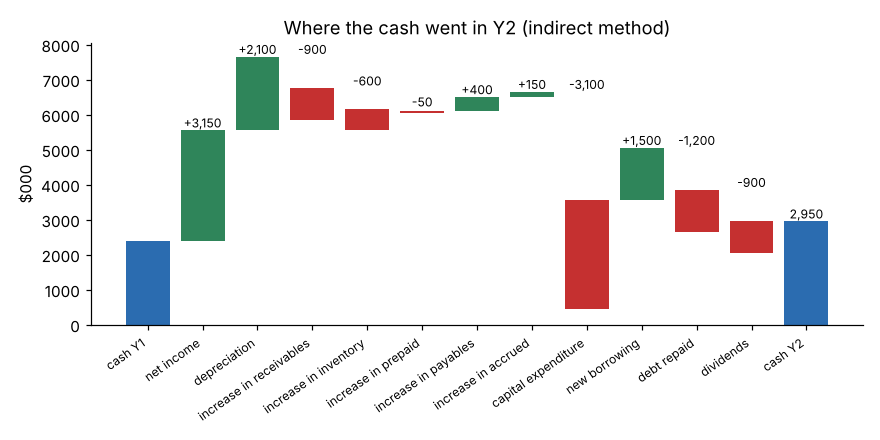

# Module 04 — Cash Flow

## Objectives

- Build a statement of cash flows by the indirect method.
- Explain why profit and cash differ: non-cash expenses and working capital.
- Compute free cash flow and the cash conversion cycle's effect on cash.

## Concept

The cash flow statement explains the change in cash between two balance sheets, in three sections:

1. **Operating (CFO)** — start with net income, add back non-cash expenses (depreciation), then adjust for working capital:
   - increase in an operating **asset** (receivables, inventory, prepaid) **uses** cash → subtract;
   - increase in an operating **liability** (payables, accruals) **provides** cash → add.
2. **Investing (CFI)** — capital expenditure, asset sales, acquisitions.
3. **Financing (CFF)** — borrowing, repaying debt, issuing stock, paying dividends.

**Free cash flow (FCF)** = CFO − capital expenditure. It is the cash available to repay lenders, pay owners or fund growth.

## Worked example: Riverbend, Y2 ($000)

| Operating activities | |
|---|---|
| Net income | 3,150 |
| + Depreciation | 2,100 |
| − Increase in receivables (6,100 → 7,000) | (900) |
| − Increase in inventory (7,300 → 7,900) | (600) |
| − Increase in prepaid (400 → 450) | (50) |
| + Increase in payables (3,900 → 4,300) | 400 |
| + Increase in accrued expenses (1,500 → 1,650) | 150 |
| **Cash from operations (CFO)** | **4,250** |
| **Investing:** capital expenditure | **(3,100)** |
| Financing: new borrowing | 1,500 |
| Financing: debt repaid | (1,200) |
| Financing: dividends | (900) |
| **Cash from financing (CFF)** | **(600)** |
| **Net change in cash** | **550** |
| Cash Y1 → Y2 | 2,400 → 2,950 ✓ |



**Free cash flow** = 4,250 − 3,100 = **1,150**.

Reading it:

- Net income was 3,150, but **1,500 of cash went into receivables and inventory** as the business grew.
- Depreciation added back 2,100, yet capex was 3,100 — the company is investing more than its equipment is wearing out (growth, or catching up).
- Dividends (900) plus net debt repayment were funded from operations, with 550 left over.

## Working capital is an engineering lever

Cash tied up in operations = receivables + inventory − payables. Every day of inventory at Riverbend is worth about COGS / 365 = 33,600 / 365 ≈ **$92k**. Cutting inventory by 10 days through setup reduction, smaller batches and pull systems frees roughly **$920k** of cash once — money that would otherwise have to be borrowed.

## Run it

```bash
python tools/finkit.py cashflow
python tools/make_figures.py
```

## Check yourself

1. Riverbend is profitable. How could it still run short of cash?
2. Next year inventory falls by $500k and nothing else changes. What happens to CFO?
3. Why is depreciation added back when it is a real cost?

<details><summary>Answers</summary>

1. Fast growth (receivables and inventory rising faster than payables), heavy capex, debt repayments or dividends can all exceed operating cash flow.
2. CFO rises by $500k — a decrease in an operating asset releases cash.
3. The cash left when the machine was bought (an investing outflow in an earlier year). Depreciation spreads that cost over the asset's life for profit measurement but does not use cash in the current period.

</details>
