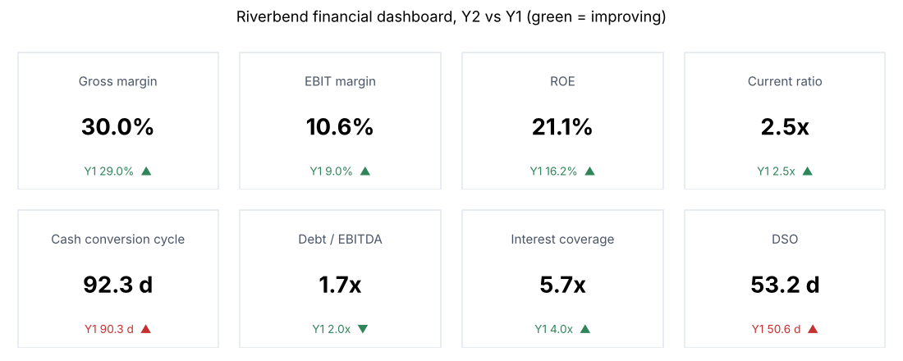

# Module 05 — Ratio Analysis and the Financial Dashboard

## Objectives

- Compute and interpret profitability, efficiency, liquidity and leverage ratios.
- Decompose return on equity with the DuPont identity.
- Build a dashboard of key metrics that a manager can read in 30 seconds.

## Ratios (Riverbend, Y2 vs Y1)

Averages use the two year-end balances for Y2; Y1 uses year-end balances.

| Group | Ratio | Formula | Y1 | Y2 |
|---|---|---|---|---|
| Profitability | Gross margin | gross profit / revenue | 29.0 % | 30.0 % |
| | EBIT margin | EBIT / revenue | 9.0 % | 10.6 % |
| | Net margin | net income / revenue | 5.1 % | 6.6 % |
| | Return on assets (ROA) | net income / avg total assets | 7.2 % | 9.6 % |
| | Return on equity (ROE) | net income / avg equity | 16.2 % | 21.1 % |
| Efficiency | Asset turnover | revenue / avg total assets | 1.41 | 1.47 |
| | Days sales outstanding (DSO) | receivables / revenue × 365 | 50.6 | 53.2 |
| | Days inventory outstanding (DIO) | inventory / COGS × 365 | 85.3 | 85.8 |
| | Days payables outstanding (DPO) | payables / COGS × 365 | 45.6 | 46.7 |
| | Cash conversion cycle | DSO + DIO − DPO | 90.3 | 92.3 |
| Liquidity | Current ratio | current assets / current liabilities | 2.45 | 2.52 |
| | Quick ratio | (cash + receivables) / current liabilities | 1.29 | 1.37 |
| Leverage | Debt / equity | total debt / equity | 0.87 | 0.77 |
| | Debt / EBITDA | total debt / EBITDA | 2.05 | 1.71 |
| | Interest coverage | EBIT / interest | 4.0 | 5.7 |

## DuPont: where ROE comes from

ROE = net margin × asset turnover × equity multiplier

21.1 % = 6.56 % × 1.466 × 2.194

- **Net margin** (6.56 %) — pricing and cost control.
- **Asset turnover** (1.466) — how hard assets work: inventory, receivables, machine utilization.
- **Equity multiplier** (avg assets 32,750 / avg equity 14,925 = 2.194) — financial leverage.

Riverbend's ROE rose mainly through margin. Asset turnover barely moved because receivables and inventory grew along with sales.

## Reading the story

- **Good:** margins up at every level, leverage down, coverage up.
- **Watch:** DSO up 2.6 days and the cash conversion cycle up 2 days. Customers are paying slower; inventory has not fallen. That is why Module 04 showed 1,500 of cash absorbed by working capital.
- **Context matters.** Compare ratios with your own history, your budget and industry peers. A ratio is a question, not an answer.

## The dashboard



Design rules for a financial dashboard:

1. **Six to ten metrics**, chosen to answer: are we profitable, efficient, liquid and safe?
2. Show **current value, comparison (prior period or budget) and direction**, colored by whether the change is good (DSO going up is bad).
3. **Same definitions every period** — write them down (see `templates/dashboard-definitions.md`).
4. **Pair company metrics with cell metrics** a manager controls: cell contribution margin, scrap %, OEE, on-time delivery, inventory days in the cell.
5. Refresh on a fixed cadence (monthly close) from one source of data.

## Run it

```bash
python tools/finkit.py ratios
python tools/make_figures.py
```

## Check yourself

1. Compute the Y2 quick ratio by hand.
2. If DSO returned to 45 days, how much cash would Riverbend free (Y2 revenue)?
3. A competitor has ROE 25 % but an equity multiplier of 4.0. Is it better run?

<details><summary>Answers</summary>

1. (2,950 + 7,000) / 7,250 = 1.37.
2. Receivables at 45 days = 48,000 × 45 / 365 ≈ 5,918; current 7,000; cash freed ≈ **1,082** ($000).
3. Not necessarily. 25 % / 4.0 = 6.25 % ROA, versus Riverbend's 9.6 %. The competitor earns less on its assets and borrows more — higher risk, not better operations.

</details>
