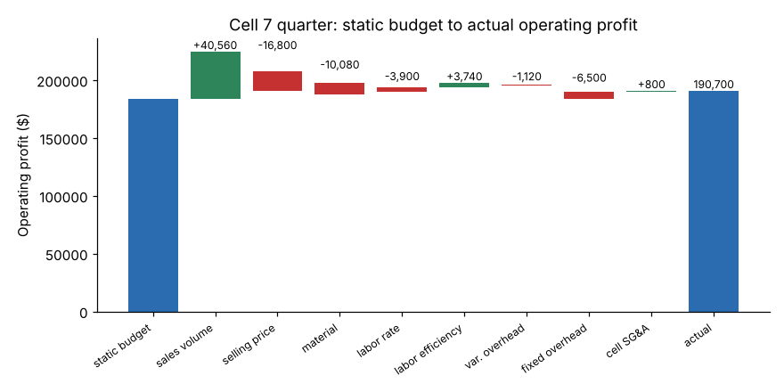

# Module 06 — Budgets and Performance Tracking

## Objectives

- Build an operating budget for a profit center from volume and standard costs.
- Use a flexible budget to separate volume effects from performance.
- Compute and explain price, spending, rate and efficiency variances.

## Concept

A **budget** is the plan in dollars. For a profit center it usually starts from:

1. **Sales volume forecast** (units) × **price** = revenue.
2. **Standard costs per unit:** material, labor hours × labor rate, variable overhead.
3. **Fixed costs:** cell overhead (supervision, maintenance, tooling, depreciation), cell SG&A.

The **static budget** is set at the planned volume. At period end, actual volume rarely matches. A **flexible budget** re-computes what costs *should* have been at the *actual* volume. Then:

- **Static vs flexible** = sales volume variance (the effect of selling more or fewer units).
- **Flexible vs actual** = performance variances (price, spending, efficiency).

Variances are labeled **favorable (F)** if they increase profit, **unfavorable (U)** if they reduce it.

## Worked example: Cell 7, one quarter

**Standards:** price $62.00; material $14.00/unit; labor 0.30 h/unit at $34.00/h; variable overhead $4.00/unit; fixed overhead $118,000; cell SG&A $36,000. **Plan:** 10,000 units. **Actual:** 11,200 units.

| | Static (10,000) | Flexible (11,200) | Actual (11,200) |
|---|---|---|---|
| Revenue | 620,000 | 694,400 | 677,600 |
| Material | 140,000 | 156,800 | 166,880 |
| Labor | 102,000 | 114,240 | 114,400 |
| Variable overhead | 40,000 | 44,800 | 45,920 |
| **Contribution** | **338,000** | **378,560** | **350,400** |
| Fixed overhead | 118,000 | 118,000 | 124,500 |
| Cell SG&A | 36,000 | 36,000 | 35,200 |
| **Operating profit** | **184,000** | **224,560** | **190,700** |

Actual details: price $60.50; material $14.90/unit; 3,250 labor hours at $35.20/h; variable overhead $4.10/unit.

**Variances (+ favorable):**

| Variance | Calculation | Amount |
|---|---|---|
| Sales volume | 224,560 − 184,000 | **+40,560 F** |
| Selling price | (60.50 − 62.00) × 11,200 | **−16,800 U** |
| Material spending | 156,800 − 166,880 | **−10,080 U** |
| Labor rate | (34.00 − 35.20) × 3,250 h | **−3,900 U** |
| Labor efficiency | (3,360 std h − 3,250 actual h) × 34.00 | **+3,740 F** |
| Variable overhead spending | 44,800 − 45,920 | **−1,120 U** |
| Fixed overhead spending | 118,000 − 124,500 | **−6,500 U** |
| Cell SG&A | 36,000 − 35,200 | **+800 F** |
| **Total vs static** | 190,700 − 184,000 | **+6,700 F** |



## The story behind the numbers

The cell beat its budget by $6,700 — but only because it sold 12 % more units. **Against the flexible budget it missed by $33,860.** Price discounts (−16,800) and material cost (−10,080) are the big items. Labor was more efficient than standard (fewer hours per part) but paid more per hour (overtime?). The manager's questions for next month: Why the discount — a deal to win volume? Is the material overrun price (supplier) or usage (scrap)? What drove the fixed overhead overrun?

The material variance can be split further when quantities are known: **price variance** = (actual price − standard price) × actual quantity; **usage variance** = (actual quantity − standard quantity) × standard price.

## Tracking cadence

- Monthly: budget vs actual with a variance bridge, top three variances explained, actions with owners.
- Rolling forecast: update the rest-of-year outlook quarterly, so surprises surface early.
- Don't manage to the budget at the expense of the business — cutting maintenance to hit a quarter is a classic false saving.

## Run it

```bash
python tools/finkit.py budget
```

`templates/budget-template.csv` is a blank version.

## Check yourself

1. Why compare actual to the flexible budget rather than the static budget for cost control?
2. Actual labor was 3,250 hours for 11,200 units. What were standard hours, and was the cell efficient?
3. If 9,000 units had sold at standard price and costs, what would the operating profit be?

<details><summary>Answers</summary>

1. The static budget's costs are for 10,000 units. Producing 11,200 units naturally costs more; the flexible budget removes that volume effect so the remaining variances reflect performance.
2. 11,200 × 0.30 = 3,360 standard hours. Actual 3,250 is 110 hours fewer — efficient, worth $3,740 at standard rate.
3. Contribution per unit = 62 − 14 − 10.20 − 4 = 33.80; 9,000 × 33.80 = 304,200; minus 154,000 fixed = **150,200**.

</details>
