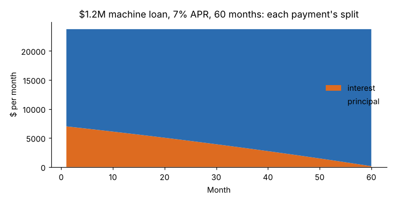

# Module 07 — Time Value of Money

## Objectives

- Move money through time: future value, present value, annuities, perpetuities.
- Convert between nominal (APR) and effective rates.
- Build a loan amortization schedule.

## Concept

A dollar today is worth more than a dollar later: it can be invested to earn a return, and later dollars carry risk. All of capital budgeting rests on five formulas (r = rate per period, n = number of periods):

| Quantity | Formula | Spreadsheet |
|---|---|---|
| Future value of a single sum | FV = PV (1 + r)^n | `=FV(r, n, 0, -PV)` |
| Present value of a single sum | PV = FV / (1 + r)^n | `=PV(r, n, 0, -FV)` |
| Present value of an annuity (payment A at the end of each period) | PV = A [1 − (1 + r)^−n] / r | `=PV(r, n, -A)` |
| Future value of an annuity | FV = A [(1 + r)^n − 1] / r | `=FV(r, n, -A)` |
| Payment to repay a loan P | A = P r / [1 − (1 + r)^−n] | `=PMT(r, n, -P)` |
| Perpetuity | PV = A / r | — |

Spreadsheet functions use sign conventions (cash out negative); check one result by hand.

**Rates.** A nominal annual rate (APR) of 7 % compounded monthly is 0.5833 % per month. The **effective annual rate** is (1 + 0.07/12)^12 − 1 = **7.229 %**. Always match the rate to the period.

**Rule of 72.** Money doubles in about 72 / (rate in %) years. At 8 %: 9.0 years (exact: ln 2 / ln 1.08 = 9.01).

## Worked examples

| Question | Answer |
|---|---|
| $100,000 invested at 6 % for 10 years grows to | **$179,084.77** |
| $250,000 due in 5 years, discounted at 8 %, is worth today | **$170,145.80** |
| $40,000 a year of savings for 7 years at 9 % is worth today | **$201,318.11** |
| $5,000 saved each quarter for 3 years at 6 % APR (1.5 % per quarter) grows to | **$65,206.06** |
| $30,000 a year forever at 10 % is worth | **$300,000** |

## Loan amortization: the 5-axis machine

Riverbend borrows **$1,200,000** at **7 % APR**, monthly payments over **5 years** (60 payments).

- r = 0.07 / 12 = 0.005833; n = 60
- Payment = 1,200,000 × 0.005833 / (1 − 1.005833^−60) = **$23,761.44 per month**
- Month 1: interest = 1,200,000 × 0.005833 = $7,000.00; principal = $16,761.44
- Total interest over 5 years ≈ **$225,686**

| Year | Interest | Principal |
|---|---|---|
| 1 | 77,420 | 207,718 |
| 2 | 62,404 | 222,733 |
| 3 | 46,302 | 238,835 |
| 4 | 29,037 | 256,100 |
| 5 | 10,523 | 274,614 |



Early payments are mostly interest; late payments are mostly principal. The full schedule is in `data/loan_schedule.csv`. Interest is usually tax-deductible for a business, which lowers the after-tax cost of debt (Module 08).

## Run it

```bash
python tools/finkit.py tvm
python tools/finkit.py loan
```

## Check yourself

1. Which is worth more today at 8 %: $100,000 now or $150,000 in 5 years?
2. A supplier offers 2 % off for paying in 10 days instead of 30 ("2/10 net 30"). What annual rate does skipping the discount cost?
3. How much principal is still owed on the machine loan after 3 years?

<details><summary>Answers</summary>

1. PV of $150,000 = 150,000 / 1.08^5 = $102,087, so the later sum is worth slightly more.
2. You pay 2 % to keep 98 for 20 extra days: (1 + 2/98)^(365/20) − 1 ≈ **44.6 %** a year. Take the discount unless cash is very tight.
3. 1,200,000 − (207,718 + 222,733 + 238,835) = **$530,714** (equal to the PV of the remaining 24 payments).

</details>
