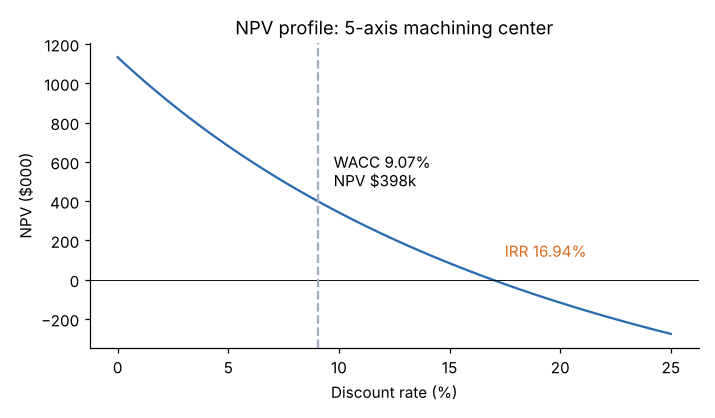

# Module 09 — Investment Analysis and Return on Investment

## Objectives

- Compute accounting ROI, simple and discounted payback, NPV, IRR and profitability index.
- Know what each measure ignores and when each misleads.
- Make an accept/reject call and explain it to a non-engineer.

## The project

Cell 7 proposes a **5-axis machining center** to replace two older machines and a manual deburr step.

| Item | Value |
|---|---|
| Machine price | $1,200,000 |
| Installation and training | $100,000 (capitalized) |
| Extra working capital (tooling, spares) | $60,000, recovered at the end |
| Annual pre-tax savings (labor, scrap, outsourcing) | $380,000 |
| Life | 7 years |
| Salvage value at year 7 | $150,000 |
| Depreciation | straight-line to zero over 7 years: $185,714 a year |
| Tax rate | 25 % (illustrative) |
| Discount rate | WACC 9.07 % (Module 08) |

Module 10 shows how these become after-tax cash flows. The result:

| Year | 0 | 1–6 | 7 |
|---|---|---|---|
| Cash flow ($) | −1,360,000 | 331,429 | 503,929 |

## The measures

**1. Accounting ROI (average rate of return)** = average annual net income / average investment

- Net income = (380,000 − 185,714) × 0.75 = 145,714
- Average investment = 1,300,000 / 2 + 60,000 = 710,000
- **ROI = 20.5 %**

Easy to explain; uses accounting profit, ignores timing.

**2. Simple payback** — years until cumulative cash flow turns positive: 1,360,000 / 331,429 = **4.10 years**. Ignores the time value of money and everything after payback.

**3. Net present value (NPV)** — sum of discounted cash flows:

| Year | Cash flow | Discount factor at 9.07 % | PV | Cumulative PV |
|---|---|---|---|---|
| 0 | −1,360,000 | 1.0000 | −1,360,000 | −1,360,000 |
| 1 | 331,429 | 0.9168 | 303,868 | −1,056,132 |
| 2 | 331,429 | 0.8406 | 278,599 | −777,533 |
| 3 | 331,429 | 0.7707 | 255,431 | −522,102 |
| 4 | 331,429 | 0.7066 | 234,190 | −287,912 |
| 5 | 331,429 | 0.6478 | 214,715 | −73,196 |
| 6 | 331,429 | 0.5940 | 196,860 | +123,664 |
| 7 | 503,929 | 0.5446 | 274,430 | **+398,094** |

**NPV = +$398,094.** The project earns the 9.07 % cost of capital and adds about $398k of value on top. **Accept if NPV > 0.**

**4. Discounted payback** = 5 + 73,196 / 196,860 = **5.37 years**.

**5. Internal rate of return (IRR)** — the rate that makes NPV = 0: **16.94 %**. Accept if IRR > hurdle rate.

**6. Profitability index (PI)** = PV of future cash flows / initial investment = 1,758,094 / 1,360,000 = **1.29**. Useful for ranking projects when capital is limited.



## Which measure to trust

| Measure | Strength | Weakness |
|---|---|---|
| NPV | measures value added in dollars; consistent with maximizing firm value | needs a discount rate; less intuitive |
| IRR | intuitive % | can mislead when ranking projects of different size or timing; can have multiple values if cash flows change sign more than once |
| Payback | simple; a liquidity and risk screen | ignores time value (simple) and later cash flows |
| Accounting ROI | matches reported profit | ignores timing and cash |
| PI | ranks under a capital budget | same caveats as NPV |

**Rule:** decide on **NPV**; report IRR and payback because people ask for them.

**Mutually exclusive projects:** a $100k project with IRR 40 % (NPV $60k) vs a $1M project with IRR 18 % (NPV $250k) — choose the larger NPV if capital is available.

## Run it

```bash
python tools/finkit.py invest
```

Spreadsheet: `=NPV(9.07%, B2:B8) + B1` (Excel's NPV discounts its first argument by one period, so add the year-0 flow separately) and `=IRR(B1:B8)`.

## Check yourself

1. Management demands payback under 4 years. What do you tell them about this project?
2. At what discount rate is NPV zero?
3. Savings turn out to be $300,000 a year. Recompute year 1–6 cash flow and say whether NPV stays positive.

<details><summary>Answers</summary>

1. Payback is 4.1 years — slightly over — but NPV is +$398k at the company's cost of capital and IRR is 16.9 %. A payback rule rejects a value-creating project; suggest payback as a risk check, not the decision.
2. At the IRR, 16.94 %.
3. OCF = 300,000 × 0.75 + 185,714 × 0.25 = 271,429. Break-even savings are about $274,000 (Module 11), so at $300,000 NPV is still positive but small (≈ +$97k).

</details>
