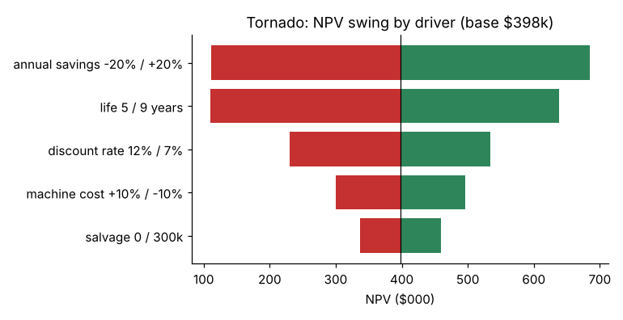
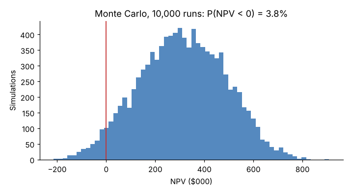

# Module 11 — Economic Analysis: Risk, Sensitivity and Comparing Alternatives

## Objectives

- Test an investment's NPV against uncertain inputs: sensitivity, break-even and scenarios.
- Run a simple Monte Carlo simulation.
- Compare alternatives with unequal lives using equivalent annual cost.

## Why

Every input in Module 09 is a forecast. A decision maker needs to know: **which assumptions drive the answer, and how wrong can they be before the decision flips?**

## 1. One-at-a-time sensitivity (tornado)

Move one input at a time to a plausible low and high value; hold the rest at base.

| Driver | Low case | NPV | High case | NPV |
|---|---|---|---|---|
| Annual savings | −20 % ($304k) | 111,888 | +20 % ($456k) | 684,300 |
| Machine life | 5 years | 110,663 | 9 years | 638,640 |
| Discount rate | 12 % | 230,590 | 7 % | 533,589 |
| Machine cost | +10 % | 299,613 | −10 % | 496,575 |
| Salvage | $0 | 336,829 | $300k | 459,359 |

Base NPV $398,094.



**Savings and life dominate.** Engineering effort should go into firming up the savings estimate (time studies, scrap data, quotes for outsourced work) and the realistic life — not into negotiating the last 2 % off the machine price.

## 2. Break-even value

Solve for the input value that makes NPV = 0. For annual savings: **$274,289**. Savings would have to come in **28 % below** the $380k estimate before the project destroys value. That single number is often more persuasive than the NPV itself.

## 3. Scenarios

Combine inputs that move together (e.g. a downturn means lower volume *and* lower savings *and* a longer payback). Typical set: pessimistic / base / optimistic, each internally consistent. Present the NPV for each and the probability you'd assign.

## 4. Monte Carlo simulation

Give each uncertain input a distribution and sample many times:

- savings: triangular (min $280k, most likely $380k, max $440k);
- machine cost: normal (mean $1.2M, SD $60k);
- life: 5, 6, 7 or 8 years with probabilities 0.10, 0.25, 0.45, 0.20.

10,000 runs (seed 2026):

| Result | Value |
|---|---|
| Mean NPV | $311,517 |
| P(NPV < 0) | **3.8 %** |
| 5th–95th percentile | $21,134 to $593,856 |



The mean is below the base-case NPV because the input distributions are skewed downward (savings can fall further than they can rise, and shorter lives are more likely than 9 years). **A single-point estimate built from "most likely" inputs is not the expected value.**

Monte Carlo is only as good as the distributions. Get them from data or structured expert judgment, and watch for inputs that are correlated.

## 5. Unequal lives: equivalent annual cost (EAC)

Two machines can do Cell 7's job:

| | Machine X | Machine Y |
|---|---|---|
| Price | $900,000 | $1,300,000 |
| Annual operating cost | $210,000 | $160,000 |
| Life | 5 years | 8 years |
| Salvage | $80,000 | $150,000 |

PV of costs at 9.07 % (pre-tax, for simplicity):

- X: 900,000 + 815,345 − 51,828 = **$1,663,517**
- Y: 1,300,000 + 883,272 − 74,894 = **$2,108,377**

Comparing these PVs directly is wrong — Y provides 8 years of service, X only 5. Convert each to an equal annual amount over its own life:

EAC = PV × r / (1 − (1 + r)^−n)

- X: **$428,455 per year**
- Y: **$381,921 per year**

**Machine Y is cheaper by about $46,500 a year**, even though its PV of costs is higher. (EAC assumes each machine would be replaced like-for-like at the end of its life.)

## Run it

```bash
python tools/finkit.py sensitivity
python tools/finkit.py eac
```

## Check yourself

1. Which two inputs would you investigate first before approving the machine, and how?
2. A manager says, "The NPV is $398k, so we'll gain $398k." What's missing?
3. Why can't you just compare the PV of costs for X and Y?

<details><summary>Answers</summary>

1. Annual savings (validate with time studies, scrap history, current outsourcing invoices) and machine life (maintenance history of similar machines, vendor data, product-life outlook).
2. Uncertainty. The simulation gives a range of roughly $21k–$594k (90 % interval) and a 3.8 % chance of losing value. And the value will only show up if the savings are actually captured — plan a post-audit.
3. They cover different periods of service. EAC (or a common-horizon analysis) puts them on the same basis.

</details>
