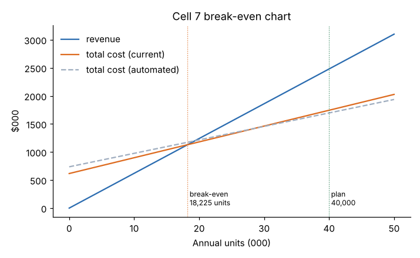

# Module 12 — Break-Even Analysis

## Objectives

- Separate fixed and variable costs and compute contribution margin.
- Find break-even volume, margin of safety and the volume for a profit target.
- Use operating leverage and indifference points to judge automation and make-vs-buy choices.

## Concept

- **Variable cost (VC)** changes with volume: material, direct labor (if flexed), variable overhead.
- **Fixed cost (FC)** does not change within a relevant range: supervision, depreciation, maintenance contracts, salaried staff.
- **Contribution margin (CM) per unit** = price − variable cost per unit. Each unit sold contributes this much toward fixed costs, then profit.

| Quantity | Formula |
|---|---|
| Break-even units | FC / CM |
| Break-even revenue | FC / CM ratio, where CM ratio = CM / price |
| Units for target profit | (FC + target) / CM |
| Margin of safety | (planned units − break-even units) / planned units |
| Degree of operating leverage (DOL) | total contribution / operating profit |

DOL tells you the % change in operating profit for a 1 % change in volume.

## Worked example: Cell 7, annual

From the Module 06 budget: price $62.00; variable cost $28.20 (material 14.00 + labor 10.20 + variable overhead 4.00); fixed costs $616,000 a year (4 × 154,000); plan 40,000 units.

| Result | Value |
|---|---|
| CM per unit | $33.80 |
| CM ratio | 54.5 % |
| **Break-even** | **18,225 units** ($1.13M revenue) |
| Operating profit at plan | 40,000 × 33.80 − 616,000 = **$736,000** |
| Margin of safety | (40,000 − 18,225) / 40,000 = **54.4 %** |
| DOL at plan | 1,352,000 / 736,000 = **1.84** |
| Units for $800,000 profit | (616,000 + 800,000) / 33.80 = **41,893** |

A 10 % drop in volume cuts operating profit by about 18.4 %.

## Should Cell 7 automate?

A robot loading cell would cut variable cost to **$24.00** per unit but add **$120,000** a year of fixed cost (depreciation, maintenance, programming).

| | Current | Automated |
|---|---|---|
| CM per unit | 33.80 | 38.00 |
| Fixed cost | 616,000 | 736,000 |
| Break-even units | 18,225 | 19,368 |
| Operating profit at 40,000 | 736,000 | 784,000 |
| DOL at plan | 1.84 | 1.94 |

**Indifference point** — where both options give the same profit:

(736,000 − 616,000) / (28.20 − 24.00) = **28,571 units**

Above 28,571 units a year, automation earns more; below it, the current setup does. At the plan of 40,000, automation adds $48,000 a year — but raises break-even and operating leverage, so profit swings more if demand falls. (For the full decision, put the robot's capital cost through Modules 09–11 rather than relying on annual profit.)



## Make vs buy uses the same logic

Buy a part for $9.50, or make it with variable cost $6.80 plus $40,000 a year of fixed cost that would otherwise be avoided? Indifference = 40,000 / (9.50 − 6.80) ≈ 14,815 parts a year. Make if volume is well above that and capacity exists; consider quality, lead time and strategic control too.

## Assumptions and limits

- Price and variable cost per unit are constant (no volume discounts, no overtime premium).
- Fixed costs are fixed only within a relevant range — a second shift or another machine steps them up.
- For a product mix, use a weighted-average CM; break-even then depends on the mix.

## Run it

```bash
python tools/finkit.py breakeven
```

## Check yourself

1. If the price drops to $58, what is the new break-even volume?
2. Why does higher operating leverage mean higher risk?
3. Volume forecast for next year is 26,000 units. Automate?

<details><summary>Answers</summary>

1. CM = 58 − 28.20 = 29.80; 616,000 / 29.80 ≈ **20,671 units**.
2. More of the cost base is fixed, so profit swings more for a given change in volume — in both directions.
3. No — 26,000 is below the 28,571 indifference point; the current setup is more profitable at that volume (unless other benefits, such as quality or safety, justify it).

</details>
