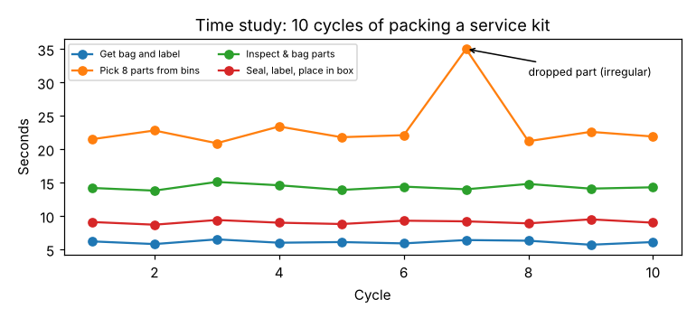

# Module 4 — Work Measurement I: Time Study and Standard Time

**Time:** 2 h · **Day 2**

## Learning objectives

1. Define and evaluate work content using stopwatch time study.
2. Apply performance rating and allowances to set a standard time.
3. Determine how many cycles to observe.

## 1. Why measure work?

Standard times are the basis for capacity planning, staffing, scheduling, costing, line balancing, comparing methods, and incentive pay. A **standard time** is the time a qualified, trained worker needs to do a task at a normal pace, using the prescribed method, plus allowances for personal needs, fatigue and unavoidable delays.

## 2. Time study procedure

1. Standardize the method first (Modules 2–3) — don't time a bad method.
2. Explain the purpose to the operator and supervisor; choose a qualified, trained operator.
3. Break the job into **elements** with clear start and end points.
4. Time enough cycles (Section 4); note any irregular readings and their cause.
5. **Rate** performance for each element.
6. Compute normal time, add **allowances**, get the standard time.

## 3. Worked example — pack a service kit

```bash
python tools/ie.py timestudy
```



| Element | Cycles used | Observed mean (s) | Rating | Normal time (s) |
|---|---|---|---|---|
| Get bag and label | 10 | 6.10 | 100% | 6.10 |
| Pick 8 parts from bins | 9* | 22.02 | 110% | 24.22 |
| Inspect & bag parts | 10 | 14.32 | 95% | 13.60 |
| Seal, label, place in box | 10 | 9.09 | 105% | 9.54 |
| **Normal time per kit** | | | | **53.47 s** |

*Cycle 7 (35.0 s — dropped part) is an irregular reading and is excluded (more than 30% from the element median). Irregular events belong in allowances or are designed out, not averaged in.

**Normal time** = observed time × performance rating. A rating of 110% means the operator worked faster than normal pace for that element, so normal time is longer than observed.

**Standard time** = normal time × (1 + allowance) = 53.47 × 1.15 = **61.49 s = 1.025 min per kit** → standard output **58.5 kits/hour**.

### Performance rating

The analyst compares the observed pace with a defined normal pace (commonly benchmarks such as walking 3 mph / 4.8 km/h, or dealing a deck of cards into four piles in 0.5 min). Rating is a trained judgment — the largest source of disagreement in time study. Train raters on films with known ratings, and rate by element, not the whole cycle.

### Allowances

| Allowance | Typical range |
|---|---|
| Personal (restroom, drinks) | ~5% |
| Basic fatigue | ~4% |
| Variable fatigue (standing, awkward posture, weight, light, noise, monotony) | 0–30%+ depending on conditions |
| Unavoidable delay | Small, if measured (e.g., by work sampling, Module 5) |

PF&D 15% is used in the case. (Allowance tables vary by source — e.g., the ILO's *Introduction to Work Study* — and company agreements; document which you use.)

## 4. How many cycles?

  n = (z · s / (k · x̄))²

with z = 1.96 (95%), s = element standard deviation, k = desired accuracy (e.g., ±5%), x̄ = element mean.

```bash
python tools/ie.py samplesize
```

| Element | Cycles needed (±5%, 95%) |
|---|---|
| Get bag and label | 3 |
| Pick 8 parts | 3 |
| Inspect & bag | 2 |
| Seal, label, box | 2 |

The 10 cycles taken are ample here because the method is stable. Variable or long-cycle jobs need far more; always compute it.

## 5. Other ways to set standards

- **Predetermined motion time systems (PMTS)**: standard times for basic motions (reach, grasp, move…) summed to build a task time without a stopwatch — useful for designing methods before the job exists. Commercial systems require training and licensing.
- **Standard data**: element times reused across similar jobs (e.g., "seal bag: 2.1 s").
- **Historical data / estimates**: fastest but least reliable.

## Check yourself

Observed time 40 s, rating 90%, allowance 12%. Standard time?

<details><summary>Answer</summary>

Normal = 40 × 0.90 = 36 s; standard = 36 × 1.12 = 40.3 s.
</details>
