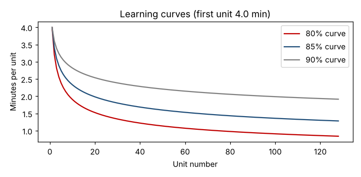

# Module 5 — Work Measurement II: Work Sampling, Learning Curves and Staffing

**Time:** 90 min

## Learning objectives

1. Use work sampling to measure how time is spent.
2. Apply learning curves to new work.
3. Calculate staffing from standards and demand.

## 1. Work sampling

Instead of timing continuously, make many **random, instantaneous observations** and record what each person is doing. The share of observations in a category estimates the share of time. Developed by L. H. C. Tippett in British textile mills in the 1930s.

**Good for:** long or irregular jobs, groups of people, measuring delays and allowances, non-repetitive work (maintenance, offices, hospitals).

### Case — 400 random observations of the packers over two weeks

```bash
python tools/ie.py worksampling
```

| Activity | Share |
|---|---|
| Packing (productive) | 71.0% |
| Waiting for parts | **11.5%** (95% CI 8.4–14.6%) |
| Searching / walking | 7.5% |
| Personal | 5.0% |
| Rework | 3.0% |
| Other | 2.0% |

Margin of error for a proportion: 1.96 × √[p(1 − p)/n] = 1.96 × √(0.115 × 0.885 / 400) = ±3.1 points.

**Reading:** about 1 hour in 9 is spent waiting for parts — a material-supply problem, not a people problem. Searching/walking (7.5%) confirms the methods findings in Module 2.

**Sample size** to estimate the productive share within ±3 points: n = 1.96² × 0.71 × 0.29 / 0.03² = **879** observations.

**Rules:** truly random times (random number table or app); observe at a glance; tell people what you're doing and why; cover all shifts and days.

## 2. Learning curves

People get faster with repetition. T. P. Wright (1936) observed that each **doubling** of cumulative units reduces unit time to a constant percentage — the learning rate.

  Tₙ = T₁ · n^b, b = log(rate) / log 2

### Case — new complex kit, first unit 4.0 min, 85% curve

```bash
python tools/ie.py learning
```

| Unit | 1 | 2 | 4 | 8 | 16 | 32 | 64 | 128 |
|---|---|---|---|---|---|---|---|---|
| Minutes | 4.00 | 3.40 | 2.89 | 2.46 | 2.09 | 1.77 | 1.51 | 1.28 |

First 100 kits take **175 min** in total (average 1.75 min each).



**Implications:** don't set standards during the learning phase; plan extra capacity and pay protection for new products and new hires; time studies should be done once performance has leveled off.

## 3. Staffing from standards

  Operators = (demand × standard time) ÷ (available time × planned efficiency)

### Case

Demand 5,200 kits/day over two 450-min shifts → 2,600 per shift. Standard time 61.49 s. Planned efficiency 90% (training, absence buffer).

```bash
python tools/ie.py staffing
```

  2,600 × 61.49 / (450 × 60 × 0.90) = **6.58 → 7 packers per shift**

The department runs with 7 per shift but still has overtime — because 11.5% of time is lost to waiting and 7.5% to walking. Fixing the method and parts supply (Modules 2 and 7) frees close to one person per shift for other work; without them, a standard alone just labels the problem.

## Check yourself

Work sampling: 1,000 observations, 120 idle. Estimate idle share and 95% margin.

<details><summary>Answer</summary>

12%; ±1.96 × √(0.12 × 0.88 / 1,000) = ±2.0 points.
</details>
