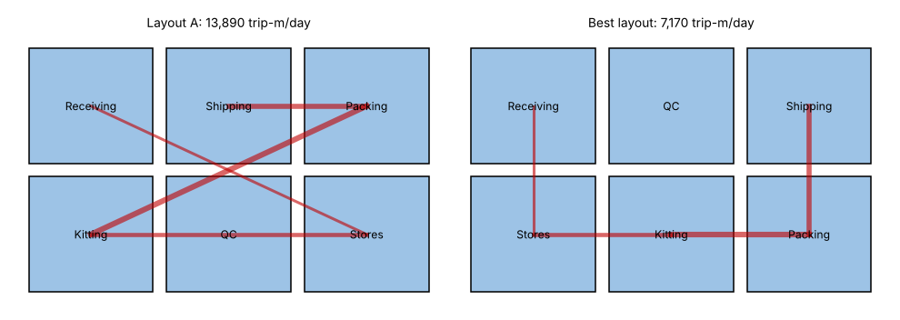

# Module 7 — Facility Layout and Material Flow

**Time:** 75 min

## Learning objectives

1. Describe the basic layout types.
2. Use a from–to chart and a load–distance score to compare layouts.

## 1. Layout types

| Type | Organized by | Best for | Example |
|---|---|---|---|
| **Process (functional)** | Similar equipment grouped together | High variety, low volume | Job shop: all lathes together |
| **Product (line)** | Sequence of steps for one product | High volume, low variety | Assembly line |
| **Cellular** | Families of similar products | Medium variety and volume | Machining cell for one part family |
| **Fixed-position** | Product stays; resources come to it | Very large items | Aircraft, ships, buildings |

## 2. Quantifying flow

1. **From–to chart:** trips (or loads) per day between each pair of departments.
2. **Distance** between departments in each candidate layout (rectilinear along aisles is realistic).
3. **Load–distance score** = Σ trips × distance. Lower is better.

### Case — kitting area, six departments on a 3 × 2 grid (15 m per cell)

Trips per day (both directions combined):

| | Stores | Kitting | Packing | QC | Shipping |
|---|---|---|---|---|---|
| **Receiving** | 60 | | | 8 | |
| **Stores** | | 90 | 10 | | |
| **Kitting** | | | 120 | 15 | |
| **Packing** | | | | 25 | 110 |
| **QC** | | | | | 5 |

```bash
python tools/ie.py layout
```

| Layout | Load–distance (trip-m/day) |
|---|---|
| Current layout A | **13,890** |
| Best of all 720 arrangements | **7,170** (−48%) |



**Best layout:** Receiving–QC–Shipping across the front; Stores–Kitting–Packing across the back. The heavy flows (Kitting ↔ Packing 120, Packing ↔ Shipping 110, Stores ↔ Kitting 90) become adjacent.

With 6 departments, all 720 arrangements can be checked by computer. For larger problems, use heuristics (e.g., pairwise exchange, systematic layout planning by Richard Muther) — and always check practical constraints (dock doors, utilities, building columns, noise).

## Check yourself

Why might the lowest load–distance layout still be rejected?

<details><summary>Answer</summary>

Practical constraints: fixed dock doors, utilities, safety separation, noise, future growth, or the cost of moving heavy equipment can outweigh the savings.
</details>
