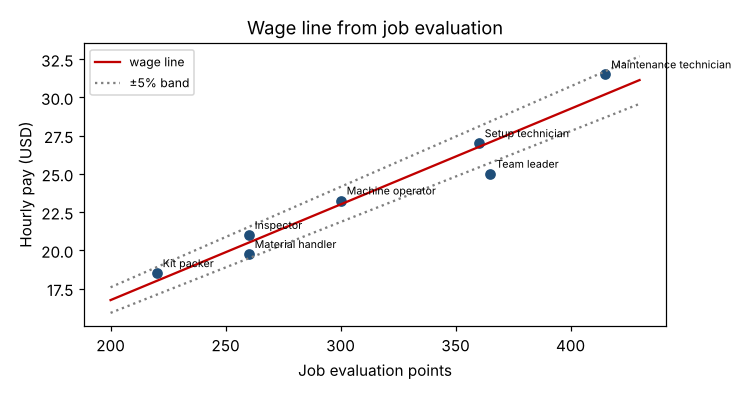

# Module 10 — Wage Payment

**Time:** 60 min

## Learning objectives

1. Build a wage line from job evaluation points and identify out-of-line jobs.
2. Compare time-based and incentive pay plans.

## 1. Wage line (pay policy line)

Regress current pay on job-evaluation points:

```bash
python tools/ie.py wagecurve
```

  **Pay = 4.23 + 0.0626 × points** (R² = 0.94)

| Job | Points | Current pay | Line | Deviation |
|---|---|---|---|---|
| Kit packer | 220 | $18.50 | $17.99 | +2.8% |
| Material handler | 260 | $19.75 | $20.50 | −3.6% |
| Inspector | 260 | $21.00 | $20.50 | +2.5% |
| Machine operator | 300 | $23.25 | $23.00 | +1.1% |
| Setup technician | 360 | $27.00 | $26.75 | +0.9% |
| **Team leader** | 365 | **$25.00** | $27.07 | **−7.6%** |
| Maintenance technician | 415 | $31.50 | $30.19 | +4.3% |



**Reading:** pay tracks job worth well overall; the **team leader** is 7.6% below the line — a "green-circled" job to bring up over time (and a likely reason the role is hard to fill). Jobs well above the line are "red-circled": pay frozen until the line catches up. Add **market data** (salary surveys) to check the line against competitors; then set **pay grades** (point bands) with a pay range for each.

## 2. Pay plans

| Plan | How pay is set | Pros | Cons |
|---|---|---|---|
| **Day work (time-based)** | Hourly or salary | Simple; quality and teamwork not penalized | No direct link to output |
| **Measured day work** | Time-based, with standards as performance expectations | Standards without piece-rate pressure | Needs good supervision |
| **Individual incentives** | Pay linked to individual output vs standard | Strong output motivation | Quality, safety, teamwork and standard disputes |
| **Group incentives** | Team output | Encourages helping | Free-rider issues |
| **Gainsharing** (Scanlon, Rucker, Improshare) | Plant-wide share of productivity gains | Aligns everyone; involvement | Complex formulas; gains can be outside workers' control |
| **Skill-based pay** | Pay for skills certified (Module 8 matrix) | Flexibility | Training cost |

### Incentive calculations — case

Base rate $18.50/h; standard 0.81 min/kit (an assumed new standard after the method improvements in Modules 2–3); a packer packs **680 kits** in an 8-hour shift.

Standard hours earned = 680 × 0.81 / 60 = **9.18 h** → efficiency **115%**.

```bash
python tools/ie.py incentives
```

| Plan | Rule | Shift earnings |
|---|---|---|
| Day rate | 8 h × $18.50 | **$148.00** |
| Standard hour (100% premium) | Paid for standard hours earned (min 8 h) | **$169.83** |
| Halsey 50% | Base + 50% of time saved × rate | **$158.92** |
| Rowan | Base × (1 + time saved / standard time) | **$167.02** |

**Any incentive needs:** sound standards (Module 4), quality requirements in the pay rule (only good kits count), a guaranteed base, and a fair process for changing standards when methods change.

## Check yourself

Why can a poorly set standard ruin an incentive plan?

<details><summary>Answer</summary>

A loose standard pays for little effort and is hard to correct later; a tight one is unattainable, demotivating and a source of grievances. Either way trust in the system collapses.
</details>
