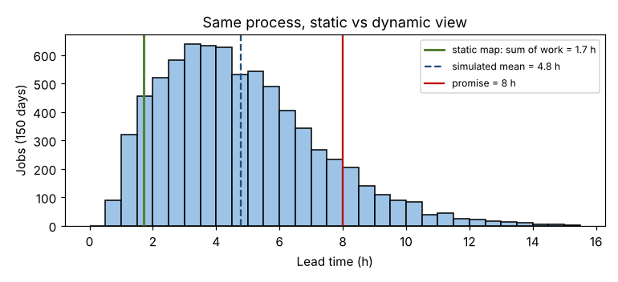

# Module 0 — Why Model Processes? Static Maps vs Real Variation

**Time:** 40 min

## Learning objectives

1. Explain why processes designed from experience and static maps often underperform.
2. Describe what a process model (simulation) adds.
3. Explain the "build to think" approach.

## 1. The problem with static maps

A process map or value stream map shows steps and **average** times. Real processes have **variation**: work arrives unevenly, tasks take different times, parts are late, people are absent. Averages don't add up the way intuition expects, because **waiting** is created by the interaction of variation and utilization.

### Case — same-day repair center

Industrial pumps and gearboxes arrive for same-day repair (promise: 8 hours). Steps: check-in → diagnosis (2 techs) → repair (4 techs; 25% of jobs wait for a part first) → test (1 rig; 12% fail and go back for rework) → release. About 50 units a day arrive between 07:00 and 17:00; staff work until 21:00.

```bash
python tools/procsim.py static
```

| View | Answer |
|---|---|
| Static map: sum of work content | **1.7 h** per unit |
| Static utilization (daily work ÷ staffed hours) | Diagnosis 80%, repair 89%, test 60% — "all below 100%, we're fine" |
| Simulation of the same process | Mean lead time **4.8 h**; 10% of jobs take more than **8.2 h**; **88.7%** meet the promise |



The static map says every job could be done in under 2 hours and no resource is overloaded. The model shows that 1 job in 9 breaks the same-day promise — because of morning arrival peaks, variable repair times, parts waits and rework loops.

## 2. What a process model adds

| Static map | Process model (discrete-event simulation) |
|---|---|
| Averages | Distributions and randomness |
| One snapshot | Behavior over time (hour by hour, day by day) |
| No queues | Queues, waiting and resource contention emerge |
| "What is" | "What if" — test designs before building them |
| Hard to argue with intuition | Numbers and animation that persuade stakeholders |

## 3. Build to think

Instead of debating designs in a meeting, **build a quick model and let it surprise you**. Start crude, run it, learn, refine. A model is a thinking tool first and a prediction tool second. Typical cycle:

```
question → simple model → run → surprise / insight → refine model or design → run again
```

## 4. Course map

| # | Module |
|---|---|
| 1 | How a process model works |
| 2 | Building the model: data and assumptions |
| 3 | Verification, validation and replications |
| 4 | Exploring the design space |
| 5 | Testing resilience against variation |
| 6 | Developing best-practice operating procedures |
| 7 | Identifying risks and building FMEAs with a model |
| 8 | Building the case for stakeholders |
| 9 | Using models to teach Lean concepts |
| 10 | Capstone |

All results come from `tools/procsim.py`, a small open simulator (Python + numpy) written for this course. The same methods apply in any commercial or open-source simulation package (e.g., SimPy for Python).

## Check yourself

Every resource is below 90% utilization. Why can lead time still be far longer than the work content?

<details><summary>Answer</summary>

Variation in arrivals and service times makes work queue even when average capacity is sufficient; waiting grows sharply as utilization rises (Module 9).
</details>
