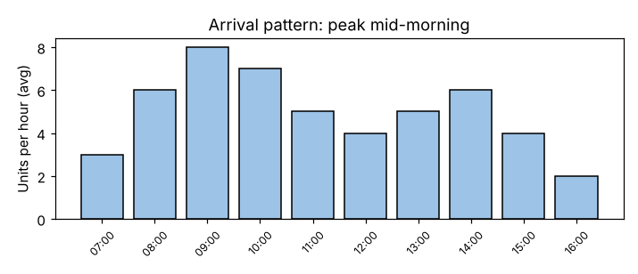

# Module 1 — How a Process Model Works

**Time:** 50 min

## Learning objectives

1. Name the building blocks of a discrete-event process model.
2. Follow how a simulation advances through events.
3. Choose distributions for arrivals and activity times.

## 1. Building blocks

| Element | Meaning | Repair-center example |
|---|---|---|
| **Entity** | The thing flowing through the process | A pump or gearbox job |
| **Activity** | Work that takes time | Check-in, diagnosis, repair, test |
| **Resource** | Capacity that performs activities | Check-in clerk, technicians, test rig |
| **Queue** | Where entities wait for a resource | Repair queue |
| **Routing** | Paths, branches and loops | 25% wait for parts; 12% fail test → rework |
| **Arrival process** | When entities enter | ~50/day, peaking 09:00–11:00 |
| **Rules** | How queues are served | FIFO, shortest job first, priority |
| **Outputs (KPIs)** | What we measure | Lead time, % within promise, utilization, queue length |

## 2. Discrete-event simulation (DES)

The model keeps a **future event list** sorted by time and jumps from one event to the next:

```
t=08:12  ARRIVE job 7      → check-in free? yes → start check-in (ends 08:18)
t=08:15  END diag job 5    → repair techs busy → job 5 joins repair queue
t=08:18  END check-in 7    → diag tech free → start diag job 7 (ends 08:41)
t=08:20  END repair job 2  → tech takes next job from repair queue (job 4)
...
```

Nothing happens between events, so DES is fast. Random numbers draw each arrival time and activity duration from its distribution. Running many days (replications) gives the distribution of results.

In `tools/procsim.py`, `simulate_day()` is the event loop (about 100 lines) and `run()` repeats it for many days.

## 3. Choosing distributions

| Quantity | Typical distribution | Why |
|---|---|---|
| Arrivals (random, independent) | Poisson counts / exponential gaps, rate varying by hour | Many independent customers |
| Activity times | Lognormal, gamma, triangular | Positive, right-skewed; triangular when only min/most-likely/max are known |
| Very consistent machine times | Normal or near-constant | Low variation |
| Yes/no branches | Bernoulli (probability p) | Rework, parts wait |

The **coefficient of variation** (CV = standard deviation ÷ mean) summarizes variability: in the case, diagnosis CV 0.6, repair CV 0.8 (very variable), test CV 0.2.



## Check yourself

Why model repair time as lognormal rather than normal?

<details><summary>Answer</summary>

Repair times can't be negative and are right-skewed (most are short, some very long); a normal distribution with a large CV would produce impossible negative times and miss the long tail.
</details>
