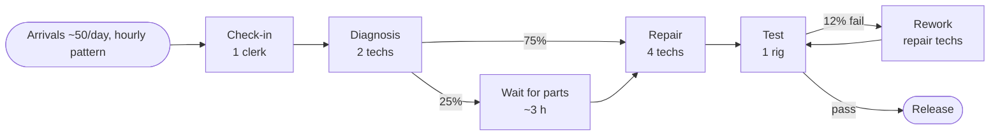

# Module 2 — Building the Model: Scope, Data and Assumptions

**Time:** 50 min

## Learning objectives

1. Define a model's purpose, scope and KPIs.
2. Collect the data a model needs.
3. Keep an assumptions log.

## 1. Start with the question

A model is built to answer a question, not to copy reality. Write it down:

> *Which change gets same-day on-time above 93% at the lowest cost, and how much demand growth can it absorb?*

The question decides the scope (check-in to release), the level of detail (individual jobs and technicians, not tool-level), and the KPIs (% within 8 h, mean and 90th-percentile lead time, utilization).

## 2. Conceptual model

## 3. Data needed

| Input | Source | Case value |
|---|---|---|
| Arrivals by hour | Check-in timestamps, 3 months | 3, 6, 8, 7, 5, 4, 5, 6, 4, 2 per hour (07:00–17:00) |
| Activity times (mean, CV) | Time study, system timestamps | Check-in 0.10 h (0.3); diag 0.45 h (0.6); repair 0.95 h (0.8); test 0.15 h (0.2) |
| Resources and schedules | Staffing roster | 1 clerk, 2 diag techs, 4 repair techs, 1 rig, until 21:00 |
| Branch probabilities | Job records | Parts wait 25%; test failure 12% |
| Parts wait time | Purchasing records | Mean 3 h, CV 0.5 |
| Rework time | Job records | ~40% of the original repair |

Collect raw data, not averages, so you can see the distribution. Watch for data that's recorded for other purposes (e.g., timestamps entered at shift end).

## 4. Assumptions log

| # | Assumption | Impact if wrong | Check |
|---|---|---|---|
| 1 | Arrival pattern is the same every weekday | Mondays may be heavier | Compare by weekday |
| 2 | All techs equally skilled | Pooling benefit overstated | Interview supervisor |
| 3 | Parts wait doesn't occupy a tech | Lead time right, utilization understated | Observe |
| 4 | Staff stay until all jobs are done | Late jobs could be left overnight in reality | Check overtime records |
| 5 | A job fails test at most once | Rare repeat failures ignored | Job records |

Share the log with stakeholders — it builds trust and invites corrections.

## Check yourself

Why not include every detail (each tool, each bench) in the first model?

Answer

Detail costs time and data, and hides insight. Model only what affects the question's KPIs; add detail when validation shows something important is missing (Module 3).

