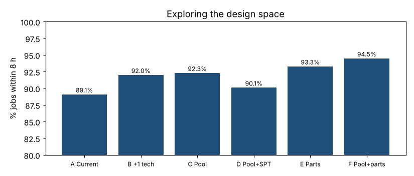

# Module 4 — Exploring the Design Space ("Build to Think")

**Time:** 45 min

## Learning objectives

1. Generate a wide range of design alternatives.
2. Compare them quickly with a model.
3. Recognize surprising results and use them to think.

## 1. Go wide before going deep

Experience suggests the obvious fix ("hire another tech"). A model makes it cheap to test many ideas — including ones that seem odd — before committing.

| Design | Change |
|---|---|
| A | Current |
| B | +1 repair technician |
| C | Cross-train all 6 techs into one pool (any tech diagnoses or repairs) |
| D | Pool + shortest-predicted-repair-first dispatch |
| E | Stock fast-moving parts (parts waits 25% → 8%) |
| F | Pool + stock parts |

## 2. Results (200 simulated days each)

```bash
python tools/procsim.py designs
```

| Design | Mean lead (h) | p90 lead (h) | On time |
|---|---|---|---|
| A Current | 4.80 | 8.19 | 88.7% |
| B +1 repair tech | 4.51 | 7.66 | 91.7% |
| C Cross-trained pool | 4.31 | 7.49 | 92.6% |
| D Pool + SPT dispatch | **3.88** | 7.89 | 90.3% |
| E Stock fast-moving parts | 4.33 | 7.34 | 93.2% |
| **F Pool + stock parts** | 4.10 | **7.06** | **94.4%** |



## 3. What the model taught us

- **The obvious fix isn't the best one.** Adding a technician (B) helps less than stocking parts (E) — the biggest delay wasn't capacity, it was waiting for parts.
- **Pooling beats adding.** Cross-training the same 6 people (C) outperforms adding a 7th to the existing structure: idle diagnosis capacity absorbs repair peaks.
- **Faster on average can be worse for customers.** SPT (D) has the lowest mean lead time but worse on-time performance than FIFO: long jobs keep getting passed over and break the promise (Module 6).
- **Combinations matter.** F combines two different mechanisms (flexibility + removing a delay) and beats either alone.

## Check yourself

Why might design D look best in a report that shows only average lead time?

<details><summary>Answer</summary>

SPT minimizes average waiting by finishing short jobs first, but it delays long jobs; the customer promise is about every job, so % within 8 h and the 90th percentile tell the real story.
</details>
