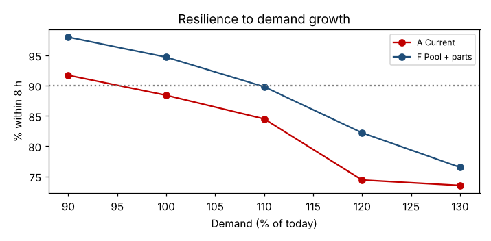

# Module 5 — Testing Processes for Resilience Against Variation

**Time:** 45 min

## Learning objectives

1. Stress-test a design against demand growth and higher variability.
2. Compare designs on robustness, not just on today's performance.

## 1. Why stress-test?

A design tuned to today's average conditions can collapse when demand grows, a key person is absent, or work gets more variable. Resilience testing asks: **how much can change before the promise breaks?**

## 2. Stress scenarios

```bash
python tools/procsim.py resilience
```

| Design | Stress | On time | p90 lead (h) |
|---|---|---|---|
| A Current | Demand today | 89.1% | 8.13 |
| A Current | Demand +10% | 83.4% | 9.04 |
| A Current | Demand +20% | 73.4% | 10.33 |
| A Current | Service-time variability ×1.5 | 85.0% | 8.93 |
| F Pool + parts | Demand today | 94.5% | 7.04 |
| F Pool + parts | Demand +10% | 88.3% | 8.34 |
| F Pool + parts | Demand +20% | 82.8% | 9.07 |
| F Pool + parts | Service-time variability ×1.5 | 92.8% | 7.38 |

(150 simulated days per scenario.)



## 3. Reading resilience

- Performance falls **non-linearly**: the first 10% of growth costs about 6 points, the next 10% about 10 more for the current design — a sign of a system near its limit.
- Design F stays near 90% on time at +10% demand (88–90% depending on how many days are simulated); the current design is below 90% already today.
- F is also much less sensitive to service-time variability (−1.7 points vs −4.1).
- Define a **trigger**: e.g., "when weekly demand exceeds 55/day for two weeks, add a flex technician" — the model tells you where the trigger should be.

## Check yourself

Why compare designs under stress rather than only at today's demand?

<details><summary>Answer</summary>

Designs that perform similarly today can differ greatly when conditions change; the one that degrades gracefully protects the customer promise and avoids emergency fixes.
</details>
