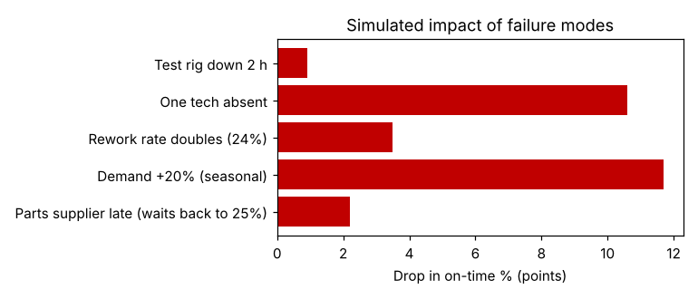

# Module 7 — Identifying Risks and Building FMEAs with a Model

**Time:** 45 min

## Learning objectives

1. Use a model to estimate the impact of failure modes.
2. Feed simulated impacts into an FMEA.

## 1. Why model failure modes?

FMEA severity scores are usually team judgment. A model can **quantify** how much each failure mode hurts the customer KPI — often correcting intuition.

## 2. Simulated impacts (design F)

```bash
python tools/procsim.py fmea
```

Baseline on time: **94.5%**.

| Failure mode | On time | Drop (points) |
|---|---|---|
| Demand +20% (seasonal) | 82.8% | **11.7** |
| One technician absent | 83.9% | **10.6** |
| Rework rate doubles (12% → 24%) | 91.0% | 3.5 |
| Parts supplier late (waits back to 25%) | 92.3% | 2.2 |
| Test rig down 2 h | 93.6% | 0.9 |



**Surprise:** the team had rated the test rig breakdown as the most severe risk ("it's our only rig"). The model shows the rig has so much spare capacity that a 2-hour outage costs under 1 point. Technician absence and demand peaks are the real threats.

## 3. Into the FMEA

| Failure mode | Effect (from model) | S | O | D | RPN | Action |
|---|---|---|---|---|---|---|
| Tech absent | −10.6 pts on time | 8 | 6 | 3 | 144 | Cross-train a flex tech from assembly; on-call list |
| Demand surge | −11.7 pts | 8 | 4 | 4 | 128 | Demand trigger (Module 5); overflow agreement with partner shop |
| Rework doubles | −3.5 pts | 5 | 3 | 5 | 75 | Root cause on test failures; test before final assembly |
| Parts late | −2.2 pts | 4 | 5 | 4 | 80 | Supplier kanban for stocked parts |
| Rig down 2 h | −0.9 pts | 2 | 4 | 2 | 16 | Preventive maintenance as planned; no extra rig |

Severity is scaled from the simulated drop; occurrence and detection still come from records and team knowledge. (Full FMEA method: *Design for Six Sigma*, Module 6.)

## Check yourself

Why can a model change the FMEA priorities?

<details><summary>Answer</summary>

It measures the effect of each failure on the customer KPI, including spare capacity and interactions the team can't judge reliably, so severity is based on evidence rather than perception.
</details>
