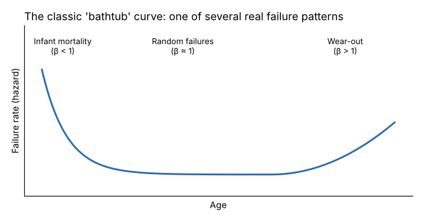

# Module 00 — Introduction and Foundations of Reliability Excellence

## Objectives

- Define reliability, availability and maintainability, and the core vocabulary.
- Describe the reliability engineer's role and how it differs from maintenance planning.
- Explain why reliability needs partnerships across departments.

## Core definitions

- **Reliability** — the probability that an item performs its required function, under stated conditions, for a stated period. Four parts matter: *probability*, *function*, *conditions*, *time*. "The pump is reliable" means nothing; "the coolant pump has a 77 % chance of running a 500-hour month without failure at current duty" is a reliability statement.
- **Failure** — loss of a required function (or performance below an acceptable standard). Defining the function and its standard comes first; "running but leaking oil onto the floor" may be a failure.
- **Failure mode** — the way an item fails (bearing spall, seal leak, encoder fault).
- **Maintainability** — how quickly and easily an item can be restored (measured by mean time to repair, MTTR).
- **Availability** — the fraction of time an item is able to perform when needed. It depends on both reliability (how often it fails) and maintainability (how long it's down).
- **Hazard rate** — the instantaneous failure rate of units that have survived to a given age.

## Failure patterns

The "bathtub" curve combines early-life failures (installation errors, defects), a period of random failures, and wear-out. Studies of equipment fleets (notably in aviation, which led to Reliability-Centered Maintenance) found that many complex items **do not** show a wear-out zone at all — their failures are random or concentrated early. **Consequence: replacing parts on a fixed schedule helps only when there is a clear wear-out pattern.** Modules 05–06 and 09 show how to tell from data.

## The reliability engineer's role

| Reliability engineer | Maintenance planner / supervisor |
|---|---|
| Long-term: eliminate failures and their causes | Short-term: plan and schedule the work |
| Analyzes failure data, Weibull, Pareto, RCA | Manages backlog, parts kits, crew assignments |
| Designs PM/PdM strategy (what, how often, why) | Executes the strategy |
| Specifies reliability in new equipment purchases | Installs and commissions |
| Measures program effectiveness | Measures schedule compliance |

The reliability engineer is a **problem eliminator**, not a fire-fighter. A useful rule: if more than about half the engineer's week goes to emergency breakdowns, the role has been absorbed by reactive work.

## Reliability excellence and partnerships

Reliability is not a maintenance-department outcome. Failures are caused or prevented across the organization:

| Partner | Their influence on reliability | What you need from them |
|---|---|---|
| Operations | operating within design limits, cleaning, inspecting, early reporting | autonomous maintenance (Module 04), failure reports |
| Engineering / projects | design, specification, installation | design-for-reliability reviews, acceptance testing |
| Purchasing / stores | spare-part quality and availability, supplier choice | life-cycle-cost purchasing, critical spares stocked |
| Quality | defect data, measurement | link quality losses to equipment condition |
| Finance | budget, capital approval | reliability economics in their language (Module 07) |
| Safety / environment | risk tolerance | joint risk assessment (Module 01) |

## Running case

**Lakeshore Components** (fictional) runs **Line A**: a hydraulic press, a grinder with a high-speed spindle, a coolant system, a transfer conveyor and a robot loader. Twelve months of work orders (`data/work_orders.csv`) record 88 corrective jobs, 364 hours of downtime and about $122,000 in repair cost. Your job is to build a reliability program for the line.

All data is simulated with fixed seeds (`python tools/relkit.py data`).

## Check yourself

1. Rewrite "the press is unreliable" as a reliability statement.
2. Why does the definition of failure start with the definition of function?
3. A plant replaces every motor at 5 years. When could that make reliability worse?

Answers

1. For example: "The press has a 70 % probability of running a 3-shift week without a stoppage over 15 minutes at current tonnage and cycle rate."
2. An item fails when it no longer does what the user needs, at the needed standard. Without a stated function and standard, people argue about whether something "failed."
3. If motors fail randomly or mainly in early life, replacement adds new early-life risk (installation errors, defective new units) without reducing random failures.

