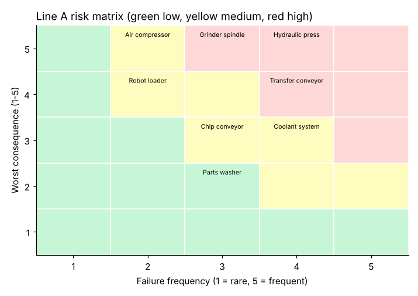

# Module 01 — Risk Management and Risk-Based Asset Management

## Objectives

- Apply risk = likelihood × consequence to equipment.
- Rank assets by criticality and decide where reliability effort goes first.
- Explain risk-based asset management and its link to business objectives.

## Risk fundamentals

**Risk** combines how likely a failure is and how bad it would be. A standard process:

1. **Identify** — what can fail, how (failure modes), and what happens.
2. **Analyze** — estimate likelihood and consequence.
3. **Evaluate** — compare with risk tolerance; rank.
4. **Treat** — avoid, reduce (likelihood or consequence), transfer, or accept.
5. **Monitor and review** — risks change as equipment ages and production changes.

Consequences are multi-dimensional: **safety and environment** first, then production, quality, repair cost. A failure with any severe safety consequence is high-risk regardless of production impact.

## Asset criticality ranking

Lakeshore scored each Line A asset 1–5 on each consequence and on failure frequency (`data/asset_register.csv`). Two ways to combine them:

- **Simple risk** = worst consequence × frequency
- **Weighted score** = (0.35 × production + 0.20 × quality + 0.10 × repair cost + 0.35 × safety/environment) × frequency

(Weights are a local policy choice — agree them with operations, safety and finance before scoring.)

| Asset | Worst consequence | Frequency | Simple risk | Weighted score | Class |
|---|---|---|---|---|---|
| Hydraulic press | 5 | 4 | 20 | 17.00 | A |
| Grinder spindle | 5 | 3 | 15 | 10.95 | A |
| Transfer conveyor | 4 | 4 | 16 | 9.00 | B |
| Coolant system | 3 | 4 | 12 | 8.80 | B |
| Robot loader | 4 | 2 | 8 | 6.50 | B |
| Parts washer | 2 | 3 | 6 | 6.00 | C |
| Chip conveyor | 3 | 3 | 9 | 5.70 | C |
| Air compressor | 5 | 2 | 10 | 5.20 | C |

Classes: A > 10, B > 6 to 10, C ≤ 6.



Note the **air compressor**: low weighted score, but worst consequence 5 (the whole plant stops). Weighting can hide a single catastrophic consequence. Good practice: **any asset with a top consequence score gets reviewed individually** — perhaps it needs a spare compressor (reduce consequence) rather than more PM (reduce likelihood).

## What criticality drives

| Class | Typical strategy |
|---|---|
| A | Formal RCM or FMEA; condition monitoring; critical spares; priority response; RCA on every failure |
| B | Standard PM and inspections; RCA on repeat failures; PdM where cost-effective |
| C | Simple inspections or run-to-failure where safe and cheap |

## Risk-based asset management

**Asset management** is the coordinated activity of an organization to realize value from its assets over their whole life — from planning and purchase through operation, maintenance and disposal. The international standard series for asset management is ISO 55000 (verify the current edition). The key ideas:

- decisions are **traceable to business objectives** (output, cost, safety);
- **risk** is the common language for comparing very different decisions (overhaul the press vs buy a spare pump vs train operators);
- decisions consider the **whole life cycle**, not just this year's budget (Module 07).

## Run it

```bash
python tools/relkit.py criticality
python tools/make_figures.py
```

## Check yourself

1. Why should safety be scored even if no failure has ever hurt anyone?
2. The press and the spindle are class A. What does that change in practice next month?
3. How would you reduce the air compressor's risk without changing its failure frequency?

<details><summary>Answers</summary>

1. Risk is about potential consequence. A hydraulic-hose burst may not have injured anyone yet, but its credible worst outcome is serious.
2. Every failure on them gets a root-cause analysis; they get condition monitoring and critical spares reviewed; their PM tasks get an RCM-style review first.
3. Reduce consequence: a standby or rental compressor, an air receiver sized to ride through a short outage, or a quick-change spare motor.

</details>
