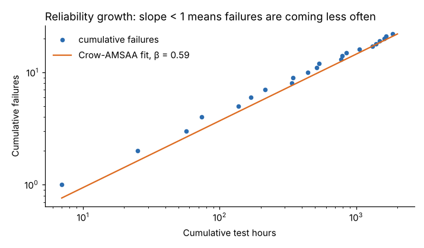

# Module 02 — Design, Asset Lifecycle and Reliability Modeling

## Objectives

- Apply design-for-reliability principles to equipment specification.
- Build in reliability during purchase, installation and commissioning.
- Model system reliability with series, parallel and k-out-of-n block diagrams.
- Track reliability growth during testing.

## Most reliability is decided before the equipment arrives

Design and installation choices lock in most of the failure behavior and life-cycle cost. Fixing reliability after start-up is far more expensive than specifying it.

## Design-for-reliability principles

| Principle | Example on Line A |
|---|---|
| Simplify — fewer parts, fewer failure modes | one servo axis instead of a cam plus clutch |
| Derate — run components below their rated stress | motors at ≤ 80 % of rated load; bearings sized for higher-than-actual load |
| Redundancy where failure consequence is high | a second coolant pump (see below) |
| Design out known failure modes | sealed-for-life bearings where contamination is the main killer |
| Design for maintainability | quick-change spindle cartridge; access panels; standard fasteners |
| Design for condition monitoring | vibration mounting pads, oil sample ports, thermography windows |
| Error-proof installation and maintenance | keyed connectors, color-coded lubrication points |
| Standardize | same pumps and motors across lines → fewer spares, more data |

## Purchase, installation, maintenance considerations

- **Purchase specification:** state reliability and maintainability requirements (e.g. target MTBF, MTTR, spare-parts list, documentation, condition-monitoring points), and ask suppliers for failure data. Compare options on life-cycle cost (Module 07), not price.
- **Installation:** precision alignment and balancing, correct foundation and grouting, clean lubrication, torque to spec. Poor installation is a major source of early-life failures.
- **Commissioning and acceptance:** run-in tests, baseline vibration and thermography readings, verification against the specification **before** sign-off.
- **Maintenance readiness:** PM plan, spares, training and drawings ready at handover — not six months later.

## Reliability block diagrams (RBD)

Using one-month reliabilities (illustrative):

| Subsystem | Press | Grinder | Coolant pump | Conveyor | Robot |
|---|---|---|---|---|---|
| R (1 month) | 0.95 | 0.92 | 0.90 | 0.97 | 0.94 |

**Series** (all must work): R_sys = product of R's = **0.7172**. A line of individually "good" machines has only a 72 % chance of a failure-free month.

**Parallel** (1-out-of-2, either pump can do the job): R = 1 − (1 − 0.90)² = **0.99**. Adding a standby pump raises the line from 0.7172 to **0.7889**.

**k-out-of-n** (e.g. at least 2 of 3 level sensors must agree): R = Σ_{k=2}^{3} C(3,k) 0.9^k 0.1^{3−k} = **0.972**.

Lessons: the system is never more reliable than its weakest series element (here the coolant pump); redundancy is most valuable on the weakest, highest-consequence element; redundancy only works if the standby unit is itself maintained and tested.

## Reliability growth during testing

When a new or redesigned machine is debugged, failures should become less frequent as fixes are made. The **Crow-AMSAA** model plots cumulative failures against cumulative time on log-log axes; a straight line with slope β < 1 shows growth.

Lakeshore tested a redesigned conveyor gearmotor for 2,000 hours (`data/gearmotor_growth_test.csv`):

| Result | Value |
|---|---|
| Failures | 22 |
| β | 0.595 (< 1: reliability is growing) |
| Cumulative MTBF at 2,000 h | 90.9 h |
| Instantaneous (current) MTBF at 2,000 h | 152.8 h |



The current MTBF is well above the cumulative average because early failures were fixed. If the target is 500 h, the test needs to continue with more fixes — the model can project how long that takes if the growth rate holds.

## Run it

```bash
python tools/relkit.py rbd
python tools/relkit.py growth
```

## Check yourself

1. Five machines in series each have R = 0.98. What is the line's reliability?
2. Why can adding a redundant unit fail to improve reliability in practice?
3. During a growth test β comes out at 1.05. What does that tell you?

<details><summary>Answers</summary>

1. 0.98⁵ = 0.904.
2. Common-cause failures (both pumps share a clogged suction strainer or a power supply), a standby unit that has failed unnoticed, or switchover that doesn't work.
3. No growth — failures are not becoming less frequent (or slightly more frequent). The fixes aren't addressing the real failure modes; stop and do RCA.

</details>
