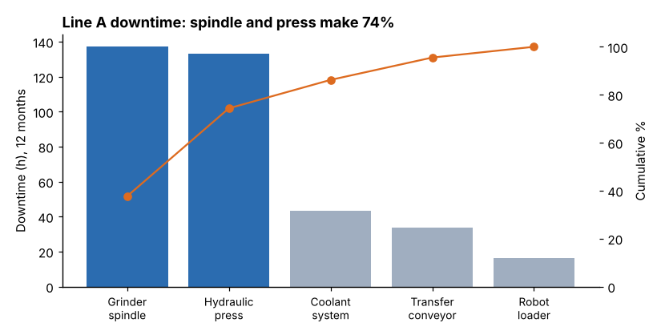
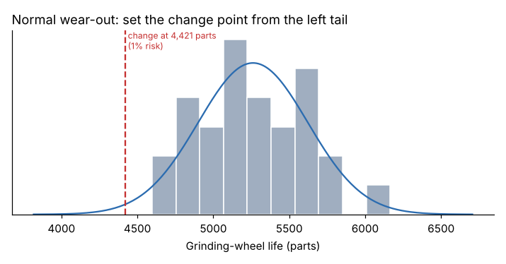

# Module 05 — Reliability Statistics: Pareto, Exponential and Normal

## Objectives

- Use Pareto analysis of failure data to focus effort.
- Model random failures with the exponential distribution: MTBF, confidence intervals, mission reliability, Poisson counts.
- Model wear-out with the normal distribution and set replacement points.

## Pareto analysis of failures

Twelve months of Line A work orders: 88 failures, 363.7 h downtime, $121,740 repair cost.

| Asset | Failures | Downtime (h) | Downtime % | Cumulative % |
|---|---|---|---|---|
| Grinder spindle | 12 | 137.1 | 37.7 | 37.7 |
| Hydraulic press | 17 | 133.3 | 36.7 | 74.3 |
| Coolant system | 26 | 43.1 | 11.9 | 86.2 |
| Transfer conveyor | 21 | 33.9 | 9.3 | 95.5 |
| Robot loader | 12 | 16.3 | 4.5 | 100.0 |



**Top five failure modes by downtime** (76.2 % of all downtime): spindle bearing failure 119.4 h; press pump wear 63.7 h; press seal leak 47.1 h; coolant pump failure 24.6 h; press valve stuck 22.5 h.

**Most frequent modes** tell a different story: coolant filter clogged (14), conveyor belt tracking (11), press seal leak (9). These are quick fixes individually but a steady drain on technician time and a sign of missing basic care.

**Always Pareto by more than one measure** — count, downtime, cost — and at the failure-mode level, not just the asset. The spindle bearing ranks first by downtime with only 5 failures.

## Exponential distribution: random failures

If failures occur at a **constant rate** λ, regardless of age:

- R(t) = e^(−λt), MTBF = 1/λ
- the number of failures in time t follows a Poisson distribution with mean λt
- **age doesn't matter**: a used unit is as good as a new one, so scheduled replacement doesn't help.

**Coolant pump** (14 failures in 27,292 operating hours):

| Result | Value |
|---|---|
| MTBF | 27,292 / 14 = **1,949 h** |
| 90 % confidence interval for MTBF (chi-square, 2r df) | **1,320 to 3,225 h** |
| Failure rate | 0.513 per 1,000 h |
| R(500 h) — a 500-hour production month without failure | e^(−500/1,949) = **0.774** |
| P(0, 1, ≥ 2 failures in a month) | 0.774, 0.198, 0.028 |

The confidence interval is wide even with 14 failures — a single MTBF number conceals a lot of uncertainty.

Is the exponential model right? Check: plot cumulative failures against cumulative time (a straight line suggests constant rate) or fit a Weibull and check whether β is close to 1.

## Normal distribution: wear-out

Items that wear steadily — tool edges, grinding wheels, brake linings — often have lives roughly normally distributed around a mean.

**Grinding wheels** (30 wheels): mean life 5,261 parts, SD 361 parts (Shapiro–Wilk p = 0.80, no evidence against normality).

| Planned change at | P(wheel fails first) |
|---|---|
| 4,800 parts | 10.1 % |
| 4,500 parts | 1.75 % |
| 4,200 parts | 0.16 % |
| **Change point for 1 % risk** | **4,421 parts** |



The trade-off: changing earlier wastes wheel life; changing later risks burn and scrap. The right point depends on the costs — Module 09 formalizes this.

## Run it

```bash
python tools/relkit.py pareto
python tools/relkit.py exponential
python tools/relkit.py normal
```

## Check yourself

1. Compute R(1,000 h) for the coolant pump.
2. Why would replacing the coolant pump every 1,500 h not improve its reliability?
3. The wheel SD drops to 200 parts after a dressing improvement. What change point gives 1 % risk now?

<details><summary>Answers</summary>

1. e^(−1,000/1,949) = 0.599.
2. Under a constant hazard, a new pump is no less likely to fail in the next hour than a 1,500-hour-old one; replacement costs money and adds installation risk.
3. 5,261 − 2.326 × 200 ≈ 4,796 parts — a smaller spread lets you use more of each wheel safely.

</details>
