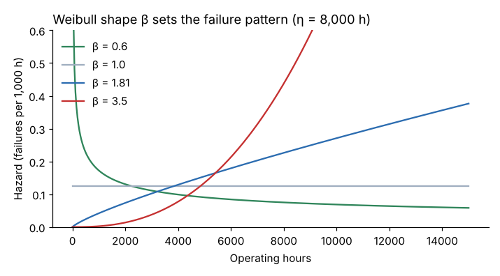
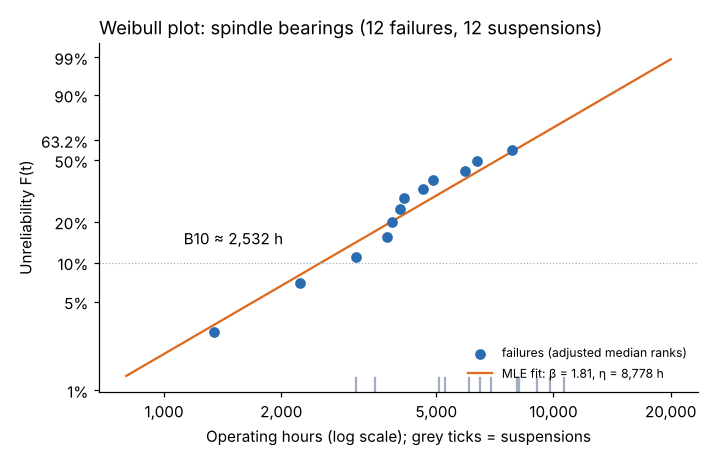

# Module 06 — Weibull Analysis

## Objectives

- Interpret the Weibull shape (β) and scale (η) parameters.
- Fit a Weibull model to life data that includes suspensions.
- Calculate B-lives, reliability at a given age and mean life, and use them in decisions.

## The Weibull distribution

R(t) = exp[−(t/η)^β]

- **η (scale, characteristic life):** the age by which 63.2 % of units have failed.
- **β (shape):** the failure pattern.

| β | Hazard | Typical meaning | Maintenance implication |
|---|---|---|---|
| < 1 | falling | infant mortality: installation, manufacturing, start-up problems | improve installation, burn-in, quality of rebuilds; age replacement makes it worse |
| ≈ 1 | constant | random: overloads, external events | condition monitoring, redundancy; no age replacement |
| 1 to ~4 | rising | early wear-out: fatigue, bearings | age replacement may pay; condition monitoring often better |
| > ~4 | rising fast | rapid wear-out near a predictable age | age replacement works well |



## Suspensions matter

Life data almost always contains **suspensions** (right-censored units): units still running at the data cut-off, or removed for reasons other than the failure mode under study (planned rebuild, a different failure mode). Ignoring them — or worse, treating them as failures — biases the result badly. Methods that handle them correctly:

- **Maximum likelihood estimation (MLE)** — uses failures and suspensions directly. Preferred with heavy censoring.
- **Rank regression with adjusted ranks** (Johnson's method + Benard's approximation) — the traditional Weibull plot. Good for visual checks.

## Worked example: spindle bearings

Twenty-four spindle bearings (`data/spindle_bearing_life.csv`): **12 failures, 12 suspensions**.

| Result | Value |
|---|---|
| MLE β | **1.81** |
| MLE η | **8,778 h** |
| B10 life (10 % fail by) | **2,532 h** |
| Mean life | 7,804 h |
| R(4,000 h) | 0.786 |
| Rank-regression check (β, η) | 2.06, 7,785 h |



Reading it:

- **β = 1.81 > 1**: the hazard rises with age — a wear-out pattern, typical of rolling-contact fatigue. Age-based action *can* help (Module 09).
- **B10 = 2,532 h**: 10 % of bearings fail by about 2,500 hours — much earlier than the 7,800-hour mean suggests. If a single unplanned spindle failure costs $22,000 (Module 09), the early tail matters.
- The two fitting methods differ (β 1.81 vs 2.06). With 12 failures, that's normal; report the MLE and note the uncertainty. Confidence bounds on β with this little data are wide.

An independent check with SciPy's censored-data fit (`scipy.stats.weibull_min.fit` on `CensoredData`) gives the same MLE (β 1.81, η 8,778).

## Practical tips

- **One failure mode per analysis.** Mixing bearing failures with encoder faults blends two distributions and produces a misleading β. Treat other modes as suspensions.
- **Use the right "age"**: operating hours, cycles or parts — not calendar time if utilization varies.
- **Small samples**: with fewer than about 5–10 failures, consider fixing β from experience (Weibayes) and estimating only η.
- **Doglegs or curves on the plot** suggest mixed failure modes, a failure-free period (three-parameter Weibull) or data errors.

## Run it

```bash
python tools/relkit.py weibull
python tools/make_figures.py
```

## Check yourself

1. Compute R(2,000 h) for the spindle bearing.
2. What is the B1 life (1 % fail)?
3. A Weibull of press seal leaks gives β = 0.7. What actions would you look at first?

<details><summary>Answers</summary>

1. exp[−(2,000/8,778)^1.81] = exp(−0.0688) ≈ 0.934.
2. t = η(−ln 0.99)^(1/β) = 8,778 × (0.01005)^(0.5525) ≈ 690 h.
3. Infant mortality: seal installation practice, seal and rod surface quality, contamination during rebuild, correct seal material for the oil. Don't add age-based seal replacement — it would add more early-life failures.

</details>
