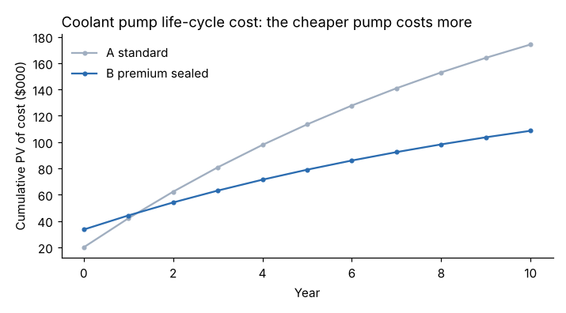
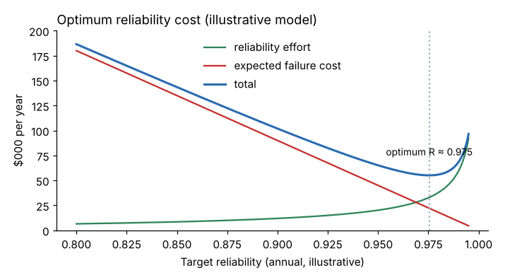

# Module 07 — Reliability Economics

## Objectives

- Compare equipment options by life-cycle cost (LCC).
- Express reliability improvements as ROI, payback, benefit–cost ratio and net return.
- Explain the optimum-reliability-cost trade-off.

## Life-cycle cost

LCC = PV of all costs over the asset's life: purchase + installation + energy + maintenance + failures (repair, downtime, scrap) + disposal − salvage.

Purchase price is often a small share of LCC for rotating equipment; energy and failure costs dominate.

## Worked example: coolant pump options

Ten years, 6,000 operating hours a year, discount rate 9 %. Each failure costs $6,500 (parts, labor, grinder downtime and scrap). All inputs illustrative.

| | A standard | B premium sealed |
|---|---|---|
| Price + installation | $20,000 | $33,500 |
| MTBF | 2,200 h | 6,000 h |
| Failures per year | 2.73 | 1.00 |
| Energy per year | $5,400 | $4,600 |
| PM per year | $900 | $600 |
| **Annual operating cost** | **$24,027** | **$11,700** |
| **LCC (PV of costs, 10 yr)** | **$174,199** | **$108,587** |



**Incremental view (B − A):**

| Measure | Formula | Value |
|---|---|---|
| Extra investment | | $13,500 |
| Annual saving | | $12,327 |
| Simple payback | 13,500 / 12,327 | **1.10 years** |
| ROI (simple, annual) | 12,327 / 13,500 | **91.3 %** |
| Benefit–cost ratio | PV of savings / extra investment | **5.86** |
| Net return (NPV) | PV of savings − extra investment | **$65,612** |

The "expensive" pump is $65,600 cheaper over its life. Purchasing on price alone would choose A. That is why reliability engineers must speak finance: the case is made in LCC and NPV, not MTBF.

## The optimum reliability cost

Spending on reliability (better design, PM, PdM, spares, training) reduces expected failure cost — but each further gain costs more. Total cost has a minimum.

Illustrative model: effort cost rises steeply as reliability approaches 1; expected failure cost falls linearly.

| Target reliability | Total annual cost |
|---|---|
| 0.85 | $143,500 |
| **0.975 (optimum)** | **$55,100** |
| 0.99 | $68,400 |



Two lessons:

1. **Most plants operate to the left of the optimum** (too little reliability effort) — reactive, failure costs high.
2. **Perfect reliability is not the goal.** Beyond the optimum, effort costs more than the failures it prevents — unless safety requires it, in which case the "cost" of failure is not just money.

The shape of these curves is plant-specific; the model here only illustrates the logic.

## Getting the cost of failure right

Downtime cost is usually the largest and most argued-over element. Agree with finance how to value it:

- **Bottleneck** equipment: lost contribution margin on sales that can't be recovered (Financial Management for Engineers, Module 12).
- **Non-bottleneck** with spare capacity: overtime to catch up, not lost sales.
- Plus scrap, expediting, customer penalties, safety and environmental costs.

## Run it

```bash
python tools/relkit.py lcc
python tools/relkit.py optimum
```

## Check yourself

1. If each failure cost $3,000 instead of $6,500, would B still win?
2. Why use the benefit–cost ratio when ranking many small reliability projects?
3. Why might a plant rationally run a non-critical conveyor to failure?

<details><summary>Answers</summary>

1. Annual failure cost: A 2.73 × 3,000 = $8,182; B $3,000. Annual operating cost A = 8,182 + 5,400 + 900 = $14,482; B = 3,000 + 4,600 + 600 = $8,200; saving $6,282/yr. PV at 9 % for 10 years = 6,282 × 6.418 = $40,316 vs $13,500 extra — B still wins (NPV ≈ $26,800).
2. With a limited budget, ranking by benefit per dollar spent (B/C or profitability index) maximizes total benefit.
3. When the cost of failure (repair plus downtime) is lower than the cost of preventing it, and there's no safety or environmental consequence.

</details>
