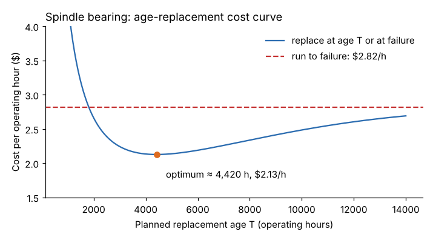

# Module 09 — Preventive Maintenance Optimization

## Objectives

- Review an existing PM program and remove, change or add tasks based on failure behavior.
- Calculate the optimum age-replacement interval from a Weibull model and costs.
- Convert time-based tasks to condition-based where it pays.

## Why PM programs need optimizing

Typical PM programs grow by accretion: OEM manuals, "after that failure, add a check", duplicated tasks, vague wording ("inspect pump"). Common findings in a PM review:

- tasks that address failure modes that **don't occur** or have **random** patterns (age replacement can't help);
- intervals set by calendar, not by usage or condition;
- **intrusive** tasks that cause failures (disturbing a working machine introduces errors);
- vague tasks with no acceptance criteria;
- important failure modes with **no** task at all.

## A PM optimization (PMO) process

1. List existing tasks for the asset (CMMS export).
2. Map each task to the failure mode it addresses; flag tasks with no failure mode.
3. Add failure modes from the failure history (Module 05), RCA (Module 08) and an RCM review (Module 04) that have no task.
4. For each failure mode, choose the task type by RCM logic: condition-based, time-based, failure-finding, redesign, run-to-failure.
5. Set intervals: from Weibull and costs (below), the P-F interval (Module 10), or failure-finding formulas for hidden failures.
6. Write tasks with clear steps and **acceptance limits** ("vibration velocity ≤ 4.5 mm/s RMS", not "check vibration").
7. Assign to operators (simple checks) or technicians; package into routes.
8. Measure results and review annually.

## Optimum age replacement

For a wear-out failure mode, replacing at age T (or at failure, if earlier) gives a long-run **cost per operating hour**:

C(T) = [C_p × R(T) + C_f × (1 − R(T))] / ∫₀ᵀ R(t) dt

where C_p is the planned replacement cost and C_f the failure cost (repair + downtime + scrap + secondary damage). Age replacement pays only if **β > 1** and **C_f is well above C_p**.

**Spindle bearings** (Weibull β = 1.81, η = 8,778 h from Module 06):

- planned rebuild C_p = $4,000; in-service failure C_f = $22,000 (illustrative).

| Replace at age | Cost per hour |
|---|---|
| 2,000 h | $2.662 |
| 3,000 h | $2.243 |
| 4,000 h | $2.134 |
| **4,420 h (optimum)** | **$2.127** |
| 5,000 h | $2.138 |
| 6,000 h | $2.189 |
| 8,000 h | $2.337 |
| Run to failure | $2.819 |

- Optimum ≈ **4,420 h**, cost 24.5 % below run-to-failure — about **$4,200 per spindle per year** at 6,000 h/yr.
- The curve is **flat** between about 3,500 and 5,500 h (within 2 % of the minimum: $2.17/h and $2.16/h at the ends), so align the rebuild with a convenient planned shutdown in that window.
- At 4,420 h, about 25 % of bearings would still fail before their planned rebuild (R = 0.75). Age replacement alone leaves significant risk — which is why condition monitoring (Module 10), which can catch most of those failures with warning, is often the better primary strategy for bearings.

A brute-force grid search in steps of 10 h gives the same optimum (4,420 h, $2.127/h).

## Time-based to condition-based

When a failure mode gives warning (bearing vibration, oil degradation, temperature rise), monitoring condition and acting on the signal usually beats a fixed interval: you get almost all of each part's life and catch early failures too. The P-F interval sets the inspection frequency (Module 10).

## Check yourself

1. Why is there no optimum replacement age for the coolant pump?
2. C_f rises to $40,000 because a spindle crash now damages the housing. Will the optimum age go up or down?
3. Rewrite "Inspect hydraulic unit" as a proper PM task.

Answers

1. Its failures are random (constant hazard; exponential), so cost per hour is lowest at T → ∞ — run to failure, with condition monitoring and redundancy instead.
2. Down — when failure is more expensive, it pays to replace earlier. With C_f = $40,000 the optimum moves from about 4,420 h to about 2,970 h, and the saving vs run-to-failure grows.
3. Example: "With unit running at operating temperature: (1) Oil level between sight-glass marks; (2) Oil temperature ≤ 55 °C; (3) Filter Δp indicator green; (4) No visible leaks at pump, manifold and cylinder fittings — wipe and recheck in 5 min; (5) Record readings. Raise a work order if any limit is exceeded."

