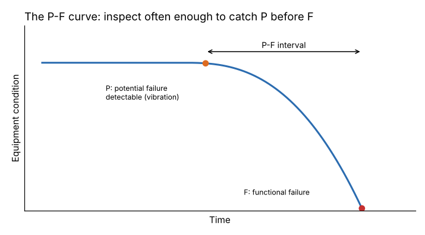

# Module 10 — Predictive Maintenance Technologies

## Objectives

- Explain the P-F interval and set inspection frequencies from it.
- Describe five predictive maintenance (PdM) technologies, what each detects and where it fits.
- Select the right technology for a failure mode and build a PdM route.

## The P-F interval



- **P** — the point where a developing failure first becomes **detectable** by a given technology.
- **F** — functional failure.
- **P-F interval** — warning time between them. It differs by failure mode *and* by technology (vibration analysis detects a bearing defect far earlier than a technician's ear).

**Inspection interval:** a common rule is to inspect at **no more than half the P-F interval**, which guarantees at least one inspection inside the window and leaves at least half the interval to plan and act.

Spindle bearing, vibration analysis, P-F interval about 1,200 h (illustrative):

| Inspection interval | Inspections inside the P-F window | Worst-case warning |
|---|---|---|
| 1,200 h | 1 (may miss) | ~0 h |
| **600 h (P-F/2)** | **≥ 1** | **≥ 600 h** |
| 400 h | ≥ 2–3 | ≥ 800 h |

At 6,000 h/yr, P-F/2 means about **10 vibration readings a year** on the spindle — a monthly route. If the P-F interval is short or erratic, continuous online monitoring is needed.

## Five PdM technologies

| Technology | Detects | Typical applications on Line A | Notes |
|---|---|---|---|
| **Vibration analysis** | imbalance, misalignment, looseness, bearing and gear defects | grinder spindle, coolant pumps, conveyor gearmotor, press pump | the core rotating-equipment technology; spectra identify the fault type |
| **Infrared thermography** | abnormal heat: loose or overloaded electrical connections, bearing friction, blocked coolers, insulation loss | electrical panels, motor control centers, press hydraulic cooler, motor bearings | non-contact; electrical surveys need trained, qualified people and appropriate safety precautions |
| **Oil analysis** | wear metals, contamination (water, dirt, coolant), oil degradation | hydraulic press, gearboxes | detects wear long before vibration in many gearbox and hydraulic failures; also tells you when oil does *not* need changing |
| **Ultrasound (airborne / structure-borne)** | compressed-air and gas leaks, early bearing friction and lubrication state, electrical arcing, valve passing, steam traps | air system, slow-speed bearings, regreasing ("grease until the signal drops"), electrical cabinets | cheap and fast; good starter technology |
| **Motor circuit / current signature analysis** | stator and rotor faults, insulation deterioration, power quality, some driven-load problems | conveyor and pump motors, spindle motor | can be done from the motor control center without accessing the motor |

Other techniques: process-parameter trending (pressure, flow, power), wear measurement, visual inspection with acceptance limits, and, increasingly, low-cost wireless sensors with automated alerts.

## Choosing a technology

1. Start from the **failure mode** (from RCM/FMECA), not the gadget.
2. Ask which technology detects that mode, with what P-F interval.
3. Check cost: equipment, training, and analyst time against the value of the warning (avoided failure cost, Module 07).
4. Define **alarm limits** and the **action** for each alarm level — a measurement nobody acts on is waste.
5. Measure success: share of failures caught by PdM before F; avoided-cost log.

## Line A PdM plan (example)

| Asset | Failure mode | Technology | Interval |
|---|---|---|---|
| Grinder spindle | bearing defect | vibration (online sensor + monthly analysis) | continuous / monthly |
| Hydraulic press | pump wear, contamination | oil analysis; vibration on pump | monthly / monthly |
| Press and line electrics | loose connections | thermography | quarterly |
| Coolant pumps | bearing defect | vibration route | monthly |
| Air system | leaks | ultrasound survey | quarterly |
| Conveyor motors | winding insulation | motor circuit analysis | semi-annual |

## Run it

```bash
python tools/relkit.py pf
```

## Check yourself

1. A failure mode has a P-F interval of 4 weeks with vibration but 3 days by ear. What inspection interval does each require?
2. Why can oil analysis reduce oil-change costs?
3. Which technology would you start with in a plant with no PdM and a large compressed-air bill?

<details><summary>Answers</summary>

1. Vibration: every 2 weeks or less. By ear: at least every 1.5 days — impractical, which is why the technology matters.
2. It shows oil condition directly, so oil is changed when it is degraded or contaminated rather than on a fixed schedule that may be too early.
3. Ultrasound: a leak survey pays back quickly and the same instrument supports lubrication and bearing checks.

</details>
