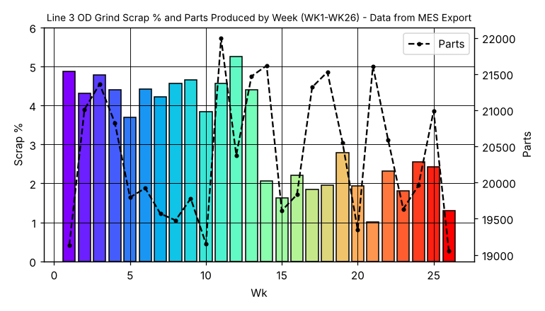
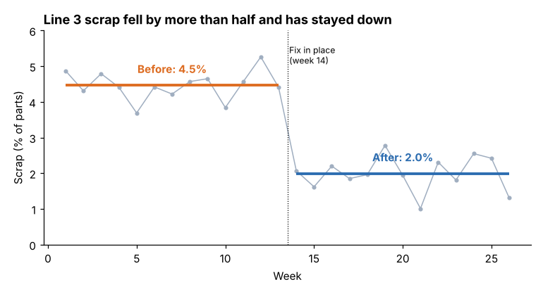
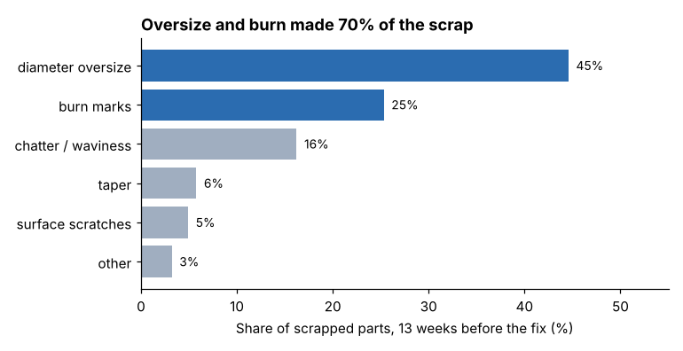
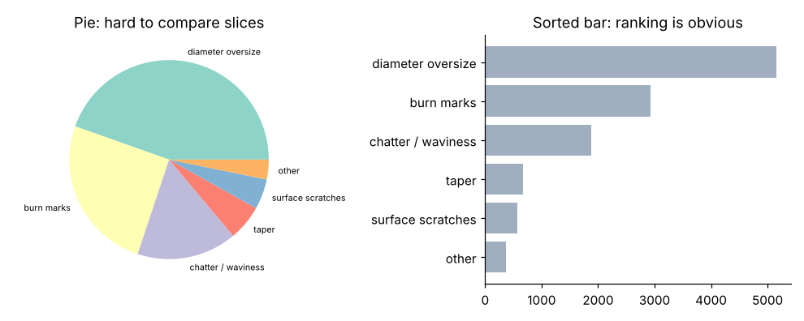

# Module 05 — Data in Presentations

## Objectives

- Choose the right chart for the message.
- Remove clutter and direct attention with titles, labels and color.
- Present numbers in context and show uncertainty honestly.

## Start from the message, not the data

Every chart should answer one question. Write the answer as the chart's title, then design the chart to make that answer obvious.

| Message type | Chart | Avoid |
|---|---|---|
| Change over time | line chart (run chart) | bars for long series; dual axes |
| Ranking / comparison of categories | sorted horizontal bars | pie charts with many slices; 3-D |
| Part of a whole | sorted bar or stacked bar; pie only for 2–3 parts | donuts with many parts |
| Before vs after | line with phase means, or two bars with intervals | separate charts with different scales |
| Relationship between two variables | scatter plot | connecting unordered points with lines |
| Distribution | histogram, box plot | averages alone |
| Exact values to look up | a small table | a chart that forces reading values off gridlines |

## Before and after: the scrap chart

**Before** (straight from the system export):



Problems: rainbow colors carry no meaning; a second axis (parts produced) is unrelated to the message and draws the eye; heavy gridlines; the title describes the data source instead of the finding; the change at week 14 is visible only if you already know to look.

**After:**



What changed:

1. **Title states the takeaway.**
2. **One series**, in a quiet gray; the before/after averages in color — the only thing that is colored is what matters.
3. **Direct labels** ("Before: 4.5 %", "After: 2.0 %") instead of a legend.
4. **The event is marked** (fix in place, week 14).
5. **Scale starts at zero** for a percentage, so the drop isn't exaggerated.
6. Gridlines, borders and the second axis removed.

## Ranking: the defect Pareto



Sorted horizontal bars, labeled with percentages, with the two bars that matter highlighted. Compare with a pie of the same data:



People compare lengths on a common baseline much more accurately than angles or areas — which is why the sorted bar works and the pie doesn't.

## Numbers in context

A number alone rarely means anything to a non-specialist. Give a comparison:

| Weak | Strong |
|---|---|
| Scrap is 2.0 % | Scrap fell from 4.5 % to 2.0 % — more than half |
| p < 0.001 | The drop is far larger than normal week-to-week variation |
| Cpk = 1.41 | The diameter now stays comfortably inside its tolerance |
| 2.47 points × 20,400 parts × 50 weeks × $3.40 | About $86,000 a year on one line |

Round to the precision the decision needs: "$86,000", not "$85,663". Keep exact values in the appendix.

## Show uncertainty honestly

From the weekly data (`python tools/commkit.py results`):

- Mean scrap: 4.46 % before, 1.99 % after; reduction 2.47 points.
- Approximate 95 % confidence interval for the reduction: **2.1 to 2.8 points**.
- It has held for 13 weeks.

For leaders, translate: "Scrap dropped by about 2½ points, and we're confident the true drop is at least 2 points." For the rollout savings, say what is assumed: "If the other lines have similar volume and scrap — which their history suggests — about $250,000." Don't present a forecast as a measurement.

## Tables

Use a table when people need exact values or will compare across several attributes. Keep it small: few columns, aligned decimals, units in headers, the key row or column emphasized.

## Accessibility

Don't rely on color alone (about 1 in 12 men has some form of color-vision deficiency — a commonly cited figure; check your own source). Use direct labels, adequate contrast, and font sizes readable from the back of the room (as a rough guide, at least about 18 pt on projected slides).

## Run it

```bash
python tools/commkit.py results
python tools/make_figures.py
```

## Check yourself

1. Your manager wants scrap by line *and* by month on one chart. What would you suggest?
2. Why start the scrap axis at zero here, when control charts often don't?
3. Rewrite for an executive: "Regression of OD deviation on coolant concentration, R² = 0.62, p < 0.001."

<details><summary>Answers</summary>

1. Small multiples: one small line chart per line, same scale, side by side — or one chart with four quiet lines and the line in question highlighted. Avoid a crowded single chart with four colors and a legend.
2. The message is the *size* of the drop; a truncated axis would exaggerate it. Control charts are for detecting signals around the process level, where a zoomed-in axis is appropriate.
3. "When the coolant mix drifted, the parts' diameter drifted with it — the coolant explained most of the size variation."

</details>
