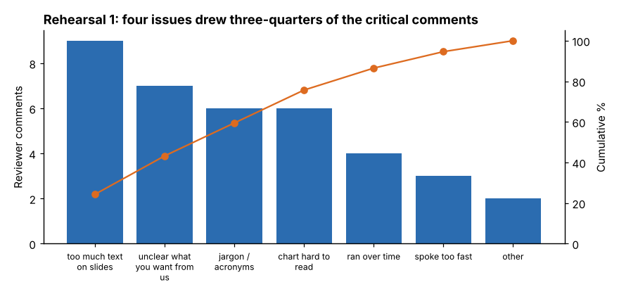

# Module 06 — Process Improvement Tools for Presentations

## Objectives

- Treat a presentation as a process with suppliers, inputs, outputs and customers.
- Use familiar improvement tools — SIPOC, fishbone, Pareto, checklists, mistake-proofing, PDCA — to raise presentation quality.
- Standardize what works so every presentation in the team gets better.

## A presentation is a process

**SIPOC of the Line 3 rollout presentation**

| Suppliers | Inputs | Process | Outputs | Customers |
|---|---|---|---|---|
| Project team | data, analysis, photos | 1. Define audience and purpose | decision (approve / not) | plant manager (decides) |
| Finance | cost and savings figures | 2. Storyboard action titles | slides + appendix | finance, operations, quality, maintenance managers |
| Maintenance | installation estimate | 3. Build slides and notes | one-page summary | line teams who will implement |
| Audience (pre-wire) | concerns, questions | 4. Rehearse and get feedback | action list with owners | |
| Template owner | slide template | 5. Deliver and handle Q&A | | |
| | | 6. Follow up | | |

The SIPOC shows what you depend on (finance's numbers arrive late? start earlier) and who the customers really are.

## Fishbone: why do technical presentations fail?

```
                People                 Method                  Material
   no audience analysis ─┐   chronological story ─┐   data dumps / raw exports ─┐
   no rehearsal ─────────┤   no clear ask ────────┤   wrong numbers ────────────┤
                          \                         \                           \
                           ─────────────────────────────────────────────────────▶ Presentation
                          /                         /                           /   doesn't lead
   room / projector ─────┤   no feedback rubric ──┤   slot too short ──────────┤   to a decision
   remote audio ─────────┘   no follow-up ────────┘   too many agenda items ───┘
                Environment            Measurement              Time
```

Use it with your team to find the causes that apply to *your* meetings.

## Pareto of feedback

After rehearsal 1, eight reviewers made 37 critical comments (plus three positive ones, kept separately — they tell you what not to change).



| Comment | Count | Cumulative % |
|---|---|---|
| Too much text on slides | 9 | 24.3 |
| Unclear what you want from us | 7 | 43.2 |
| Jargon / acronyms | 6 | 59.5 |
| Chart hard to read | 6 | 75.7 |
| Ran over time | 4 | 86.5 |
| Spoke too fast | 3 | 94.6 |
| Other | 2 | 100.0 |

Four issues account for about three-quarters of the critical comments. The engineer fixed those four first: action titles and fewer words, the ask on slide 1, plain language, and the cleaned-up charts from Module 05.

## Checklist and mistake-proofing

A **checklist** catches routine errors that experts make under time pressure (`templates/presentation-checklist.md`). Excerpt:

- [ ] The ask is on slide 1, with amount, owner and date
- [ ] Every slide title is a full-sentence takeaway
- [ ] Every number has a comparison or unit
- [ ] Every chart's message is stated in its title
- [ ] Rehearsed aloud, timed, with at least one outsider
- [ ] Appendix covers the top ten feared questions
- [ ] File opens on the meeting-room computer; backup on a USB drive / shared folder

**Mistake-proofing (poka-yoke) ideas:**

- A slide template whose first slide is titled "Decision needed:" — you can't leave it blank without noticing.
- Run `python tools/commkit.py check deck.md` to flag crowded slides and topic titles automatically.
- Send the deck to the meeting room's computer the day before and test it there.
- Use a countdown timer visible to the presenter.

## PDCA on your presentations

- **Plan:** purpose, audience, one-sentence message, storyboard.
- **Do:** build and rehearse.
- **Check:** rubric scores and comment Pareto; after the meeting, was the purpose met?
- **Act:** fix the top issues; update the team's template and checklist so the next presenter starts from a better standard.

## Standard work for the team

Teams that present often (weekly production reviews, monthly KPIs) benefit from standard work: a fixed slide order, standard chart formats, the same metric definitions every time, and a rotation for who presents. Standardization reduces the audience's effort — they know where to look.

## Check yourself

1. Which customers in the SIPOC are easy to forget?
2. Why keep positive comments out of the Pareto but still record them?
3. Name one mistake-proofing device for a recurring monthly KPI review.

<details><summary>Answers</summary>

1. The people who will implement the decision (line teams, maintenance) — they're not in the room, but the presentation's output becomes their work.
2. The Pareto is for prioritizing problems; positive comments aren't problems. But they tell you what works, so you don't "fix" it away.
3. Examples: a template that pulls numbers automatically from the source (no retyping); fixed chart scales; a slide that won't print unless the "actions and owners" box is filled.

</details>
