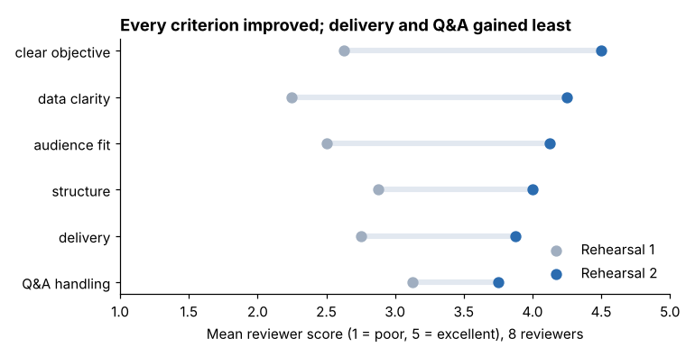
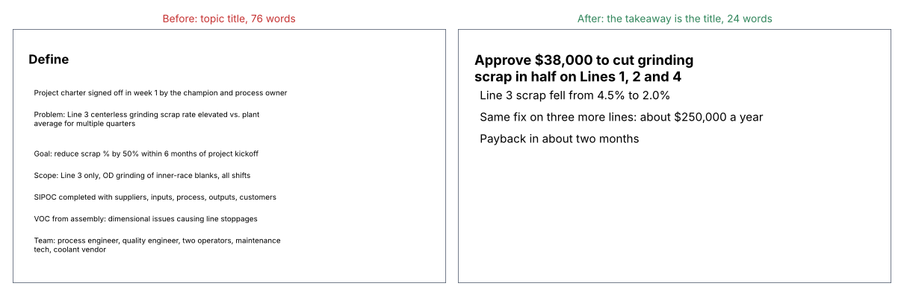

# Module 07 — Quality Presentations

## Objectives

- Define what "quality" means for a presentation and measure it.
- Apply slide-design and delivery practices that raise quality.
- Apply the same standards to written technical documents.

## What is a quality presentation?

Borrowing the quality definition "fitness for use": a presentation is high quality if it achieves its purpose for its audience (Module 02) — efficiently and accurately. Measurable dimensions:

| Dimension | Measure |
|---|---|
| Purpose achieved | decision made / audience can restate the message |
| Clear objective | rubric score |
| Audience fit | rubric score; number of "what does X mean?" questions |
| Structure | action titles tell the story alone |
| Data clarity | charts read correctly without explanation |
| Delivery | on time; pace; eye contact; few filler words |
| Accuracy | zero errors found afterwards |

## Measuring improvement: the rehearsals

Eight reviewers scored both rehearsals on a 1–5 rubric (`python tools/commkit.py feedback`):

| Criterion | Rehearsal 1 | Rehearsal 2 | Change |
|---|---|---|---|
| Clear objective | 2.62 | 4.50 | +1.88 |
| Audience fit | 2.50 | 4.12 | +1.62 |
| Structure | 2.88 | 4.00 | +1.12 |
| Data clarity | 2.25 | 4.25 | +2.00 |
| Delivery | 2.75 | 3.88 | +1.13 |
| Q&A handling | 3.12 | 3.75 | +0.63 |
| **Overall** | **2.69** | **4.08** | |

The content fixes (objective, data, audience fit) moved most. Delivery and Q&A moved least — they improve with practice, not editing. Her next step: one more timed run-through and a Q&A drill with the finance manager.

(These are simulated scores from a small panel; treat differences of a few tenths as noise.)

## Slide design

- **One idea per slide**, stated in the title.
- **Fewer words**: the slide supports what you say; it is not your script. Put detail in speaker notes or a handout. (`commkit.py check` flags slides over 40 words — an arbitrary but useful trigger for a second look.)
- **Visual hierarchy**: title largest; key number emphasized; everything else quiet.
- **Consistency**: same fonts, colors and positions throughout; use the company template.
- **Readable**: large fonts; high contrast; no text over busy photos.
- **Photos of the real thing** (a burned part, the coolant pump) often beat diagrams for a plant audience.

## Delivery

- **Know your first and last 30 seconds by heart.** Open with the purpose; close with the ask.
- **Talk to people, not the screen.** Glance at the slide; speak to the decision maker.
- **Pace and pauses**: pause after the key number so it lands.
- **Fewer filler words**: replace "um" with a pause; it sounds more confident.
- **Rehearse aloud**, standing, with a timer — at least twice; once in front of someone.
- **Remote meetings**: test audio and screen share; look at the camera for the key points; say slide numbers so people can follow; pause more for questions.
- **Nerves are normal.** Preparation is the best remedy; so is focusing on the audience's needs rather than on yourself.

## Quality in written documents

The same principles apply to reports, emails and summaries:

- **Executive summary first**: finding, impact, ask (compare `examples/summary_draft.md` and `examples/summary_revised.md`).
- **Short sentences, active voice, plain words.** "We installed a pump" not "Implementation of an automated apparatus was undertaken."
- **Define every acronym once** — or avoid it.
- **Headings that state conclusions.**
- **Proofread numbers**: check every figure against its source; make totals add up.
- **Readability check**: aim for a Flesch–Kincaid grade around 8–10 for a general business audience (a commonly used target, not a rule). The revised summary scores 9.2; the draft scored 27.9.

## Check yourself

1. Your deck scored high on every criterion, but no decision was made. Was it a quality presentation?
2. Why do delivery scores improve more slowly than content scores?
3. List three changes you'd make to a 500-word email that asks IT to replace a gauge PC.

Answers

1. Not by the fitness-for-use definition — the purpose wasn't achieved. Find out why: wrong decision maker in the room, a concern not addressed, or the ask unclear.
2. Content can be fixed by editing in an evening; delivery is a skill that needs repetition and feedback.
3. Put the ask and deadline in the first two lines; cut background to two or three sentences; add the specific impact (e.g. "the line can't release parts if this PC fails"); include the asset tag and contact details at the bottom.

