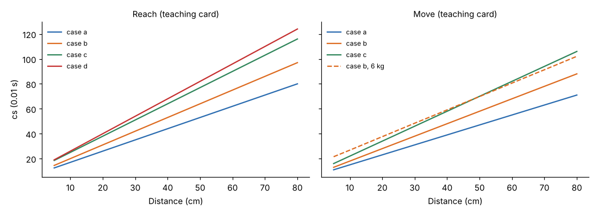

# Module 04 — Reach

## Objectives

- Define the reach motion and the variables that drive its time.
- Code reaches with the teaching card.

## Definition

**Reach** moves the empty hand (or fingers) to a destination, usually to gain control of an object. It starts when the hand begins to move and ends when it arrives at the destination.

## What drives the time

1. **Distance**: the actual path of the hand (knuckle path), measured or estimated in cm.
2. **Case**: how much control the destination needs. The more the hand must search or slow down to hit the target, the longer it takes.
3. **Hand in motion**: a reach that starts or ends with the hand already moving is faster.

## Teaching card (DTC)

Time (cs) = constant + slope × distance (cm). Code: `R<distance><case>`, add `m` if the hand is already moving.

| Case | Meaning | Formula | 30 cm |
|---|---|---|---|
| a | Fixed, known location, or to the other hand | 8 + 0.9 d | 35 |
| b | Location varies slightly from cycle to cycle | 9 + 1.1 d | 42 |
| c | Object mixed with others: search and select | 12 + 1.3 d | 51 |
| d | Very small object, or precise grasp needed | 12 + 1.4 d | 54 |
| m | Hand already in motion | − 3 (minimum 2) | e.g. R30cm = 48 |

Cases c and d are **high-control** reaches (Module 11).

These four cases are the course's own classification. Other systems define reach classes differently.

## Measuring distance

- Measure the path the hand actually travels, not the straight line between the bins.
- Subtract any part of the motion done by the body (turning or leaning). Body motions are coded separately (Module 10).
- Round to the nearest 5 cm when analysing from a drawing.

## Check yourself

Code and time:

1. Reach 40 cm into a bin of mixed bolts.
2. Reach 20 cm to a fixed button.
3. Reach 25 cm to a part whose position varies slightly, hand already moving.

Answers

1. **R40c** = 12 + 1.3 × 40 = **64 cs**.
2. **R20a** = 8 + 0.9 × 20 = **26 cs**.
3. **R25bm** = 9 + 1.1 × 25 − 3 = **33.5 cs**.

