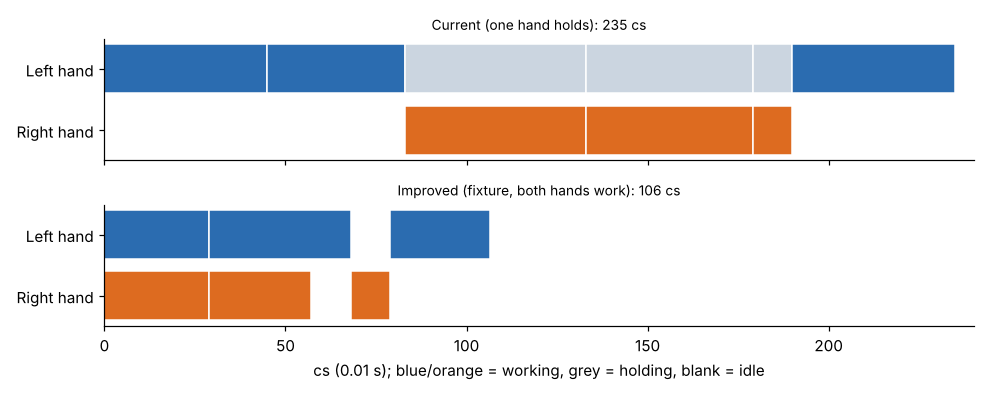

# Module 13 — Methods Improvement with Motion Analysis

## Objectives

- Use a simultaneous-motion (SIMO-style) chart to see idle and holding time.
- Redesign a method and quantify the gain.

## Lab 3: washer on bolt

**Current method:** the left hand holds the bolt while the right hand gets and places the washer. Then the left hand disposes of the assembly.

**Improved method:**

- A fixture holds the bolt.
- Bolts are in a tray and washers in a magazine at a fixed pick point, so all grasps are Gp.
- Both hands reach at the same time.
- The finished assembly is pushed off the fixture into a chute (contact grasp, contact release).



| | Current | Improved |
|---|---|---|
| Total | 235 cs (2.35 s) | **106.5 cs (1.06 s)** |
| Saving | | **54.7 %** |
| Per hour (12 % allowance) | 1,368 | **3,018** |
| Right hand idle | 128 cs | 0 |
| Left hand holding or idle | 107 cs | small gap only |

Where the time went:

- **Holding** (left hand, 107 cs) was replaced by a fixture.
- **Selective and small grasps** (Gs) became Gp through presentation.
- **Sequential hands** became simultaneous, because one side is low control in every step.
- **Disposal** became a push into a chute (Gc, RLc).

## A general improvement checklist (motion level)

| Look for | Change |
|---|---|
| A holding hand | Fixture, clamp or nest |
| Gx, Gs grasps | Oriented, isolated presentation |
| Case c/d reaches and moves | Fixed pick points, guides, larger targets |
| Close or tight positions; non-symmetric parts | Chamfers, symmetric design, locating features |
| Long distances | Shorter layout (normal work area) |
| Body motions | Bring material to waist height and within reach |
| Both hands high control at once | Make one hand's work low control so they can overlap |

## Run it

```bash
python tools/dmtkit.py simo
```

## Check yourself

If the improved method's washer magazine were replaced by a mixed bin (R20c Gx instead of R20a Gp for the right hand in step 1), what would step 1 take, and would the hands still overlap?

<details><summary>Answers</summary>

RH = R20c Gx = 38 + 14 = 52 cs. LH = R20a Gp = 29 cs, low control. Only one side is high control, so the hands still overlap: step = max(29, 52) = **52 cs** instead of 29, adding 23 cs to every cycle.

</details>
