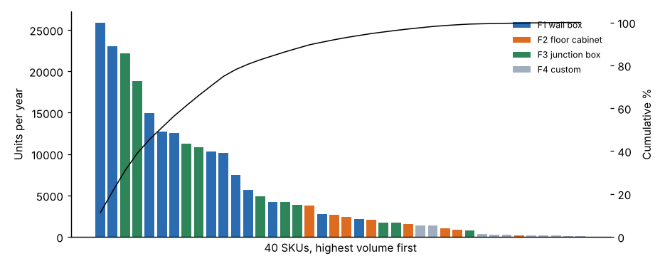

# Module 03 — Information Acquisition · Products · Volumes

Outline items: **Information acquisition**, **Products**, **Volumes**

## Objectives

- Plan what information a layout needs and where to get it.
- Group products into families and run a product–quantity (P–Q) analysis.

## Information acquisition

| Need | Source | Watch for |
|---|---|---|
| Products, bills of material, routings | ERP and engineering | Routings that don't match what the shop actually does: walk the floor |
| Volumes, history and forecast | Sales and planning | Use the **planning horizon** (e.g. 3–5 years), not last year |
| Inventory and usage | ERP, cycle counts | Obsolete stock inflates space |
| Equipment list and footprints | Maintenance and asset register | Clearances, utilities, foundations |
| Building data | Drawings, site survey | Columns, floor load, crane rails, doors, ceiling height |
| Supporting services | Interviews | Hidden needs (maintenance, quality lab, break rooms) |
| Constraints | EHS, codes, landlord | Fire separation, egress, environmental permits |

Validate every source on the floor. Most layout surprises come from data nobody checked.

## Products

Group products into **families** that share a routing and similar handling (size, weight, container). Corvan's 40 SKUs form 4 families with distinct routings (`data/routings.csv`):

| Family | Routing |
|---|---|
| F1 wall box | RCV → SHR → PUN → BRK → WLD → PNT → ASM → TST → PKG |
| F2 floor cabinet | RCV → SHR → PUN → BRK → WLD → PNT → ASM → TST → WHS → PKG |
| F3 junction box | RCV → PUN → BRK → PNT → ASM → PKG |
| F4 custom | RCV → SHR → BRK → WLD → PNT → ASM → TST → PKG |

## Volumes

A **P–Q analysis** ranks products by volume to decide the type of layout for each group:



- **13 SKUs (32.5 %)** account for 80 % of units.
- By family: F1 wall box **57.1 %** of units, F3 junction box **34.8 %**, F2 floor cabinet **6.3 %**, F4 custom **1.8 %**.

| Region of the P–Q curve | Typical layout |
|---|---|
| High volume, few products ("head") | Product layout or dedicated cell |
| Medium volume, families | Cells by family (group technology) |
| Low volume, many products ("tail") | Functional (process) layout, or a flexible job-shop cell |

At Corvan, wall boxes (F1) are the cell candidate. F4 custom stays functional.

**Units vs loads.** Space and handling depend on **loads**, not units. F2 floor cabinets are only 6 % of units but travel 2 per load, so they generate 7,235 loads a year, **more than F1's 6,586**. Always convert to a common handling unit before analysing flow (Module 05).

## Run it

```bash
python tools/fwdkit.py pq
python tools/fwdkit.py flow
```

## Check yourself

1. Why does a P–Q analysis use the planning-horizon volume rather than last year's?
2. F3 junction boxes are 34.8 % of units but only 2,003 loads a year. Why?

<details><summary>Answers</summary>

1. The layout must serve the future mix. Last year's volume may over- or under-size areas, and product launches or exits would be missed.
2. They are small and travel 40 per load: 80,130 / 40 ≈ 2,003 loads.

</details>
