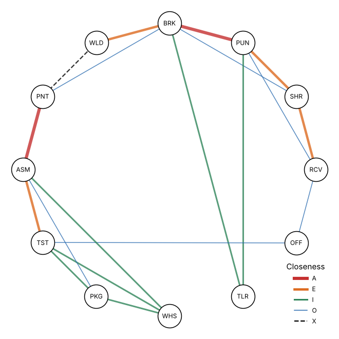

# Module 07 — Space Constraints · Configuration Diagrams

Outline items: **Space constraints**, **Configuration diagrams**

## Objectives

- List the physical and regulatory constraints a layout must respect.
- Draw a relationship (configuration) diagram and turn it into a space-relationship layout.

## Space constraints

| Constraint | Examples |
|---|---|
| Building | Columns, walls, ceiling height, floor load capacity, pits, crane rails |
| Access | Dock positions (Corvan: receiving on the west wall, shipping on the east), doors, main aisles |
| Monuments | Paint booth and oven, large presses, compressors: expensive to move |
| Regulations | Fire separation, egress distance, aisle widths, environmental permits |
| Utilities | Power, compressed air, gas, ventilation, drains |
| Expansion | Which walls can move; reserved areas |

Write the constraints down before drawing layouts. They remove impossible options early.

## Configuration diagrams

A **relationship (configuration) diagram** places the planning units as nodes and draws the closeness ratings as lines. In the usual convention, more lines or thicker lines mean a higher rating, and a dashed or zig-zag line means X.

Steps:

1. Place the **A** pairs together first, then E, then I.
2. Keep **X** pairs apart.
3. Respect fixed positions (docks, monuments).
4. Rearrange until the strongest lines are shortest.
5. Then give each node its **area** (space-relationship diagram) and fit it to the building.

Corvan's diagram shows a main chain:

RCV – SHR – PUN – BRK – WLD … (separated) … PNT – ASM – TST – PKG/WHS

The tool room hangs off punch and brake.

## Check yourself

1. Which two pairs should be placed first?
2. How should a configuration diagram treat the paint booth if it can't be moved?

Answers

1. The A pairs: **PNT–ASM** and **PUN–BRK**.
2. As a fixed node. Arrange the other units around it: put ASM next to it (A) and WLD near but separated (X).

