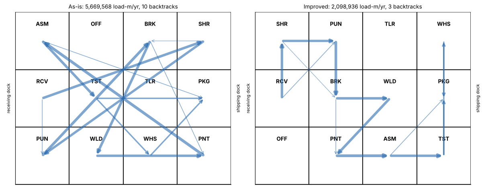

# Module 08 — Material Flow

Outline item: **Material flow**

## Objectives

- Evaluate block layouts by flow × distance, adjacency and backtracking.
- Improve a layout systematically with pairwise exchanges.

## Material flow

### Measuring a layout

For a block layout, measure between area centres along the aisles (rectilinear distance):

- **Flow × distance** = Σ loads/yr × metres, summed over all pairs (**load-metres per year**)
- **Handling cost** = load-metres × cost per load-metre (Corvan: $0.012, illustrative)
- **Adjacency score** = Σ closeness weights of pairs that share an edge (A = 4 … X = −4)
- **Backtracks** = routing steps that move back toward receiving

### Corvan: three block layouts

The course simplifies the plant into a 4 × 3 grid of equal slots (12.5 m × 13.3 m). Receiving is fixed on the west dock and pack & ship on the east dock. Real block layouts use areas proportional to need (Module 06). The grid keeps the arithmetic visible.

Each grid is shown with the top row first, matching the figure:

| As-is | Improved (A) | Alternative B (paint stays) |
|---|---|---|
| ASM · OFF · BRK · SHR | SHR · PUN · TLR · WHS | SHR · PUN · TLR · WHS |
| RCV · TST · TLR · PKG | RCV · BRK · WLD · PKG | RCV · BRK · TST · PKG |
| PUN · WLD · WHS · PNT | OFF · PNT · ASM · TST | OFF · WLD · ASM · PNT |



| Measure | As-is | A | B (paint stays) |
|---|---|---|---|
| Load-metres per year | 5,669,568 | **2,098,936** | 2,149,011 |
| Handling cost per year | $68,035 | $25,187 | $25,788 |
| Saving vs as-is | — | 63.0 % | 62.1 % |
| Adjacency score | 5 | 28 | 27 |
| Backtracks | 10 | 3 | 4 |
| X pair adjacent? | no | no | no |
| Wall-box route length | 345.8 m | 115.8 m | 115.8 m |

**Alternative B keeps the paint booth and oven where they are.** It costs only $601 a year more in handling than A, while moving a powder booth and cure oven can cost far more and stop production. That is why monuments are often fixed first. **B is the recommended block layout.**

### Pairwise exchange

Start from a layout and, at each step, try swapping every pair of movable units. Keep the swap that reduces flow × distance the most, with a large penalty if an X pair becomes adjacent. Repeat until no swap helps.

- From the as-is layout, **7 exchanges** reach layout A.
- This is a simple local search in the spirit of classic computerized layout methods. It finds a good layout, **not necessarily the best**. Try several starting layouts, and always apply judgment for constraints the model can't see.

## Run it

```bash
python tools/fwdkit.py layout
```

## Check yourself

1. Two departments exchange 2,000 loads a year. Moving them from 37.5 m to 12.5 m apart saves how many load-metres, and how much at $0.012?
2. Why is the lowest flow × distance not automatically the chosen layout?

<details><summary>Answers</summary>

1. 2,000 × 25 = **50,000 load-m** → **$600 a year**.
2. Other criteria matter: the cost and disruption of moving monuments, safety separations, expansion, supervision, noise and cleanliness. Alternative B is chosen because it gives up only 1 % of flow savings and avoids moving the paint system.

</details>
