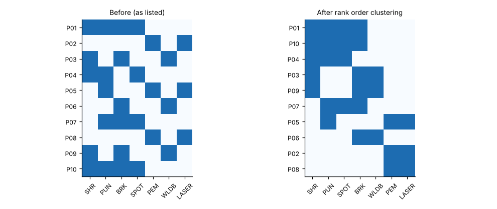

# Module 09 — Cellular Layouts · Workstation Layouts

Outline items: **Cellular layouts**, **Workstation layouts**

## Objectives

- Form cells from part–machine data with rank order clustering.
- Lay out a workstation for reach, height and parts presentation.

## Cellular layouts

A **cell** groups the different machines and people needed to make a **family** of parts, so that the family flows piece by piece (or in small lots) through one area. Compared with functional layouts, cells give:

- short lead times
- little work in process
- clear ownership
- fast quality feedback

They need stable families, enough volume, and cross-trained people.

**Forming cells: rank order clustering (ROC).** Build a part–machine matrix (1 = the part uses the machine). Read each row as a binary number, sort the rows in decreasing order, then do the same for the columns. Repeat until nothing changes.



Corvan's 10 parts × 7 machines (`data/part_machine_matrix.csv`) cluster into:

| Cell | Machines | Parts |
|---|---|---|
| Cell 1, fabricate boxes | SHR, PUN, SPOT | P01, P04, P07, P10 |
| Cell 2, laser + hardware | LASER, PEM | P02, P05, P08 |
| Cell 3, welded frames | BRK, WLDB | P03, P06, P09 |

**Exceptional elements** (a part needs a machine in another cell):

- P01, P07 and P10 need BRK
- P03 and P09 need SHR
- P05 needs PUN

Options for each:

- **duplicate** the machine (Corvan's wall-box cell gets its own brake, Module 11)
- **re-route** or redesign the part
- **subcontract**
- accept a planned **inter-cell move**

## Workstation layouts

Design rules (general ergonomics guidance; the numbers are typical values to be checked against your workforce and a current standard):

| Principle | Guideline |
|---|---|
| Normal work area | Frequent parts and tools within forearm reach (about 35–45 cm from the body) |
| Maximum work area | Occasional items within full-arm reach (about 55–65 cm); nothing beyond |
| Work height | Precision work: near or slightly above elbow height; light assembly: a little below elbow; heavy work: lower still. Adjustable where several people share the station |
| Parts presentation | Front, angled, in order of use; gravity-feed or flow racks for frequent items |
| Tools | Hung at the point of use on balancers; returned by gravity or spring |
| Sitting vs standing | Standing for cells where the operator moves between stations; sitting or sit-stand for long precision tasks |
| Vision | Adequate light on the task; no glare |

The [Predetermined Time Standards](../../predetermined-time-standards/README.md) course shows how reach classes and parts presentation change cycle time.

## Run it

```bash
python tools/fwdkit.py roc
```

## Check yourself

1. Row P04 = (SHR 1, PUN 1, BRK 0, SPOT 1, PEM 0, WLDB 0, LASER 0). What binary number is it in the original column order?
2. Name two ways to remove the exceptional element "P05 needs PUN".

<details><summary>Answers</summary>

1. 1101000 in binary = 64 + 32 + 8 = **104**.
2. Any two: move P05's punching to the laser (if the design allows); duplicate a small punch in cell 2; route P05 through cell 1 for one operation as a planned inter-cell move; redesign the feature.

</details>
