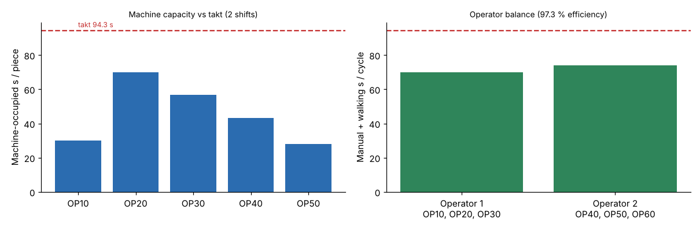

# Module 11 — Calculating Cell Capacity · How Many People and Machines?

Outline items: **Calculating cell capacity**, **How many people and machines?**

## Objectives

- Compute takt time and the capacity of each machine in a cell.
- Determine the number of machines and operators the cell needs.

## Calculating cell capacity

**Available time:** 230 days × 2 shifts × 7.5 h × 3,600 = **12,420,000 s a year**.

**Takt time** = available time ÷ demand = 12,420,000 ÷ 131,730 = **94.3 s per box**.

**Machine time per piece** = machine cycle + load/unload (the machine waits while the operator loads it) + setup ÷ lot size (lot = 150):

| Op | s per piece | Capacity/yr (90 % availability) | Utilization | Machines |
|---|---|---|---|---|
| OP10 Shear | 14 + 10 + 900/150 = **30.0** | 372,600 | 35.4 % | 1 |
| OP20 Punch | 48 + 14 + 1,200/150 = **70.0** | 159,685 | **82.5 %** | 1 |
| OP30 Brake | 18 + 34 + 720/150 = **56.8** | 196,795 | 66.9 % | 1 |
| OP40 Spot weld | 22 + 18 + 480/150 = **43.2** | 258,749 | 50.9 % | 1 |
| OP50 Hardware press | 6 + 20 + 300/150 = **28.0** | 399,214 | 33.0 % | 1 |

Capacity = 12,420,000 × 0.90 ÷ s per piece.



- The **punch is the bottleneck** at 82.5 %. It has room for growth of about 21 %, and less if lot sizes shrink (more setups). Setup reduction on the punch protects the cell's capacity.
- A machine is needed for each operation, but none needs a second unit at this demand.

## How many people and machines?

**Operators** = total manual work content per piece ÷ takt.

- Manual time = 10 + 14 + 34 + 18 + 20 + 24 = **120 s**, plus walking ≈ 6 moves × 2 s = 12 s, total **132 s**.
- 132 ÷ 94.3 = **1.40**, so **2 operators per shift**.

Two operators have 2 × 94.3 = 188.6 s of capacity for 132 s of work: about 70 % loaded. Options:

- run with 2 and give them extra cell duties (inspection, replenishment, setups)
- design for 1.4 by sharing one operator with a neighbouring cell
- use the spare time when demand grows

Check the machine and operator interaction with a worker–machine chart: while the punch runs its 48 s cycle, the operator can unload and load the brake.

## Run it

```bash
python tools/fwdkit.py cell_capacity
python tools/fwdkit.py staffing
```

## Check yourself

1. Demand grows 15 %. What is the new takt, and is the punch still OK?
2. If punch setup fell from 20 to 8 minutes, what would its utilization be at today's demand?

<details><summary>Answers</summary>

1. 131,730 × 1.15 = 151,490 → takt 12,420,000 / 151,490 = **82.0 s**. Punch utilization = 151,490 / 159,685 = **94.9 %**. That is technically possible but leaves almost no margin: plan setup reduction or overtime.
2. s per piece = 48 + 14 + 480/150 = 65.2 → capacity 12,420,000 × 0.9 / 65.2 = 171,442 → utilization 131,730 / 171,442 = **76.8 %**.

</details>
