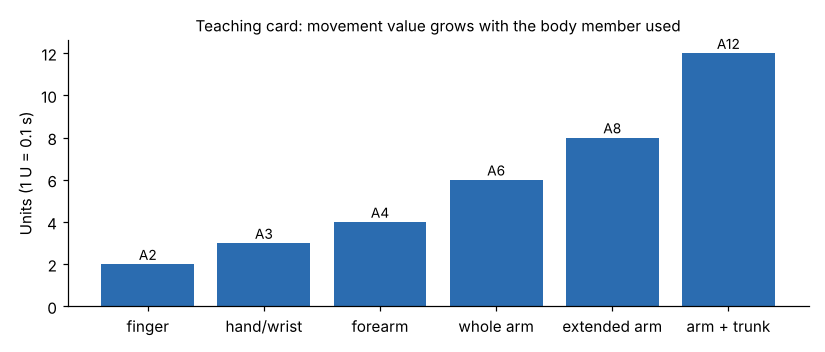

# Module 11 — Movement Classifications

> The source outline lists "Movement Classifications" twice in a row (probably two lessons). They are combined here: Part A covers the classes, Part B covers hard cases.

## Objectives

- Apply the six teaching movement classes reliably.
- Handle hard cases: compound motions, the two hands working together, and body assists.

## Part A — The classes

| Code | Body member | Rough guide | Typical examples |
|---|---|---|---|
| A2 | Finger | ≤ 3 cm | Press a key, flip a switch, open a bag mouth |
| A3 | Hand / wrist | 3–10 cm | Turn the wrist to orient a part; move a tool between close screws |
| A4 | Forearm | 10–25 cm | Reach to a tray just in front of the work |
| A6 | Whole arm | 25–45 cm | Reach to bins at the back of a normal work area |
| A8 | Extended arm | 45–65 cm | Reach to the top shelf of a parts rack, or the far side of a bench |
| A12 | Arm + trunk | > 65 cm, feet fixed | Lean over a wide table |

These distance guides are the teaching card's. Real systems define their own classification rules.

## Part B — Hard cases

| Situation | Rule on the teaching card |
|---|---|
| A movement that starts with the wrist and ends with the whole arm | Code the **largest** body member used (A6) |
| Both hands move at the same time to similar targets | Code the **longer** of the two movements once (the limiting hand) |
| One hand moves while the other holds a part | Code only the moving hand; holding is not a motion |
| The body turns while the arm reaches | Code the arm; add a body motion only if the feet move (walk) or the trunk bends deeply (B22) |
| A movement interrupted by a stop to look | Movement + E3, then the rest of the movement |

## Check yourself

1. Both hands reach at once: the right 40 cm (whole arm), the left 20 cm (forearm), each to an easy part. Code the reach and get.
2. An operator reaches 55 cm to a rack. Code it, and suggest a layout change.

Answers

1. Code the limiting hand: **A6 G2** (8 U). The left-hand A4 G2 happens inside that time. This only works if both gets are low control (Module 14).
2. **A8** (extended arm). Move the rack closer or angle it toward the operator so the reach becomes A6 or A4. That saves 2–4 U every cycle and reduces shoulder load.

