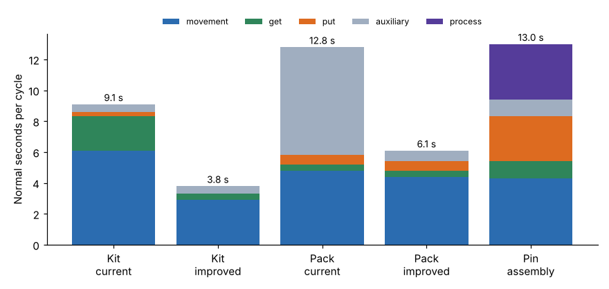

# Module 20 — Practice Analysis

## Objectives

- Code complete tasks with the teaching card, step by step.
- Use the analysis to set a standard, improve the method and reduce ergonomic exposure.

## Short exercises

`data/practice_exercises.csv` has 10 short tasks with the codes left blank. Code them, then check against `data/practice_exercises_key.csv`:

| # | Task | Key | U |
|---|---|---|---|
| P1 | Get a pencil 30 cm away, put it in a cup | A6 G2 A6 P3 | 17 |
| P2 | Get a clip from a box of loose clips 20 cm away, toss onto a tray | A4 G5 A4 P0 | 13 |
| P3 | Push a button 10 cm away with the index finger | A4 G0 | 4 |
| P4 | Get a nut from a bowl 40 cm away, start it on a bolt (one correction) | A6 G5 A6 P6 C2 | 25 |
| P5 | Walk 4 steps, read a 3-group label, decide | W6x4 R2x3 D3 | 33 |
| P6 | Press a pedal once | F4 | 4 |
| P7 | Get a 6 kg casting one-handed 50 cm away, place loosely on a bench | A8 G2 A8 L1x2 P3 | 23 |
| P8 | Sit down, stand up | S20 U22 | 42 |
| P9 | Crank 5 revolutions | K6x5 | 30 |
| P10 | Transfer a screw between hands | T2 | 2 |

The P7 key applies the load-factor rule: 6 kg in one hand is 4 kg above 2 kg, so L1 twice.

## Task A — Bag a fastener kit



**Current method** (`python tools/ptskit.py show A_kit_current`): three selective gets from mixed bins, a selective get for the next bag from a stack, and whole-arm moves throughout.
**91 U = 9.1 s normal**, 10.19 s standard (12 % allowance), about **353 kits an hour**.

**Improved method:**

- gravity trays, with parts pre-oriented, 15–20 cm away
- bolt and nut picked together with both hands (allowed now, because the gets are low control)
- a bag holder with self-opening perforated bags

**38 U = 3.8 s normal** (−58 %), about **846 kits an hour**.

## Task B — Pin assembly (a new job, not yet built)

`python tools/ptskit.py show B_pin_assembly`: 14 steps, **130 U = 13.0 s normal**.

- Process time (two screws at 1.8 s) is 36 U.
- Puts are 29 U (22 %), mostly high-control P6s (two locating pins, tight pin, screw engagement).
- Standard = 13.0 × 1.12 = **14.56 s** (247 an hour) if the allowance is applied to everything.
- If it is applied only to manual time: (94 × 1.12 + 36) × 0.1 = **14.13 s**. State which convention you use. (The [Work Measurement](../../work-measurement/README.md) course covers allowance conventions.)
- Design questions this raises: can the housing locate on one pin plus an edge stop (a P3)? Can the pin bore have a lead-in chamfer?

## Task C — Pack a carton

**Current method:** walk 3 steps to a pallet on the floor, bend and arise with an 8 kg carton, walk back, read a 4-group label, then tape. **128 U = 12.8 s**. Auxiliary codes are 55 % of it.

**Improved method:** a lift table with cartons at bench height next to the bench; a fixed barcode scanner instead of reading; a tape gun holder at the seam start. **61 U = 6.1 s** (−52 %).

### Ergonomic exposure at the same demand (600 cartons per shift)

| | Current | Improved |
|---|---|---|
| Bends to floor | 600 | **0** |
| Steps walked | 3,600 | **0** |
| Extended reaches (A8) | 1,800 | 1,800 (next target: move the outgoing roller closer) |
| Busy time for the 600 cartons | 2.39 h | 1.14 h |

The PMTS analysis gives the business case (time) and the safety case (exposures) from the same sheet. Exposure counts are a screening aid, not a validated ergonomic risk assessment. Use a recognized method such as the NIOSH lifting equation for lifting tasks.

## Run it

```bash
python tools/ptskit.py tasks
python tools/ptskit.py improve
python tools/ptskit.py ergonomics
python tools/ptskit.py standard
```

## Check yourself

1. In Task A, why could the improved method use both hands at once when the current one couldn't?
2. In Task B, what is the total U for all P6 and C2 codes, and what share of the manual time is that?
3. What would the improved packing time be if the outgoing roller were moved so that the two A8s in the last step became A6s?

<details><summary>Answers</summary>

1. The gets changed from G5 (high control: sequential) to G2 (low control: simultaneous allowed, Module 14).
2. P6 × 4 = 24, plus C2 = 2, so **26 U**. That is 26 / 94 = **28 %** of manual time. High-control placements are the main design target.
3. 61 − 2 × (8 − 6) = **57 U = 5.7 s**.

</details>
