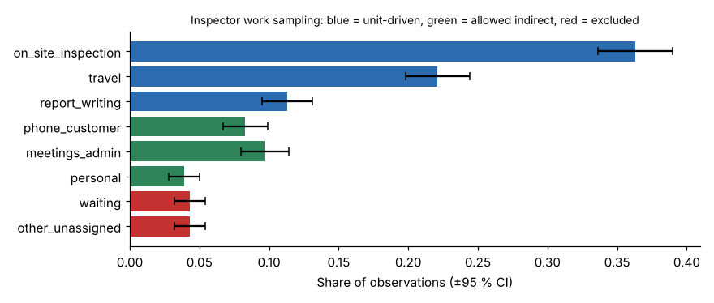

# Module 03 — Where and How Work Measurement Relates to Staffing Models

## Objectives

- Choose a work measurement method for each activity in a staffing model.
- Judge the precision of unit times and the sample size needed.
- Use work sampling to separate unit-driven, indirect and excluded time.

## Where work measurement enters the model

```
Required FTE = Σ (volume × UNIT TIME) ÷ UNIT-DRIVEN SHARE ÷ available hours
                           ▲                   ▲
               time study, time records,   work sampling,
               standard data, SME,         activity logs
               PMTS
```

Work measurement supplies the **two middle terms**. Errors in them carry straight into FTE. A 10 % error in unit times is a 10 % error in staff.

## Methods

| Method | How | Precision | Cost | Best for |
|---|---|---|---|---|
| **Time study** | Observe and time repeated units; rate pace; add allowances | High | High per activity | Repetitive, observable work (inspections, counter service) |
| **Time records** (self-reported or system-logged) | Start and stop times from case or job systems | Medium; bias possible | Low | High-volume knowledge work (plan review) |
| **System and sensor data** | GPS, call-centre logs, scanners | High for what is logged | Low | Travel, call handling |
| **Work sampling** | Random observations of what people are doing | Good for shares; poor for unit times | Medium | Direct/indirect split, allowances, non-repetitive work |
| **Standard data / PMTS** | Built-up from element times | High where it applies | Medium | Routine manual tasks |
| **SME estimates** (e.g. Delphi) | Structured expert estimates over rounds | Low to medium; bias possible | Very low | Rare or new work, or when data doesn't exist yet |

Match the method to the size of the activity. Put measurement effort into the activities that drive the most hours, and use cheaper methods for small ones.

## Tri-County unit times

| Activity | Method | n | Mean (min) | ±95 % precision | n for ±5 % |
|---|---|---|---|---|---|
| Residential inspection | time study | 48 | 33.1 | ±7.8 % | 117 |
| Commercial inspection | time study | 30 | 68.2 | ±9.8 % | 115 |
| Re-inspection | time study | 40 | 19.8 | ±9.9 % | 156 |
| Complaint | time records | 120 | 77.7 | ±8.0 % | 305 |
| Travel per stop | GPS | 900 | 18.0 | ±3.1 % | 343 |
| Residential plan review | time records | 200 | 102.8 | ±5.3 % | 226 |
| Commercial plan review | time records | 80 | 467.4 | ±9.2 % | 269 |
| Residential resubmittal | SME (Delphi, 6) | 6 | 41.5 | ±18.5 %* | — |
| Commercial resubmittal | SME (Delphi, 6) | 6 | 175.7 | ±8.1 %* | — |
| Permit processing | time study | 60 | 11.8 | ±8.1 % | 160 |
| Counter service | time study | 150 | 10.8 | ±15.6 % | 1,453 |

\* For SME estimates the "precision" only shows how much the experts agree. It says nothing about bias. Six experts can agree and all be wrong.

**Precision** (±95 %) = 1.96 × SD / (mean × √n). **Sample size for ±5 %** = (1.96 × SD / (0.05 × mean))².

- The **commercial inspection** (±9.8 %) drives over 10,000 hours, so it is worth more observations.
- **Counter service** is highly variable (SD ≈ mean). Its mean is less precise, but the queueing model (Module 05) uses the whole distribution anyway.

## Work sampling: what share of time is unit-driven?

1,200 random observations of inspectors over four weeks (`data/work_sampling_inspectors.csv`):



| Group | Activities | Share |
|---|---|---|
| **Unit-driven** | on-site inspection 36.3 %, travel 22.1 %, report writing 11.3 % | **69.7 %** |
| **Indirect, allowed** | customer phone and email 8.3 %, meetings and admin 9.7 %, personal 3.9 % | **21.8 %** |
| **Excluded** | waiting 4.3 %, other or unassigned 4.3 % | **8.5 %** |

Staffing decision: staff for unit-driven plus allowed indirect time, and **don't** staff for waiting or unassigned time. Treat those as improvement opportunities (scheduling, routing).

Unit-driven share used in the model = 0.697 / (0.697 + 0.218) = **0.761**.
Staffing multiplier = 1 / 0.761 = **1.31**: every unit-driven hour needs 1.31 staffed hours.

Including the excluded 8.5 % would use a share of 0.697 instead of 0.761 and add about **9 %** to required inspectors (2.2 FTE in 2025). That is a **policy choice**, so make it explicitly.

## Cross-check the methods

The unit times and 2025 volumes imply **31,415 unit-driven hours** of demand. The work sampling says the 21 inspectors on staff spend 69.7 % of their time on unit work: 21 × 1,738 × 0.697 ≈ **25,430 hours** of capacity.

The gap of about 6,000 hours matches what the agency sees: a backlog and next-day inspection averaging only 77 % in 2025. Each method should roughly confirm the other. A mismatch with no operational explanation means a unit time or a volume count is wrong.

## Run it

```bash
python tools/stmkit.py unit_times
python tools/stmkit.py sampling
```

## Check yourself

1. How many more commercial inspections must be timed to reach ±5 %?
2. Why not measure every activity by time study?
3. The union argues that waiting time should be included because "inspectors can't control when sites are ready". How do you respond?

<details><summary>Answers</summary>

1. 115 needed − 30 timed = **85 more**.
2. Cost and value. Time study is expensive, so use it where hours are large and work is repetitive. Time records, GPS and SME estimates are fine for smaller or less observable activities, as long as their weaknesses are known.
3. It is a fair point and a policy decision. Some waiting is unavoidable (site not ready on arrival). Options: include a defined unavoidable-delay allowance, or measure how much waiting better scheduling can remove and include only the remainder. Document whichever choice is made, and show the FTE effect of each.

</details>
