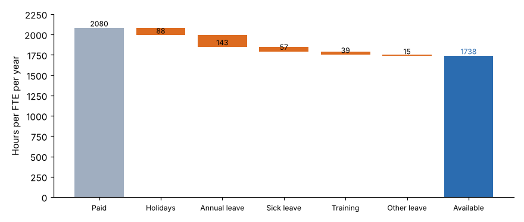

# Module 04 — Available Time and Relief Factors

## Objectives

- Compute available hours per FTE from leave and training records.
- Compute relief factors for posts that must be covered.
- Recognize how availability assumptions move FTE numbers.

## From paid to available hours

`data/leave_2025.csv` covers all 35 employees for 2025:



| Item | Hours per FTE |
|---|---|
| Paid hours | 2,080.0 |
| − Holidays | 88.0 |
| − Annual leave | 143.4 |
| − Sick leave | 56.6 |
| − Training | 38.9 |
| − Other leave | 14.9 |
| **= Available hours** | **1,738.1** (83.6 % of paid) |

By role: inspectors 1,739, permit technicians 1,765, plan reviewers 1,708, supervisors 1,751. The differences are small, so the course uses the agency average. Use role-specific values when they differ materially. Shift workers and field staff with heavy mandatory training often do.

## Decisions hidden in availability

| Question | Options | Effect |
|---|---|---|
| Use **average** or **planned** leave? | Actual 2025 average, or the leave entitlement | Entitlement is higher; it assumes everyone takes their full leave |
| Is training **non-available** or **indirect**? | Formal courses as non-available; on-the-job learning as indirect | Don't count it in both |
| Include **overtime** in supply? | No: model on standard hours and treat overtime as a short-term lever | Including it hides chronic shortage |
| **Vacancies** | Supply counts filled positions only | Budgeted but vacant positions do no work |

## Relief factors

For posts that must be covered regardless of workload (a counter, a 24/7 control room, a security post), the question is **how many people does it take to keep one post filled**?

**Relief factor = hours the post must be covered per year ÷ available hours per FTE**

| Post | Hours to cover | Relief factor |
|---|---|---|
| Permit counter, 8 h × 250 days | 2,000 | 2,000 / 1,738 = **1.15** |
| 24/7 post | 8,760 | 8,760 / 1,738 = **5.04** |

So a 24/7 post needs about five people, not 4.2 (8,760 ÷ 2,080). The difference is exactly the non-available time.

Two refinements:

- **Overlap or handover** time at shift changes adds to the hours to cover.
- **Minimum staffing with a variable load** (one person at night, three in the day) is calculated post by post, or hour by hour with a queueing model (Module 05).

## Sensitivity

A ±5 % change in available hours changes FTE by roughly ∓5 %. For Tri-County's 2026 inspector requirement, that is about ±1.2–1.3 FTE (Module 08). Small-looking leave policy changes, such as one more holiday or a new training mandate, show up directly in staffing.

## Run it

```bash
python tools/stmkit.py availability
python tools/stmkit.py coverage
```

## Check yourself

1. A new policy adds 24 hours of mandatory training per person per year. What are the new available hours, and how many more inspectors does the 2025 workload (41,260 total hours) need?
2. How many FTE are needed to cover two 24/7 posts?
3. Why is dividing by 2,080 hours a common source of under-staffing?

<details><summary>Answers</summary>

1. 1,738.1 − 24 = **1,714.1 h**. FTE = 41,260 / 1,714.1 = 24.07 vs 23.74, so **+0.33 FTE**.
2. 2 × 8,760 / 1,738.1 = **10.1 FTE**.
3. 2,080 is paid time, not working time. It ignores holidays, leave and training, about 16 % here, so the model asks for about 16 % fewer people than the work needs.

</details>
