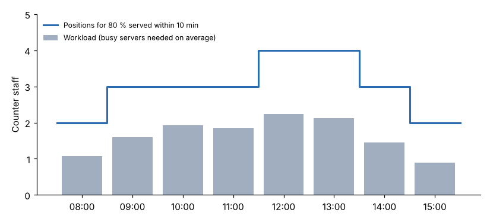
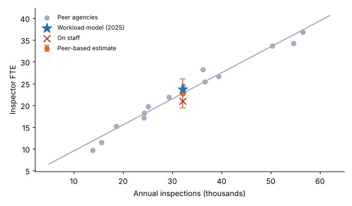

# Module 05 — Types of Staffing Models

## Objectives

- Build a workload-driven model for inspectors and plan reviewers.
- Size a service counter with a queueing model and explain why workload alone under-staffs it.
- Use ratios and peer benchmarks as cross-checks, not as the model.

## Choosing the model type

| Type | Use when | Logic | Tri-County role |
|---|---|---|---|
| **Workload-driven** | Work comes in countable units with measurable times | FTE = Σ volume × unit time ÷ unit share ÷ available hours | Inspectors, plan reviewers, back office |
| **Coverage (post)** | A post must be staffed whatever the workload | FTE = posts × relief factor | Minimum counter staffing |
| **Queueing** | Random arrivals and a waiting-time target | Erlang C (M/M/c) positions per period × relief | Permit counter |
| **Ratio / policy** | Staff support other staff | FTE = supported FTE ÷ span | Supervisors |
| **Statistical / benchmark** | Cross-checking, or when unit data is missing | Regression of FTE on drivers across sites or peers | Peer check for inspectors |

Real staffing models usually **combine** types by role. The same report's VHA example combines a baseline per facility with variances driven by workload and complexity ([NASEM 2020](https://www.nationalacademies.org/read/25454/chapter/6)).

## 1. Workload-driven: inspectors (2025 actual volume)

| Driver | Volume | Unit time + travel (min) | Hours |
|---|---|---|---|
| Residential inspections | 19,711 | 33.1 + 18.0 = 51.1 | 16,787 |
| Commercial inspections | 7,394 | 68.2 + 18.0 = 86.2 | 10,623 |
| Re-inspections | 4,990 | 19.8 + 18.0 = 37.8 | 3,144 |
| Complaints | 540 | 77.7 + 18.0 = 95.7 | 861 |
| **Unit-driven hours** | | | **31,415** |

Total hours = 31,415 ÷ 0.761 = **41,260**. Required FTE = 41,260 ÷ 1,738.1 = **23.74**, against **21 on staff**.

**Plan reviewers:** each review plus its expected resubmittal (35 % residential, 55 % commercial), ÷ (1 − 20 % indirect) ÷ 1,738 h = **6.01 FTE** for 2025, against 6 on staff.

## 2. Queueing: the permit counter

Customers arrive at random. Service takes 10.8 min on average and is highly variable. The target is **80 % served within 10 min**.

For each hour of the day, the **Erlang C** formula gives the probability that a customer waits when *c* staff serve an offered load *a* = λ × service time:

P(wait > t) = C(c, a) × e^−(cμ − λ)t, with service rate μ = 60 / 10.8 per hour.

Choose the smallest *c* that meets the target:



| Hour | Arrivals | Load (Erlangs) | Positions | Served ≤ 10 min | Utilization |
|---|---|---|---|---|---|
| 08:00 | 5.9 | 1.07 | 2 | 84 % | 53 % |
| 09:00 | 8.9 | 1.60 | 3 | 93 % | 53 % |
| 10:00 | 10.7 | 1.93 | 3 | 85 % | 64 % |
| 11:00 | 10.2 | 1.84 | 3 | 87 % | 61 % |
| 12:00 | 12.4 | 2.24 | 4 | 95 % | 56 % |
| 13:00 | 11.8 | 2.13 | 4 | 96 % | 53 % |
| 14:00 | 8.1 | 1.45 | 3 | 95 % | 48 % |
| 15:00 | 5.0 | 0.90 | 2 | 90 % | 45 % |

- **24 position-hours a day** × 250 days = 6,000 h a year.
- Workload alone (rounding busy-servers up each hour) would give only 4,250 h. The **wait-time target** adds about 40 %, because random arrivals need spare capacity.
- Back-office permit processing adds 883 h. Total = (6,000 + 883) ÷ 1,738 = **3.96 FTE**, against 4 on staff.

Utilization of 45–64 % isn't waste. It is the price of a 10-minute service promise with random arrivals. Ask leadership whether that promise is worth it; Module 09 shows the trade-off.

## 3. Ratio: supervisors

Policy span 1:9. In 2025: (21 + 6 + 4) ÷ 9 = **3.44 supervisors**, against 4. A span of control should come from what supervisors actually have to do (coaching, quality review, field visits), not from habit. Revisit it with the same work measurement methods.

## 4. Peer benchmark: a cross-check

Fourteen peer agencies (`data/peer_benchmark.csv`): FTE = 3.55 + 0.598 × (inspections ÷ 1,000), R² 0.97.



For Tri-County's 32,095 inspections (residential, commercial and re-inspections), the peer line predicts **22.7 FTE** (95 % prediction interval 19.4–26.1). The workload model's 23.7 sits inside that range. The current 21 is near the bottom of it.

Benchmarks are **cross-checks, not models**:

- Peers may have different travel distances, codes, technology and service levels.
- If every peer is under-staffed, the benchmark copies their problems.
- They say nothing about *why* a number differs.

## Run it

```bash
python tools/stmkit.py workload_model
python tools/stmkit.py queueing
python tools/stmkit.py ratio
```

## Check yourself

1. Travel per stop falls from 18 to 14 minutes after route optimization. Recompute the 2025 inspector FTE.
2. Why does the 12:00 hour need 4 positions when the load is only 2.24?
3. A council member says: "Peer agencies average 0.72 inspectors per 1,000 inspections, so we need 23.2." What is right and wrong about this?

<details><summary>Answers</summary>

1. Stops = 19,711 + 7,394 + 4,990 + 540 = 32,635. Saving = 32,635 × 4 / 60 = 2,176 h. Unit hours = 31,415 − 2,176 = 29,239. FTE = 29,239 / 0.761 / 1,738.1 = **22.09** (down from 23.74, −1.6 FTE).
2. With 3 positions the load per server is 75 % and random bunching makes too many customers wait more than 10 minutes: only 72 % are served within 10 minutes. The 4th position buys the waiting-time promise.
3. Right: it is a useful check, and the figure is close to the model (23.7). Wrong: a median ratio ignores the intercept (the regression gives 22.7), ignores differences in travel, mix and service level, and gives no basis for hiring decisions. The workload model explains *why*.

</details>
