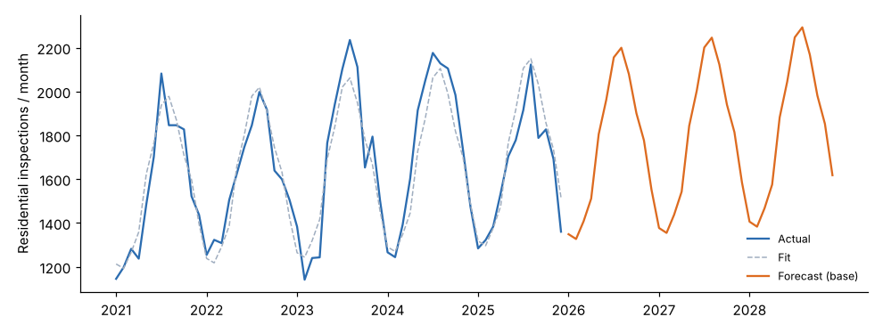

# Module 06 — Forecasting Workload

## Objectives

- Forecast workload drivers with trend and seasonality.
- Turn forecasts into FTE scenarios for future years.
- Decide how to staff for seasonal peaks.

## Why forecast

Hiring and training take months, so the model must size the workforce for **future** workload, not last year's. A staffing model with a stale volume is precise and wrong.

## A trend-and-season model

For each driver, regress the log of monthly volume on a time trend and month-of-year dummies (60 months, 2021–2025):

ln(volume) = b₀ + b₁ × t + month effect

- The **log** makes the trend a constant percentage growth, and the seasonal effect a percentage too.
- Growth per year = e^(12·b₁) − 1.
- Back-transforming adds half the residual variance (× e^(σ²/2)) so the forecast is the mean, not the median.



| Driver | 2025 actual | Growth/yr | 2026 | 2027 | 2028 | R² |
|---|---|---|---|---|---|---|
| Residential permits | 3,299 | 2.1 % | 3,490 | 3,562 | 3,635 | 0.91 |
| Commercial permits | 518 | 4.6 % | 537 | 562 | 588 | 0.75 |
| Residential inspections | 19,711 | 2.1 % | 21,025 | 21,467 | 21,917 | 0.89 |
| Commercial inspections | 7,394 | 5.7 % | 7,756 | 8,195 | 8,658 | 0.80 |

**2025 was below trend.** The 2026 residential forecast is 6.7 % above 2025 actual, while the trend is only 2.1 % a year. A model that simply adds 2 % to last year would under-forecast. Check this kind of jump with the people who know the market (permits in the pipeline, planned developments, interest rates). Don't accept or reject it on statistics alone.

## Scenarios

Point forecasts are always wrong. Plan for a range:

| Scenario | Assumption | Inspector FTE 2026 | 2027 | 2028 |
|---|---|---|---|---|
| Low | Volumes 5 % below base by 2028 | 24.70 | 25.09 | 25.49 |
| **Base** | Trend continues | **25.12** | **25.96** | **26.83** |
| High | Volumes 8 % above base by 2028 (e.g. a new subdivision program) | 25.79 | 27.34 | 28.98 |

Hire to the **base** scenario. Prepare **triggers** for the others: for example, "if permits run 5 % above base for two quarters, release two more inspector requisitions".

## Seasonality: staff for the average or the peak?

Residential inspections in the peak month are **1.66×** those in the lowest month (2021–2025 monthly averages). Averaged over 2021–2025, required inspector FTE runs from about 18.4 in February to 26.6 in August.

| Option | Pros | Cons |
|---|---|---|
| Staff to the **annual average** | Lower cost | Summer backlogs |
| Staff to the **peak** | Service all year | Idle capacity in winter |
| **Average + flexible capacity** | Covers the peak at a lower cost | Needs planning |

Ways to add flexible capacity in the peak:

- seasonal or contract inspectors
- overtime
- moving plan reviewers with inspector certification into the field
- scheduling training and leave in winter
- third-party inspection programs

The course model sizes **permanent** staff to the annual average and treats the peak with flexible capacity. That is a leadership choice; Module 08 shows the service effect of each.

## Run it

```bash
python tools/stmkit.py forecast
```

## Check yourself

1. At 5.7 % a year, how many commercial inspections would you expect in 2030, from the 2028 forecast?
2. Why use a log model rather than a straight-line trend?
3. The director asks for "the" 2027 number. What do you give her?

<details><summary>Answers</summary>

1. 8,658 × 1.057² ≈ **9,673**. That is a long way out, so treat it as a scenario, not a forecast.
2. Growth and seasonal swings are proportional to the level: a 25 % summer bump on a bigger base is a bigger number. A log model handles both as percentages, and it can't forecast negative volumes.
3. The base figure (26.0 FTE), with the low–high range (25.1–27.3) and the trigger that would move the plan toward either end.

</details>
