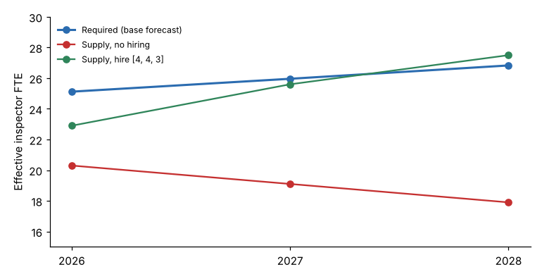

# Module 07 — Workforce Supply and Gap Analysis

## Objectives

- Project workforce supply from the roster, separation rates and retirement eligibility.
- Account for hiring lead time and the new-hire productivity ramp.
- Compare demand and supply by year and build a hiring plan.

## Supply inputs

| Input | Tri-County inspectors | Source |
|---|---|---|
| Headcount, Jan 2026 | 21 | `workforce_roster.csv` |
| Quit rate | 4.6 % a year (2021–2025 pooled) | `separations_history.csv` |
| Retirement rate, history | 3.7 % a year | `separations_history.csv` |
| Retirement eligibility | 1 eligible now, 2 by 2028 | Roster ages and service, illustrative rule |
| Take-up of eligibility | 35 % of eligible staff retire each year | Course assumption |
| New-hire productivity, first year | 65 % of an FTE (hiring lag + training) | Course assumption |

The retirement eligibility rule in `tools/stmkit.py` is **illustrative**. Use your own pension or retirement plan's rules.

## Two retirement estimates that disagree

The pooled history shows **3.7 %** a year (about 0.8 inspectors). The roster-based method shows only about **0.3 a year**, because few inspectors are eligible now.

Possible reasons:

- Past retirements came from older cohorts who have now left.
- Some retirements were early or disability retirements that the simple rule ignores.
- Five years of a small group gives an unstable rate.

The course uses the roster method, which is more forward-looking, and checks it against history. **Show both** to decision makers, and plan for the higher one if the cost of a shortage is high.

## No-hire projection

| Year | Start | Retirements | Quits | End | Effective FTE |
|---|---|---|---|---|---|
| 2026 | 21.0 | 0.3 | 1.0 | 19.7 | 20.3 |
| 2027 | 19.7 | 0.2 | 0.9 | 18.6 | 19.1 |
| 2028 | 18.6 | 0.5 | 0.9 | 17.2 | 17.9 |

Effective FTE = average headcount over the year + new hires × 0.65.

## Gap analysis

Demand comes from Module 06 (base scenario):

| Year | Required | Effective, no hiring | Gap |
|---|---|---|---|
| 2026 | 25.12 | 20.3 | **−4.8** |
| 2027 | 25.96 | 19.1 | **−6.9** |
| 2028 | 26.83 | 17.9 | **−8.9** |

The gap **grows** each year: demand rises while attrition shrinks supply.

## Hiring plans

**Unconstrained** (the smallest hires each year that close each year's gap): **8, 0, 3**. Eight hires in 2026 are needed because each counts as only 0.65 FTE in its first year. But eight at once is beyond Tri-County's capacity to recruit, train and mentor, and it overshoots in 2027.

**Capped at 4 hires a year** (training capacity: one senior inspector mentors two trainees, and two mentors are available): **4, 4, 3**.

| Year | Hires | Effective | Gap |
|---|---|---|---|
| 2026 | 4 | 22.9 | −2.2 |
| 2027 | 4 | 25.6 | −0.4 |
| 2028 | 3 | 27.5 | +0.7 |



The 2026 shortfall of about 2.2 FTE (≈3,860 hours) must be **bridged**: overtime, contract or third-party inspectors, or a temporary service-level adjustment. Module 09 prices these options.

## What else can close a gap

| Lever | Effect | Lead time |
|---|---|---|
| Hire | Adds supply; first year at reduced productivity | 4–12 months |
| Retain | Cuts quits (pay, career paths, workload relief) | Months to years |
| Improve methods | Lowers unit time or travel (e.g. routing: −1.6 FTE in Module 05) | Weeks to months |
| Reduce failure demand | Fewer re-inspections through better contractor guidance | Months |
| Redeploy or cross-train | Moves capacity between roles | Weeks |
| Contract or overtime | Short-term capacity | Days to weeks |
| Change service level | Lowers demand; a political decision | Immediate |

## Run it

```bash
python tools/stmkit.py supply
python tools/stmkit.py gap
```

## Check yourself

1. Re-inspections are 18 % of inspections. If better contractor guidance cut them by a third, roughly how many FTE would that save in 2026? (2026 base re-inspections ≈ 5,300; 37.8 min each including travel.)
2. Why does the 2026 hiring plan need more than 4.8 hires to close a 4.8 FTE gap?
3. What happens to the gap if quits double to 9 % a year?

<details><summary>Answers</summary>

1. 5,300 / 3 × 37.8 / 60 = 1,113 unit hours ÷ 0.761 ÷ 1,738 ≈ **0.84 FTE**.
2. New hires count for only 0.65 FTE in their first year (hiring lag plus training), so 4.8 / 0.65 ≈ 7.4, and attrition during the year adds more. The search gives 8.
3. About one more inspector a year leaves. Effective FTE falls by a further **0.4, 1.4 and 2.2** in 2026–2028 (the first year shows only half, because leavers go through the year). Retention then becomes as important as hiring, which is a strong case for exit interviews and workload relief.

</details>
