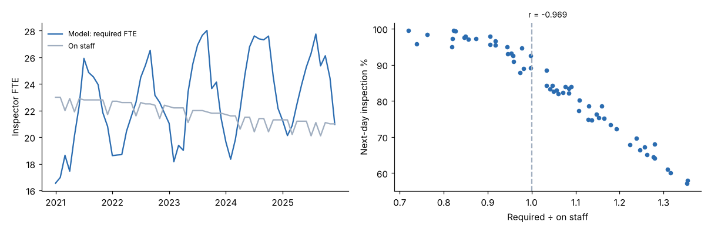
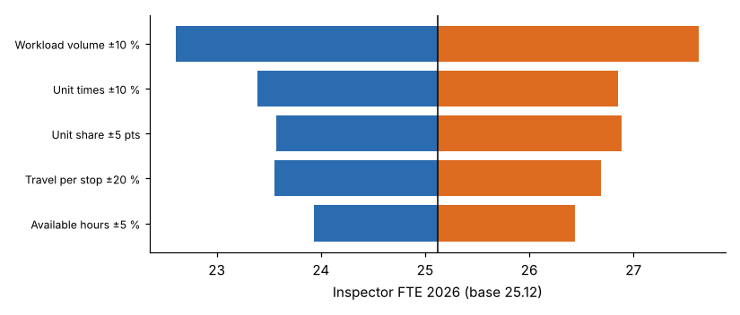

# Module 08 — Staffing Model Development Phases

## Objectives

- Plan a staffing-model project through its development phases, with deliverables and decision points.
- Validate a model against history and test its sensitivity.
- Set up governance to keep the model current.

## Phases

The phase structure below is this course's synthesis. Organizations name and split the phases differently. One published example is the eight-step process in the VHA facilities staffing report: define performance levels and KPIs, link staffing to KPIs, set baselines, add complexity variances, apply, convert to budget, review annually ([NASEM 2020](https://www.nationalacademies.org/read/25454/chapter/6)).

| # | Phase | Key activities | Deliverable | Decision |
|---|---|---|---|---|
| 1 | **Initiate and scope** | Sponsor, questions to answer, roles in scope, timeline; involve HR, finance, union and supervisors early | Charter | Go / no go, scope |
| 2 | **Define the work** | Map processes; list workload drivers and units; write definitions; agree service levels and policies | Work and driver catalogue; definitions | Service levels and policies (leadership) |
| 3 | **Plan and collect data** | Data plan for the seven types; extract history; check quality | Data inventory and quality review | Data fit for use? |
| 4 | **Measure the work** | Choose methods by activity; time studies, time records, work sampling, SME panels | Unit times and activity profile, with precision | Measurement adequate? |
| 5 | **Build the model** | Availability, model type per role, forecasts, supply projection | Working model (spreadsheet or code), documented | — |
| 6 | **Validate and test** | Back-test against history; cross-check with peers; sensitivity; review with SMEs and supervisors | Validation report | Model accepted? |
| 7 | **Implement** | Gap analysis, hiring plan, budget request, performance measures; communicate | Staffing plan; budget justification | Fund / approve |
| 8 | **Maintain** | Refresh volumes yearly, unit times after method changes or every few years, re-validate | Model version log | Update cycle |

Typical failure points:

- skipping phase 2, so definitions get argued about after the results are out
- validating only with people who built the model
- having no owner for phase 8

## Phase 6, test 1: does the model explain history?

Apply the model to each month of 2021–2025 with the actual volumes and compare it with inspectors actually on staff and with service results:



| Test | Result |
|---|---|
| Correlation between (required ÷ on staff) and next-day inspection % | **−0.97** |
| Months where required > on staff | 35 of 60 |
| Average next-day % in those months | **74.6 %** |
| Average next-day % when required ≤ 0.92 × on staff | **97.3 %** |
| Service loss | about **7.3 points per 0.1 of shortfall ratio** |

The model's shortage signal matches the service failures that builders complain about: summer months, getting worse as headcount fell. This is the strongest evidence that the model measures something real. It also gives leaders a way to price a lower service level.

## Phase 6, test 2: sensitivity

How much do the 2026 inspector numbers move when each input moves within a plausible range?



| Input (range) | FTE low | FTE high | Swing |
|---|---|---|---|
| Workload volume ±10 % | 22.61 | 27.63 | 5.02 |
| Unit times ±10 % | 23.39 | 26.85 | 3.46 |
| Unit-driven share ±5 points | 23.57 | 26.89 | 3.31 |
| Travel per stop ±20 % | 23.55 | 26.69 | 3.14 |
| Available hours ±5 % | 23.93 | 26.44 | 2.52 |

**Monte Carlo** (5,000 runs, triangular ranges for all five inputs at once):

| Statistic | FTE |
|---|---|
| Base | 25.12 |
| Mean | 25.62 |
| P10 | 23.83 |
| P50 | 25.54 |
| P80 | **26.86** |
| P90 | 27.53 |

Notes:

- The mean is above the base because the ranges are **skewed upward**: travel −15 %/+20 %, unit times −8 %/+10 %. Overruns are more likely than savings.
- **Volume** is the biggest uncertainty, so forecasting deserves effort (Module 06). Among the work measurement inputs, **unit times** and the **unit share** matter most.
- Planning at **P80** (≈27 FTE) instead of the base (25) means hiring for a 4-in-5 chance of having enough staff. Choose the confidence level according to the cost of a shortage in this mission-critical role.

## Phase 8: governance

| Item | Frequency | Owner |
|---|---|---|
| Update volumes and forecast | Yearly, before the budget cycle | Analyst |
| Re-validate against service results | Yearly | Analyst + operations |
| Refresh unit times | After method or technology changes; otherwise every 2–3 years | IE |
| Repeat work sampling | Every 2–3 years, or after organizational change | IE |
| Review policies (service levels, span, coverage) | With the strategic plan | Leadership |
| Version log and documentation | Every change | Model owner |

## Run it

```bash
python tools/stmkit.py validate
python tools/stmkit.py sensitivity
```

## Check yourself

1. Which phase sets service levels, and why must it come before data collection?
2. The back-test shows a weak correlation (r = −0.2) between shortfall and service. List two possible explanations.
3. Why might a director choose to plan at P80 rather than P50?

<details><summary>Answers</summary>

1. Phase 2, define the work. Service levels change what must be measured (for example, the counter wait target needs arrival-by-hour data) and what demand is. Measuring before you know the target wastes effort.
2. Possible explanations: the service measure doesn't reflect staffing (it is driven by contractor readiness or scheduling rules); volumes or unit times are wrong; overtime or contractors are hiding shortages; the on-staff count includes people on leave or in training.
3. Inspector shortages cause construction delays and safety risk, and new hires take a year to become productive. The cost of being short is higher than the cost of a small surplus, so a higher confidence level is justified.

</details>
