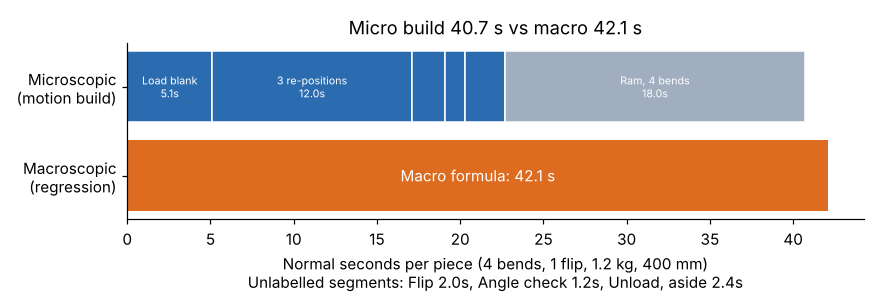

# Module 01 — Microscopic Standard Data

## Objectives

- Explain microscopic (motion-level) standard data and where its times come from.
- Build an element time from basic motions.
- Cross-check a motion build against measured data.

## Levels of detail

Standard data can be built at any level of a **work hierarchy**:

```
motion  ►  element  ►  operation / task  ►  job (lot)  ►  order / product
reach,     load blank,   form one part,      setup + run    all operations
grasp      form a bend   on the brake        of 50 pieces   on a routing
◄────── microscopic ──────►◄──────────── macroscopic ────────────►
```

**Microscopic standard data** works at the motion level. The time units are fractions of a second, and the data is universal: a 30 cm reach takes about the same time on a brake, a lathe or an assembly bench.

## Where microscopic times come from

- **Predetermined motion time systems (PMTS).** These are tables of normal times for basic motions (reach, grasp, move, position, release, body motions), adjusted for distance, weight and difficulty. Well-known families include MTM and MOST. They are licensed systems. Analysts need training and usually certification, and you must use the system's own tables and rules. This course does **not** reproduce any of them.
- **Your own micro-element studies.** These are short, repeated measurements of very small elements, for example from frame-by-frame video.

Because PMTS times are already at **normal pace**, a motion build needs no rating. You still add allowances.

## A motion build at Harlan

To keep the course open, `data/motion_table_illustrative.csv` is a **course-made** motion table. Its values are plausible but are **not** taken from any commercial system, so don't use them for real standards.

| Motion | s | Motion | s |
|---|---|---|---|
| reach_short (≤30 cm) | 0.4 | position_loose | 0.5 |
| reach_long (30–80 cm) | 0.7 | position_backgauge | 2.5 |
| grasp_simple | 0.2 | release | 0.1 |
| grasp_flat_sheet | 0.6 | foot_pedal | 0.3 |
| move_short / move_long | 0.5 / 0.9 | turn_body | 0.8 |

Part: **4 bends, 1 flip**, 1.2 kg, 400 mm.

| Element | Motions | s |
|---|---|---|
| Load blank (first bend) | reach long, grasp sheet, move long, position to backgauge, release, pedal | 5.1 |
| Re-position for next bend (×3) | reach short, grasp, move short, position to backgauge, release, pedal | 3 × 4.0 = 12.0 |
| Flip part (×1) | grasp, turn body, move short, position loose | 2.0 |
| Check angle | reach short, grasp gauge, position loose, release | 1.2 |
| Unload, aside | reach short, grasp, turn body, move long, release | 2.4 |
| **Manual subtotal** | | **22.7** |
| Ram: approach, form, return (×4) | **machine time**, from the brake's cycle | 4 × 4.5 = 18.0 |
| **Total normal time** | | **40.7 s = 0.678 min** |

Motions only cover manual work. Machine-controlled time (here the ram stroke, assumed at 4.5 s per bend) has to come from the machine.

## Cross-check: micro vs macro

Module 02 builds a **macroscopic** formula from 40 time studies. For the same part it predicts **0.702 min (42.1 s)**. The motion build is **3.4 % lower**.



A gap of a few percent is normal: time studies include small hesitations and variation that motion builds leave out. A large gap means something is wrong. Usual causes:

- a missing element (for example the angle check)
- the wrong ram time
- a time-study rating bias
- a method in the studies that differs from the method you modelled

## When to use microscopic data

| Use micro when | Use macro when |
|---|---|
| The job doesn't exist yet and you are comparing methods | There are many past studies of a stable operation |
| Cycles are very short (a few seconds) | You need standards for hundreds of parts quickly |
| You need to explain where every second goes | Variables like bends and weight drive time |
| You are building a new element for a macro system | The people using it are planners and estimators, not IEs |

Many companies use both: motion builds to **create and check** the elements, and macroscopic formulas for **daily use**.

## Run it

```bash
python tools/sdskit.py micro
```

## Check yourself

1. Using the course table, build the normal time for a **6-bend, 2-flip** part (one load, five re-positions, two flips, one angle check, one unload, six ram strokes).
2. The macro formula gives 1.024 min for that part (2.0 kg, 600 mm). What is the percentage gap?
3. Why doesn't a motion build need a rating factor?

<details><summary>Answers</summary>

1. 5.1 + 5 × 4.0 + 2 × 2.0 + 1.2 + 2.4 + 6 × 4.5 = **59.7 s = 0.995 min**.
2. (0.995 − 1.024) / 1.024 = **−2.8 %**. That is in line with the 4-bend part, so the two methods agree.
3. Motion times are defined at normal pace already. Rating corrects an *observed* pace, and a motion build doesn't observe anyone.

</details>
