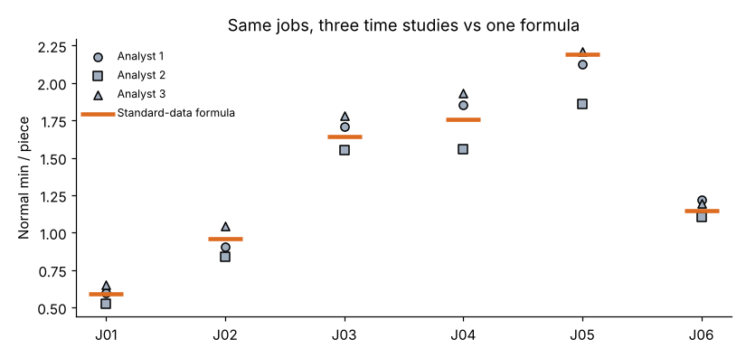
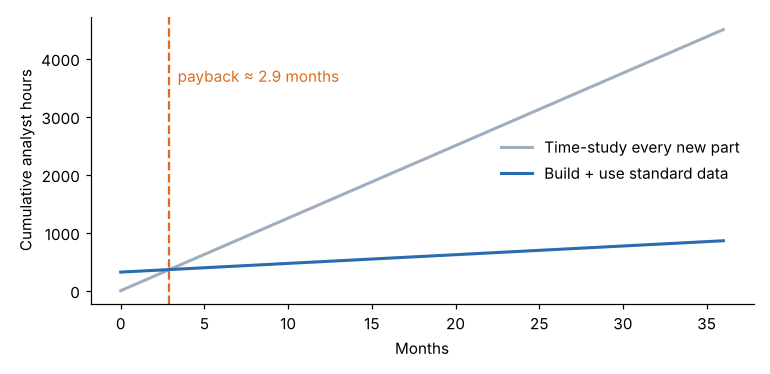

# Module 03 — Advantages of Standard Data

## Objectives

- List the advantages of standard data systems.
- Quantify the consistency gain over individual time studies.
- Estimate the analyst-time saving and payback of building a system.

## The advantages

| Advantage | What it means at Harlan |
|---|---|
| **Speed** | A standard takes about 12 minutes (read the drawing, enter the variables) instead of about 2.5 analyst-hours for a study |
| **Standards before production** | Quotes, routings and capacity plans have real times the day the order arrives |
| **Consistency** | The same features always give the same time, whichever analyst sets it |
| **Fewer rating disputes** | Element times come from many studies, so one analyst's rating has little effect |
| **Integration** | Formulas plug into ERP routings, cost estimating, MRP capacity and scheduling |
| **Method visibility** | Each element has a defined method, so a change in method shows up as a change in data |
| **Better use of IE time** | IEs work on methods and improvement instead of timing jobs |

## Consistency: three analysts vs one formula

`data/analyst_consistency.csv`: six jobs, each time-studied by three trained analysts.



| Job | Lowest analyst | Highest analyst | Spread | Formula |
|---|---|---|---|---|
| J01 | 0.523 | 0.654 | 22.1 % | 0.589 |
| J02 | 0.839 | 1.047 | 22.4 % | 0.960 |
| J03 | 1.550 | 1.781 | 13.8 % | 1.644 |
| J04 | 1.556 | 1.933 | 21.2 % | 1.758 |
| J05 | 1.860 | 2.208 | 16.8 % | 2.195 |
| J06 | 1.105 | 1.218 | 9.6 % | 1.146 |

Each job's three standards differ by **17.6 %** on average (high minus low, as a share of the mean). Analyst 2 is the lowest on every job, which suggests a rating bias. The formula averages over 40 studies by several analysts, so a single analyst's bias is diluted, and the same job always gets the same answer.

Consistency matters for **fairness**: two operators running similar parts should face similar standards. It also matters for **trust**: a standard that changes with whoever set it gets argued over.

## Economics

Harlan's assumptions:

- 600 new part numbers a year
- 2.5 analyst-hours per time-study standard
- 0.2 h per standard-data standard
- 320 h to develop the system, plus 60 h a year to maintain it
- $55 per analyst-hour

| | Hours per year |
|---|---|
| Time-study every new part | 600 × 2.5 = **1,500** |
| Standard data | 600 × 0.2 + 60 = **180** |
| Saving | **1,320 h ≈ $72,600 a year** |
| Payback on 320 development hours | **≈ 2.9 months** |
| Break-even volume (3-year horizon) | **73 new parts a year** |



In practice the bigger benefit is usually not analyst time. It is **having** a standard for every job at all. Most shops in Harlan's position never study most of their parts and run on estimates instead.

## Run it

```bash
python tools/sdskit.py consistency
python tools/sdskit.py economics
```

## Check yourself

1. Re-run the economics for 150 new parts a year. What are the payback and the 3-year net saving?
2. At 60 new parts a year, is the system worth building on economics alone? What else might justify it?
3. Analyst 2 is consistently low. Does the formula fix this completely?

<details><summary>Answers</summary>

1. Time study 375 h; standard data 150 × 0.2 + 60 = 90 h; saving 285 h = $15,675 a year. Payback 320 × 55 / 15,675 × 12 ≈ **13.5 months**. 3-year net = 3 × 15,675 − 17,600 = **$29,425**. (`python -c "import sys; sys.path.insert(0,'tools'); import sdskit as s; print(s.ex_economics(new_parts=150))"`)
2. No. The 3-year net is about **−$4,730**, below the break-even of 73. It could still be justified by quoting speed, consistency, or the ability to plan capacity before orders arrive.
3. Not completely. If Analyst 2 did a third of the 40 source studies, the formula carries a third of that bias. Calibrate analysts' rating (see the [Work Measurement](../../work-measurement/README.md) course, Module 06) **before** building the data, and check the formula against independent studies (Module 08).

</details>
