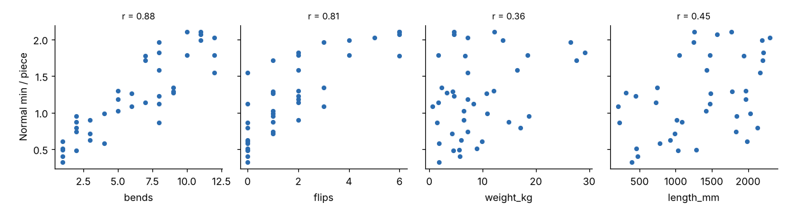

# Module 06 — Regression and Correlation within Standard Data

## Objectives

- Use scatter plots and the correlation coefficient to screen candidate variables.
- Fit a simple linear regression and interpret slope, intercept, R² and standard error.
- Read Excel `LINEST` and Analysis ToolPak regression output.

## Screening variables: scatter plots first

Always plot time against every candidate variable before calculating anything (`data/brake_run_studies.csv`, 40 studies):

> Modules 06 and 07 use the data **after** one keying error (study S27) has been corrected. Module 08 shows how the error was found and what it did to the model. In a real project you would run the Module 08 checks on the first fit, then refit.



| Variable | r with normal time |
|---|---|
| bends | **0.879** |
| flips | **0.813** |
| length_mm | 0.448 |
| weight_kg | 0.358 |
| thickness_mm | 0.155 |

The **correlation coefficient r** (−1 to +1) measures the strength of a *straight-line* relationship between two variables:

- It doesn't show curves (Module 07 covers transformations).
- It is distorted by outliers. One mis-keyed study is enough.
- It doesn't prove cause. Here bends and flips are related (r = 0.64), because parts with more bends need more flips, so each one's r includes some of the other's effect.

A low r on its own **doesn't** mean a variable is unimportant. Weight has r = 0.36 alone but becomes highly significant once bends and flips are in the model (Module 07), because bends explain most of the variation and hide it.

## Simple linear regression

Least squares fits the line ŷ = b₀ + b₁x that minimizes the sum of squared residuals.

**Normal min = 0.413 + 0.1305 × bends**

| Output | Value | Meaning |
|---|---|---|
| Slope b₁ | 0.1305 min/bend | Each extra bend adds about 7.8 s |
| 95 % CI on slope | 0.107 to 0.154 | Range of plausible slopes |
| t for slope | 11.3 | Slope / std error; well above 2, so the slope isn't zero |
| Intercept b₀ | 0.413 min | Predicted time at zero bends (load/unload + everything not in the model) |
| R² | 0.772 | 77 % of the variation in time is explained by bends (= r² = 0.879²) |
| Std error of estimate | 0.26 min | Typical scatter of studies around the line |
| n | 40 | |

Bends alone leave a standard error of **0.26 min** on parts averaging 1.2 min, about 21 %, which is too loose for quoting. Module 07 adds variables.

## The same output in Excel

**Option 1: `LINEST` (live, no add-in).** Select a 5-row block that is one column wider than the number of X variables, enter
`=LINEST(known_y, known_x, TRUE, TRUE)`, and confirm as an array formula (in older Excel, Ctrl+Shift+Enter).

| Row | Contents (columns run in **reverse** order of X, intercept last) |
|---|---|
| 1 | coefficients |
| 2 | standard errors |
| 3 | R², standard error of estimate |
| 4 | F, residual degrees of freedom |
| 5 | regression SS, residual SS |

**Option 2: Analysis ToolPak → Regression.** This gives the same numbers plus p-values, confidence limits and residuals. The output is static, so re-run it after any data change.

`templates/standard-data-workbook.xlsx` has both set up. Its "ToolPak steps" sheet walks through the menu (menu names can differ between Excel versions).

## Assumptions behind the numbers

The t-tests, confidence intervals and prediction intervals rely on:

1. **Linearity.** The relationship is a straight line in the variables used.
2. **Independence.** One study's error doesn't influence another's.
3. **Constant variance.** The scatter is similar for small and large jobs.
4. **Normal residuals.** This matters mainly for intervals with small samples.

Module 08 checks all four with residual plots.

## Run it

```bash
python tools/sdskit.py correlation
```

## Check yourself

1. Using the simple model, predict the normal time for a 6-bend part.
2. R² = 0.772. What is r, and why could r on its own still mislead you?
3. In `LINEST` output for X = (bends, flips, weight, length), which column holds the bends coefficient?

<details><summary>Answers</summary>

1. 0.413 + 0.1305 × 6 = **1.196 min**. With SE 0.26, though, an individual job could easily be ±0.5 min.
2. r = √0.772 = **0.879**. r measures only a straight-line, two-variable relationship. It can be inflated or hidden by other variables (bends and flips overlap) and by outliers.
3. Columns are in reverse order: length, weight, flips, bends, intercept. So bends is the **4th** column.

</details>
