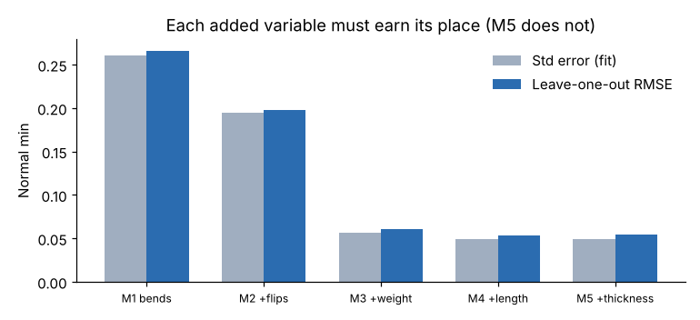
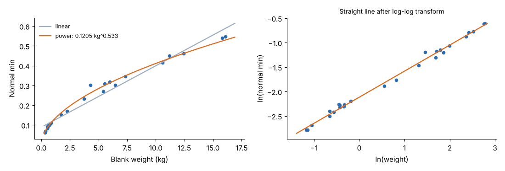

# Module 07 — Developing Models

## Objectives

- Build a multiple regression model one justified variable at a time.
- Use indicator (dummy) variables and transformations.
- Detect multicollinearity and avoid overfitting.

## A model-building procedure

1. **Define the element and its boundaries** (Module 05). Every study must measure the same work.
2. **List candidate variables** that have a physical reason to drive time and are known before production.
3. **Plot** time against each candidate (Module 06).
4. **Add variables in order of engineering logic**, checking at each step:
   - Is the new coefficient's **sign and size** physically sensible?
   - Does the **standard error** (or cross-validated error) fall by a useful amount?
   - Is the coefficient **significant** (|t| > about 2, p < 0.05)?
   - Did the other coefficients change a lot (a sign of overlap)?
5. **Stop** when a new variable no longer improves prediction.
6. **Evaluate** the chosen model (Module 08).

## Harlan's run model: the ladder

| Model | Variables | R² | Adj. R² | SE (min) | Leave-one-out RMSE | Worst p |
|---|---|---|---|---|---|---|
| M1 | bends | 0.772 | 0.766 | 0.260 | 0.266 | <0.001 |
| M2 | + flips | 0.876 | 0.869 | 0.195 | 0.198 | <0.001 |
| M3 | + weight | 0.990 | 0.989 | 0.056 | 0.060 | <0.001 |
| **M4** | **+ length** | **0.993** | **0.992** | **0.049** | **0.053** | **0.001** |
| M5 | + thickness | 0.993 | 0.992 | 0.050 | 0.055 | 0.861 |



- **Weight** has a low simple r (0.36), but once bends and flips are in the model it cuts the SE from 0.195 to 0.056. Heavy blanks are slower to handle and position.
- **Length** gives a small further gain (SE 0.056 → 0.049), and its coefficient is significant (p = 0.001) and positive: long parts are harder to sight against the backgauge and support.
- **Thickness** adds nothing (p = 0.86), and the **leave-one-out error goes up**. Its effect is already carried by weight. Leave it out.

**Chosen model (M4):**

| Term | Coefficient | Std error | t |
|---|---|---|---|
| Intercept | 0.1863 | 0.0210 | 8.9 |
| bends | 0.0873 | 0.0028 | 30.7 |
| flips | 0.1184 | 0.0055 | 21.6 |
| weight_kg | 0.0226 | 0.0013 | 17.5 |
| length_mm | 0.0000535 (0.0535 per m) | 0.0000151 | 3.6 |

Physical check:

- All signs are positive and all sizes are plausible: 5.2 s per bend, 7.1 s per flip, 1.4 s per kg, 3.2 s per metre, and an 11.2 s constant for load, unload and aside.
- Don't expect single coefficients to match single motion elements one-to-one. The illustrative motion build in Module 01 puts 8.5 s on each bend (4.0 s positioning + 4.5 s ram) and less on the constant. When variables overlap, regression shares the time differently between the intercept and the slopes.
- Compare **whole-job predictions** instead: for the 4-bend part, micro and macro agree within 3.4 %.

## Leave-one-out cross-validation

R² **always** rises when you add a variable, even a useless one. **Leave-one-out (LOO) cross-validation** gives a fairer test:

1. Fit the model without study *i*.
2. Predict study *i* and record the error.
3. Repeat for every study and take the RMSE of those errors.

LOO error rises when a variable fits noise, as it does for M5. Adjusted R² and AIC (lower is better) point the same way.

## Multicollinearity

When predictors are strongly related to each other, their coefficients become unstable: large standard errors and, sometimes, the wrong sign. The **variance inflation factor (VIF)** measures this for each predictor:

VIF = 1 / (1 − R²ⱼ), where R²ⱼ comes from regressing predictor *j* on the other predictors.

| Predictor | VIF in M4 |
|---|---|
| bends | 1.73 |
| flips | 1.75 |
| weight_kg | 1.43 |
| length_mm | 1.52 |

All are well below the common warning levels of 5–10. Weight and length are related (r = 0.54), because longer blanks weigh more, but not so much that the data can't separate them.

If VIF were high, the options would be:

- drop one of the related variables
- combine them (for example, use area instead of length and width)
- collect studies that break the link (long but light parts, short but heavy ones)

## Indicator (dummy) variables

Yes/no features enter as 0/1 variables. The setup model:

**Setup = 6.785 + 2.712 × tool segments + 9.624 × new program** (R² 0.981, SE 1.21 min)

The coefficient on `new_program` is the **extra** time when the backgauge program is new: 9.6 min to write and prove it. For a feature with more than two levels (for example three brake models), use *k* − 1 dummies. A single 1/2/3 code would wrongly assume equal steps between the levels.

## Transformations for curved relationships

The shear's "load and square blank" element rises steeply for light blanks and then levels off (`data/shear_handling_studies.csv`):



| Model | Form | R² | RMSE | Mean abs. error, blanks < 2 kg |
|---|---|---|---|---|
| Linear | 0.0883 + 0.0311 × kg | 0.965 | 0.029 | **20.9 %** |
| Power (log-log) | 0.1205 × kg^0.533 | 0.994 | 0.013 | **3.8 %** |

Taking logs of both sides, ln t = ln a + b ln w, turns the power curve into a straight line, which ordinary regression can fit.

- A high R² alone hides the linear model's failure. It is 21 % wrong on the light blanks, which are the majority of the parts.
- An exponent below 1 means each extra kilogram adds less time than the one before.

Other common forms:

- **Square root**, for distance-driven travel
- **Reciprocal**, for speed-limited work
- **Piecewise**, for a step change such as a two-person lift above a weight limit

Choose the form from the physics and the plot, not by trying everything.

## Interactions

If the effect of one variable depends on another (for example, each bend takes longer on heavy parts), add a product term such as `bends × weight_kg`. Test it the same way as any other variable. At Harlan it isn't needed: adding `bends × weight_kg` gives p = 0.78, and the leave-one-out RMSE rises from 0.053 to 0.055.

## Run it

```bash
python tools/sdskit.py models
python tools/sdskit.py transform
```

## Check yourself

1. Why keep length (p = 0.001) but drop thickness (p = 0.86), when both describe part size?
2. With the power model, how much longer does a 4 kg blank take than a 1 kg blank?
3. A colleague codes brake model as 1, 2, 3 in one column. What is wrong, and what should they do instead?

<details><summary>Answers</summary>

1. Length explains variation that weight doesn't (sighting and supporting long parts), and it lowers the leave-one-out error. Thickness affects time mainly through weight, which is already in the model. Adding it raises the LOO error.
2. (4/1)^0.533 = **2.09×**, about double, not four times.
3. A 1/2/3 code forces equal time steps between models in a fixed order. Use two 0/1 dummy variables, with one model as the baseline. Better still, check whether the difference is only in machine time, and model that directly.

</details>
